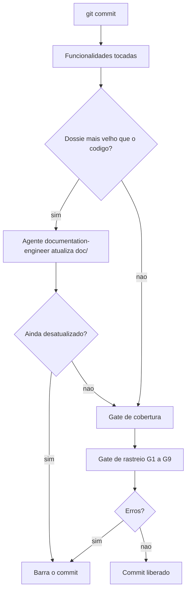

# Workflow gate-local (pre-commit)

Roda a cada `git commit` no repositório do projeto. O gate de rastreio e o agente de documentação são **etapas separadas** (D3): o gate só aponta erros; o agente só escreve em `doc/`.

## Etapas

1. **Documentação** (só se o dossiê ficou atrás do código): aciona o agente `documentation-engineer`, limitado a `doc/`; se tocar código ou o stage, barra. Gasta cota; limite de 4 funcionalidades por commit.
2. **Cobertura:** cabeçalho inválido ou arquivo com dois donos barra.
3. **Rastreio:** `node <harness>/tools/rastreio/cli.mjs --config <rastreio.config.json> --root <repo> --features <slugs do commit>`. Código 1 barra; código 2 (config inválida) também barra. Avisos (G6, G8 e parte do G9) não barram.

## Ligação ao projeto

O projeto chama o gate por um wrapper fino (D2), por exemplo `tools/doc-features/rastreio.mjs`, que lê `HARNESS_DIR` e `RASTREIO_CONFIG` e repassa os argumentos. O CI (D4) roda o mesmo comando; por isso `doc/` e `tools/` precisam estar versionados no repositório do projeto e o config acessível ao CI.
