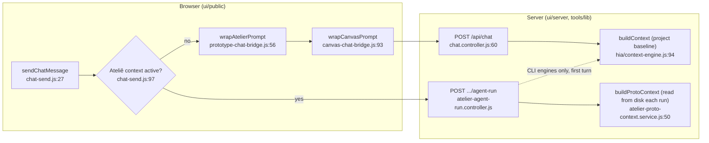
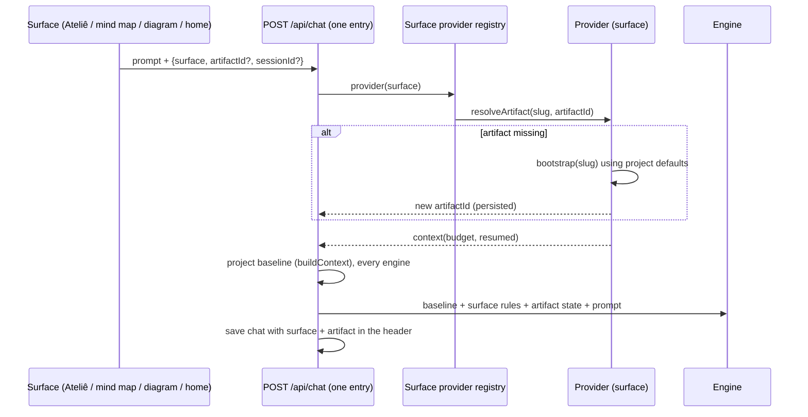

# Chat context by surface

How the chat gets its context on each screen of the harness, what it remembers between sessions, and the gaps
against the intended behaviour. Status as of 2026-11-13. File references point to the code that implements each step.

## Intended behaviour

The chat is one component that opens on several screens (surfaces). On each one it must:

1. Load the **project baseline**: global and project instructions, and memory.
2. Load the **surface context**: what this screen is for and its rules. For example, Ateliê implementation settings or
   the mind-map reply format.
3. Recognise the **current artifact**: the prototype, mind map or diagram on screen. If there is none yet, it should set
   up the initial artifact and store it, so the next session (same chat or a new one) finds and reuses it.
4. Let the user **start a new conversation or resume one**, and a resumed conversation should reopen on its artifact.

## Current behaviour at a glance

| Surface | Project baseline | Surface context | Current artifact | New / resume |
|---|---|---|---|---|
| Home dashboard, mini dock, Studio | Yes, on the server. It is added only on a session's first turn; resumed native sessions already have it | None. Studio can add `<contexto-codigo>` / `<contexto-elemento>` blocks | n/a | New: `resetChatSession` (`chat-continue.js:104`). Resume: the last chat restores quietly (general scope only, `chat-scope.js:61-69`), or pick one from the "continuar" list (`chat-persist.js:103`) |
| Ateliê (prototypes) | CLI engines only, first turn (`atelier-cli-engine-turn.service.js:58`). OpenCode and Gemini API get **none** | Tool catalogue (`TOOL_INSTRUCTION`), navigation contract, continuation rules | **Yes.** Prototype map, screens, storage keys and `proto.css`, re-read from disk on every run | Engine session per (slug, chat, scope) in localStorage |
| Mind map | Yes (`/api/chat`) | `<mindmap>` reply rules (`canvas-chat-bridge.js:93-108`) | **Partly.** A whole-map outline plus the selected node, sent from the client. Skipped if the island has not published yet | Same as home. The chosen board is not saved |
| Diagram board (Excalidraw) | Yes (`/api/chat`) | `<board>` Mermaid reply rules | **Partly.** An element outline, no selection | Same as mind map |
| `diagram` / `flow` canvas kinds | — | **No chat surface** | — | — |
| Office desk chat | Yes, every message (stateless) | None | n/a | Nothing is saved |
| Compare mode | Yes | **None** (raw prompt, `chat-send-compare.js:58`) | No | — |

## Surface by surface

### Home dashboard

- Opens from `openInteractiveChat` (`chat-stream-ui.js:24`), the mini dock (`chat-mini.js:232`) and Studio
  (`studio-chat.js:115`). All three call `sendChatMessage`.
- The server builds `<contexto_do_harness>` with `buildContext(slug, {scope, daiAgent})`
  (`tools/lib/hia/context-engine.js:94-176`). It holds the DAI role, global and project instructions, memory, the
  `app.json` URL, optional map sections and safety rules. `HIA_CONTEXT_SCOPE` can turn it down (none, minimal,
  project_only, full).
- The Claude Code CLI outside the UI gets the same baseline from the hook `.claude/hooks/load-project.ps1:47-70`.

### Ateliê

- `prototype-atelier.js:97-107` binds the chat to the prototype with `setChatArtifact("prototypes", protoId)` and
  `setAtelierChatContext(...)`. Every message then goes to the agent loop
  (`POST /api/project/:slug/design/prototypes/:protoId/agent-run`).
- The prototype is **recognised and kept**: `buildProtoContext` reads `projects/<slug>/design/prototypes/<id>/` on every
  run. A new chat or a new session gets the current state again, because the state lives on disk, not in the chat.
- **Gaps:**
  - The project design-system and implementation profile (`getProjectDesignContext`) is not injected into the agent run.
  - The quality prompt (DS index and tokens, `prototype-prompt-quality.js:88`) is not injected either.
  - Neither is the MCP design-system rule. They live in `wrapAtelierPrompt`, which the agent-run branch skips
    (`chat-send.js:97-123`).
  - So the Ateliê agent prototypes without the implementation settings the user expects.

### Mind map and diagram board

- `design-canvas-workspace.js:59-95` mounts the board catalogue, the chat dock and the React island. The island
  publishes its state with the `harness:canvas-state` event (`useCanvasChatBridge.ts:57`, `useBoardChatBridge.ts:37`).
- The client wraps the prompt:
  - **First turn:** the full rules and the current map or board.
  - **Later turns:** a one-line reminder, plus the map again if its hash changed.
- The chat replies with `<mindmap>` or `<board>` blocks, which `applyCanvasReply` sends back to the island.
- **Gaps:**
  - The selected board per view is held in an in-memory `Map` (`design-canvas-workspace.js:20`). After a reload the first
    board in the list opens instead.
  - The "already sent" flag is also in memory, so after F5 the next message re-sends everything.
  - The selection context pack (`AgentGroup.tsx:15-30`) only copies to the clipboard.

## Where conversations live

| What | Where | Keyed by |
|---|---|---|
| Draft / in-progress turns | localStorage `harness_active_chat_<slug>[::<scope>]` (`shared/state.js:183`) | scope: `""`, `design:<view>`, or `design:<view>:<artifactId>` |
| Engine session ids | localStorage `harness:engine-sessions:v1` (`chat-session-store.js:9`), capped at 60 | `<slug>::<chatFile\|draft>[:<scope>]` |
| Saved chats | `projects/<slug>/chats/<date>-<title>-<sid8>.md` (`tools/lib/chat-save.js:12`) | session id only. **No surface or artifact** |
| Engine, model, effort | screen state `chats` (`screen-state/registry.js:37`) | project |
| Ateliê UI state | screen state `prototypes` | project |

Effect:
- A saved chat does not know which surface or artifact it belongs to.
- The "continuar" list mixes chats from every surface.
- Resuming one does not reopen its prototype or board.
- Artifact chats survive only in the browser that made them.

## Gaps

1. **G-CTX-1**: No shared "surface context provider". Each surface has its own transport and its own wrapper (a
   hard-coded if-chain in `prototype-chat-bridge.js`).
2. **G-CTX-2**: The Ateliê agent does not receive the project design-system / implementation profile, the quality prompt
   or the MCP rule.
3. **G-CTX-3**: On the agent-run path, OpenCode and the Gemini API get no project instructions or memory.
4. **G-CTX-4**: Saved chats lose their surface and artifact binding.
5. **G-CTX-5**: Mind-map and board selection are not persisted. If the island has not published, no context is sent.
6. **G-CTX-6**: `diagram` and `flow` boards have no chat.
7. **G-CTX-7**: There is no "bootstrap" step. When a surface has no artifact yet, the chat does not create and record the
   initial one with project defaults.

## Target design (proposal)

One contract that every surface implements, assembled **on the server**. The Ateliê already reads from disk on the
server, and that is the pattern to keep.

Provider contract (one file per surface, about 100 lines each):

| Method | Ateliê | Mind map | Diagram | Home |
|---|---|---|---|---|
| `resolveArtifact` | prototype folder | canvas board `kind: mindmap` | canvas board `board/diagram/flow` | none |
| `bootstrap` | new prototype from the design profile, DS tokens and template | board with the root node = project or story | empty board using the project style | none |
| `context` | proto map + **design profile + DS index + MCP rule** | map outline + selected node | element outline | none |
| `rules` | agent tools | `<mindmap>` format | `<board>` format | none |
| `applyReply` | tool calls | `harness:canvas-apply` | `harness:canvas-apply` | none |

Persistence changes this needs:

- The saved chat header gains `superficie:` and `artefato:` (format change in `tools/lib/chat-format.js` only).
  "Continuar" can then filter by surface and reopen the artifact.
- The last artifact per surface moves to the server screen state (`design:<view>.lastArtifact`), replacing the
  in-memory `Map`.
- The baseline is added for every engine on every path. The engine's "already has it" check moves to the server.

This is a contract change, so it goes through the **complete route** (`docs/delivery/rota-curta.md`).
