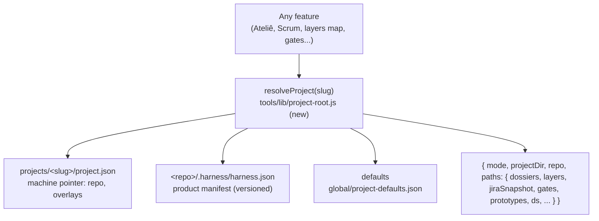

# Project configuration: harness-local, project repo, or both

Any project can use every harness feature: Studio, Ateliê, mind map, diagrams, Scrum, layers map, gates. Some
projects keep that configuration inside the harness (`projects/<slug>/`). Others keep it in their own repository,
such as `saude-dispensacao`, which points at `saude/dispensacao`. This page describes how it works today and proposes
one standard for both cases. Status as of 2026-11-13.

## How a project points at its repository today

- **Pointer:** `projects/<slug>/mcp.json` → `"repo"` (plus `servidores` for MCP servers). It is documented in
  `tools/lib/project-mcp.js:5-11`. For DIS it is `"repo": "C:/Users/.../git/saude/dispensacao"`.
- **Secondary fallback:** `app.json` → `"repo"`, read by only two resolvers.
- **Adoption does not write it.** `tools/adopt-project.js:73-87` creates `instructions.md`, `memory.md`, `chats/`,
  `context/` and `scheduled/`, but not `mcp.json`. `docs/setup/05-adopt-existing-projects.md` does not mention `repo`.

## Where each feature looks

| Feature | Lives in | Resolved by | Notes |
|---|---|---|---|
| Chats, memory, routines, canvas boards (mind map, diagrams) | Harness | `state.paths`, `memory/store.js:22`, `canvas-store.js:50` | Harness only |
| Ateliê prototypes, `design.json`, DS registry | Harness `projects/<slug>/design/` | hardcoded `projectDir` joins (`atelier-proto-context.service.js:51`, `design-registry.service.js:39`) | The repo only receives a snapshot for G10 |
| Design profile | Harness `design/profile.json` → `global/design/design-systems/<ref>.json` → `global/design/defaults.json` | `resolveProjectDesignProfile` (`design-profile-resolver.service.js:54`) | Its `docs` paths are applied against `repo \|\| projectDir` |
| MCP design system | Server code in the repo; declared in the repo `.mcp.json` | `loadProjectConfig` (`project-mcp.js:38`) | **Circular:** the repo env points back to the harness folder `projects/saude-dispensacao/design/ds` |
| Scrum board | Harness `scrum.json` + repo `doc/scrum/*` merged | `loadProjectScrum` (`project-scrum-persist.js:68`) | `_jira-dis.json` is hardcoded in 4 places |
| Layers map | Repo `doc/sistema/features/<f>/mapa-camadas.json`, `_prototipos.json` | profile `docs.layers` in some places; hardcoded in `project-screens-features.js:31`, `project-screens-prototypes.js:19` | Mixed |
| Stories ↔ files panel | Repo `doc/scrum/_historias-arquivos.json` | `story-files.service.js:6` | Hardcoded |
| Feature dossiers | Repo `docs/features` → `dossier.json` override → harness fallback | `resolveDossierRoot` (`workflow-dossier-paths.js:55`) | Its own resolver |
| Rastreio gate G1-G9 | Config in harness `rastreio.config.json`; data in the repo | `carregaConfig` (`tools/rastreio/config.mjs:14`) | Config has no `root`, so the CLI needs `--root` |
| harness-gates G10-G13 | Repo `harness-gates.json`, `tools/harness-gates/` (lock-pinned) | `--repo` argument only | ADR-016 says the config lives in the repo, but the **harness copy is still there too** |
| Studio services | Harness `app.json`; code in the repo | `getProjectRepoInfo` + `resolveWorkspace` | `cwd` relative to the repo |
| pacote-revisao | Harness `pacote-revisao.json` | `tools/pacote-revisao/config.js:22` | Output folder is an absolute Desktop path |
| Deploy | Global `global/deployments.json` | `deploy-config.service.js:7` | Not per project |

## Problems

1. **At least seven resolvers** read `repo`, and they differ:
   - `getProjectRepoInfo` lives in a controller (`inspect.controller.js:11`) and does not check that the folder exists.
   - `loadProjectConfig` throws when the folder is missing.
   - `proc-manager-config`, `jira-snapshot`, `jira-refresh` and `pacote-revisao` each keep their own copy.
2. **The projects folder is resolved three ways.** `config.getProjects()` honours `HARNESS_PROJECTS_DIR`. The others
   build `ROOT/projects`, so worktrees and tests can diverge.
3. **Hardcoded repo paths** bypass the profile's `docs` settings: `doc/sistema/features`, `_prototipos.json`,
   `_historias-arquivos.json`, `_jira-dis.json` (a DIS name inside generic code) and `docs/logic`.
4. **Duplicated config.** `rastreio.config.json` (harness) and `harness-gates.json` (repo) hold the same blocks with
   different paths.
5. **Absolute machine paths:**
   - `audit-layers-drift.js:26-27`;
   - the repo `.mcp.json` env;
   - `pacote-revisao.json`.
6. **Engines disagree on cwd.** Claude runs in the repo; Codex runs in the harness project folder.

## Proposed standard: pointer, not copy

**Decision rule.** The owner of an artifact decides where it lives.

| Kind | Lives in | Examples |
|---|---|---|
| **Product artifacts**: versioned with the code, needed without the harness | Project repo | dossiers, `rastreio.yml`, `regras.md`, `mapa-camadas.json`, gates config and lock, prototype snapshot, DS MCP server |
| **Harness working state**: about how we work, not about the product | Harness `projects/<slug>/` | chats, memory, canvas boards, routines, run history, screen state, Ateliê working copies |
| **Machine-specific** | Harness, never committed in the repo | absolute repo path, output folders, credentials (env) |

The harness **never copies** a product artifact. It keeps a pointer to it. A project with no repo (harness-only)
uses the same layout inside `projects/<slug>/`, so features see no difference.



**Precedence:**
1. Harness overlay (`projects/<slug>/project.json`), only for machine-specific values.
2. Repo manifest (`<repo>/.harness/harness.json`).
3. Defaults.

**Modes** come out of what is found:

| Mode | When | Product artifacts resolve to |
|---|---|---|
| `harness` | no `repo` | `projects/<slug>/` |
| `repo` | `repo` set and the repo has `.harness/harness.json` | the repo, with paths from its manifest |
| `hybrid` | `repo` set, no manifest yet | the repo for paths that exist there, otherwise the harness. Each fallback is reported by `node tools/project.js doctor` |

Repo manifest sketch (relative paths only, safe to commit):

```json
{
  "version": 1,
  "paths": {
    "dossiers": "docs/features",
    "layers": "doc/sistema/features",
    "scrumDocs": "doc/scrum",
    "jiraSnapshot": "doc/scrum/_jira-snapshot.json",
    "storyFiles": "doc/scrum/_historias-arquivos.json",
    "prototypesSnapshot": "design/prototipos",
    "gates": "harness-gates.json"
  },
  "designSystem": { "ref": "procempa-dis", "mcpServer": "dis-design-system" }
}
```

## Migration (incremental, each step shippable)

1. Add `tools/lib/project-root.js` with `resolveProject(slug)`. It uses `getProjects()` and honours
   `HARNESS_PROJECTS_DIR`. Make `getProjectRepoInfo` and `project-mcp.js` delegate to it.
2. Replace the six tool-side copies and the hardcoded repo paths with `resolveProject(slug).paths.<name>`.
3. `adopt-project` asks for the repo path, writes the pointer and offers to create `.harness/harness.json`.
4. Retire the harness `rastreio.config.json` and keep `harness-gates.json` in the repo, as ADR-016 plans (line 95).
5. Make the DS MCP env relative to the repo, or resolve it at start-up from the pointer, to break the circular path.
6. Record the rule as an ADR (next number in `docs/harness-evolution/03-decisions/`).

Steps 1-2 touch more than 3 files and change an internal contract, so they need the **complete route**.
