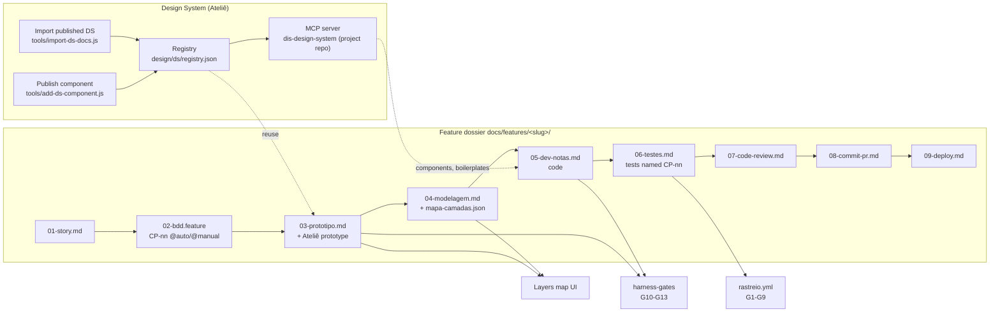
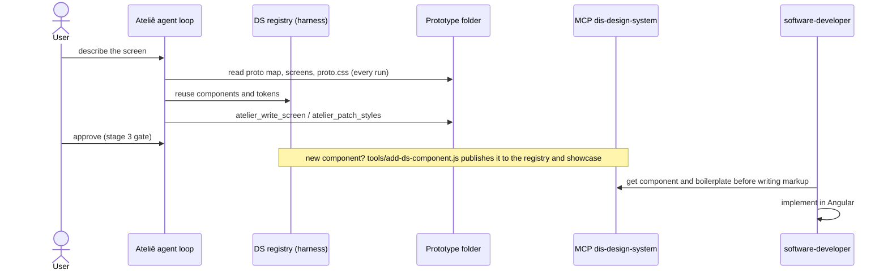
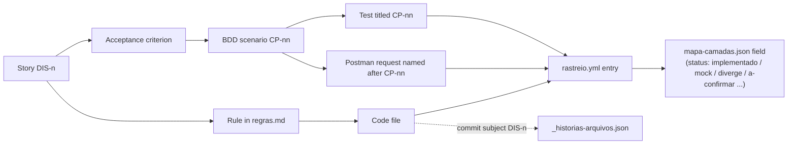
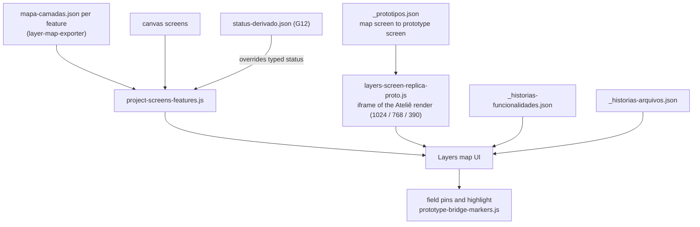

# Delivery pipeline: from prototype to layers map

How a feature goes from idea to delivered code with traceable deliverables, which agent acts at each step, and how the
deliverables are reused by documentation and the layers map. Status as of 2026-11-13.

Status tags: **[done]** implemented with code and tests, **[partial]**, **[planned]** documented only, **[missing]**.

## The whole flow

Stage catalogue: `ui/server/services/orchestration/agent-stage-definitions.js:58-178`. The workflow source is
`~/.claude/skills/sdlc-pipeline/workflows/global/feature-delivery/WORKFLOW.md`. Every stage reads and writes the same
dossier.

## Stage by stage

| # | Stage | Agent (executor + support) | Skills | Deliverable | Gate | Status |
|---|---|---|---|---|---|---|
| 0 | start | session | `sdlc-pipeline` | `_status.md` (`story:` key) | — | [done] |
| 1 | story | business-analyst + product-owner | `requirements-engineering`, `jira-story-publishing` | `01-story.md`, acceptance criteria in the story | criteria present | [done] |
| 2 | bdd | qa-engineer | `bdd-scenarios` | `02-bdd.feature`, `CP-nn` scenarios | `tests/bdd-traceability.test.js` | [done] |
| 3 | prototype | ux-ui-designer | `ux-design-process`, Ateliê agent | `03-prototipo.md` + prototype in the Ateliê | **user approval** | [done] |
| 4 | modeling | software-architect | `obsidian-feature-modeler`, `layer-map-exporter` | `04-modelagem.md`, `mapa-camadas.json` | — | [done] |
| 5 | dev | software-developer | `feature-implementation`, stack skills | code, `05-dev-notas.md` | build + lint | [done] |
| 6 | tests | qa-engineer | `tdd-test-driven`, `postman-bdd-tests` | tests titled `CP-nn`, Postman `pm.test`, `06-testes.md` | rastreio G1-G9 | [done] |
| 7 | review | built-in code review | `code-review-checklist` | `07-code-review.md` | — | [done] |
| 8 | commit-pr | session | `commit`, `conventional-commits` | `08-commit-pr.md` | user approval | [done] |
| 9 | deploy | devops-engineer | `release-operations` | `09-deploy.md` | — | [done] |
| — | exit | session | — | — | `node tools/scrum.js story done-check <id>` | [done] |

**Short route** (at most 3 code files, no new screen, no contract change):
- Modeling is skipped.
- The prototype is skipped unless something visual is new (`workflow-definitions.js:32-41`).
- The rule is in `docs/delivery/rota-curta.md`.

**Known inconsistency:** `docs/playbook/stages.json:91-139` puts modeling before the prototype, while the workflow code
puts the prototype first. Pick one and align both.

## 1. Prototyping in the Ateliê with the Design System

- **[done]** DS import from the published site, registry, component publisher with manifest validation, prototype
  context on every run (`atelier-proto-context.service.js:3-6`).
- **[partial]** Calls through MCP during implementation:
  - The rule exists only as prose: project instructions, the handoff `AGENTS.md` (`handoff-docs.service.js:38`) and the
    playbook.
  - No skill or gate checks that the dev stage used the MCP.
  - The Ateliê agent itself does not receive the DS profile or the MCP rule (see
    [01-chat-context-by-surface.md](01-chat-context-by-surface.md), G-CTX-2).

## 2. Traceable deliverables

Every deliverable carries an id, so it can be followed in both directions:

These links are checked by:
- `bdd-traceability.test.js`: scenario to test.
- rastreio G1-G9: rastreio, code, tests, Postman and the layers map.
- `done-check`: dossier stages.

The done-check evidence flags (`--tests --lint --browser`) are **declared, not audited**.

## 3. Documentation from the deliverables

| Output | Agent | Skill | Built from |
|---|---|---|---|
| Feature dossier with Mermaid diagrams | software-architect / documentation-engineer | `obsidian-feature-modeler` | story, BDD, code |
| `mapa-camadas.json` | documentation-engineer | `layer-map-exporter` | dossier `01`-`06`, Postman collection, `02-bdd.feature`, code |
| README, ADR, runbook | documentation-engineer | `technical-writing` | dossier, decisions |
| Code comments | documentation-engineer | `code-documenter-ts-angular` | source |
| Handoff package (README, AGENTS.md, MAPA.md, `.mcp.json`) | harness | `handoff-docs.service.js` | prototypes + DS |
| Review package (story board + layers map) | harness | `tools/pacote-revisao` | Scrum + layers map |

- **[partial]** The automatic doc refresh in the project's pre-commit (only when the dossier is older than the code) is
  described in `.agents/skills/rastreio-adocao/workflows/gate-local.md`, but it is not wired into the project repos yet.

## 4. Assembling the layers map

- **[done]** The layers map **does not redraw the design**. It embeds the approved Ateliê prototype
  (`/design/prototypes/<id>/render/<screen>?part=content`) in play mode and pins each mapped field on it.
- Screens with no prototype mapping fall back to a generic replica (`layers-screen-replica.js:227`).
- Each field shows its layers: interface, rule, API and data, with a status. A field with no evidence in the code is
  `a-confirmar`.

The next step, comparing this prototype with the running code, is in
[04-validation-and-gates.md](04-validation-and-gates.md).
