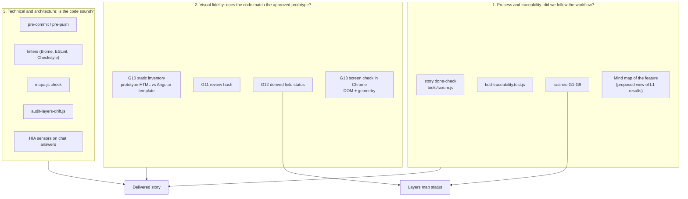
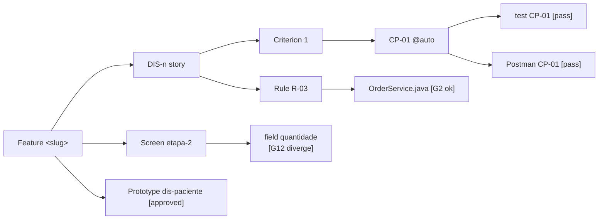
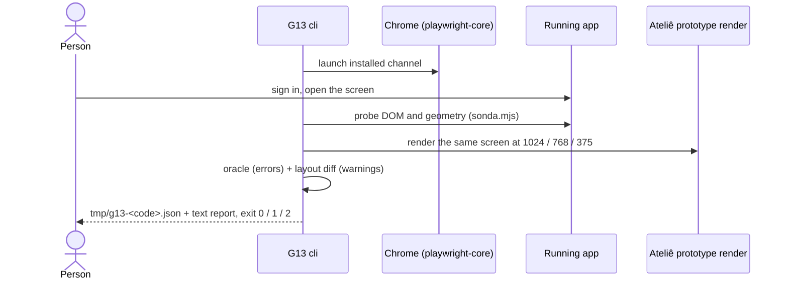

# Validation: mind map, prototype vs code, technical checks

What checks a delivery, in three layers. Status as of 2026-11-13. Tags: **[done]**, **[partial]**, **[planned]**,
**[missing]**.

## 1. Process and traceability

| Check | What it proves | Status |
|---|---|---|
| `node tools/scrum.js story done-check <id>` | Each dossier stage is `done`, or `skipped` with a reason. Acceptance criteria exist. Exit 3 while anything is open (`tools/lib/scrum-cli/done-check.js:32`) | [done]. The evidence flags are declared, not audited |
| `tests/bdd-traceability.test.js` | Every `@auto` scenario `CP-nn` has a test with its id | [done] |
| rastreio G1-G9 (`tools/rastreio/cli.mjs`) | rastreio.yml vs code, tests (JUnit, Karma, pytest), Postman, `regras.md`, layers map | [done] as a CLI. Pre-commit and CI wiring in project repos is [partial] |
| Delivery Orchestrator (EP-18) | One state machine across Scrum and the dossier | [planned]: `docs/scrum-traceability/04-ARQUITETURA-PROPOSTA.md` |

| Gate | Fails on |
|---|---|
| G1 | entry with no proof |
| G2 | rule with no code or proof |
| G3 | broken link |
| G4 | missing test, request or code file |
| G5 | placeholder id |
| G6 | test not linked to anything (warning) |
| G7 | reused id |
| G8 | stale count (warning) |
| G9 | layers map out of step with rastreio |

### Mind map validation: [missing], proposal

No flow today validates a feature through a mind map. What exists:
- `tools/epic-canvas.js` projects an **epic** folder into a `mindmap@1` board, one way (stories are the source).
- The context pack turns a selected branch into an agent prompt (clipboard only).

The mind map has **no link** to `docs/features/<slug>`, `rastreio.yml` or `mapa-camadas.json`.

**Proposal: the feature mind map as a read-only view of the traceability chain.** It follows the same pattern as
`epic-canvas-sync`: the files stay the source of truth and the map is regenerated.

- **Source:** the dossier (`_status.md`, `01`, `02`), `rastreio.yml`, the rastreio JSON output, and `mapa-camadas.json`
  plus G12.
- **Node status:** the colour comes from the last gate run (pass / warn / fail / not run). Each gate finding becomes a
  note on its node.
- **Command:** `node tools/feature-canvas.js sync <slug>`, the twin of `epic-canvas.js`. The Scrum story drawer and the
  layers map gain a "View in mind map" link.
- **Chat:** the mind map surface provider ([01](01-chat-context-by-surface.md)) sends the red branches as context. The
  agent works on the deliverable files, never on the map, and the map is synced again afterwards.

## 2. Prototype vs running code

| Gate | How | Compares | Status |
|---|---|---|---|
| G10 | Static. Inventory of the prototype HTML and of the Angular templates (`tools/gates/fidelidade/*`) | labels, icons, widths, presence, minus the declared differences in `pareamento.json` | [done]. Field order and geometry are not compared |
| G11 | Hash of the cited code files against the stored review | whether the code changed since the review | [done] |
| G12 | Field status derived from G10 → `status-derivado.json` | typed vs derived status in the layers map | [done] |
| G13 | **playwright-core + the installed Chrome/Edge** (`tools/gates/g13/navegador.mjs`), nothing downloaded | DOM text, labels, notices and `getBoundingClientRect` geometry against the expected-values oracle (errors) and the rendered prototype at 1024 / 768 / 375 px (warnings) | [partial]: one pilot screen (DIS etapa 2), one medicamento per run, a person signs in and navigates |
| Screenshot / pixel diff | — | — | [missing] |

Next steps, in order of value:
1. A recorded login and navigation script per screen, so G13 runs without a person.
2. Screens listed from `_prototipos.json`, not hardcoded to one.
3. A screenshot of both sides, with a pixel diff as evidence attached to the layers map field. Report only at first.
4. Slice 4 of `docs/harness-gates/01-execution-plan.md`: a second project and the `react-jsx` adapter.

## 3. Technical and architecture checks

| Check | Covers | Blocks? | Status |
|---|---|---|---|
| `scripts/pre-commit.js` | project data and secrets, files missing from the map, syntax and JSON, island gates (Biome, tsc, npm audit), affected tests | yes | [done] (harness repo) |
| `.githooks/pre-push` | full test suite | yes | [done] |
| `node tools/mapa.js check` | map frontmatter, size, dead globs, orphan files | yes (in pre-commit) | [done] |
| `tools/audit-layers-drift.js` | dossier vs layers map vs Java/Angular sources vs DS components (API, UI, test drift) | report | [done]. It has hardcoded DIS paths ([02](02-project-config-hybrid.md)) |
| `cobertura.mjs` (project side) | one owner per file, no dependency cycles between features | yes | [done] |
| HIA sensors | chat answers: Biome, `ast.parse`, `javac`, secrets, emoji, Mermaid | no (report only) | [done] |
| Checkstyle | Java style and layer import control | — | [partial]: skill only. `project-audit.service.js:133-141` reports a hardcoded `PASS` |
| done-check `--lint` | lint ran | — | declared only |

**Fix soon:** the hardcoded Checkstyle `PASS` reports a check that never ran. Either run Checkstyle through the project's
Maven or Gradle wrapper, or report `not-run`.
