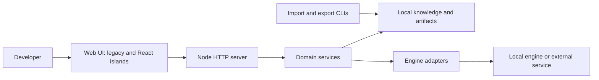

# Architecture and evolution: decision brief

English | [Português](PROJECT-STATUS.pt-BR.md)

Document review: 2026-11-16, reference commit `675c574`. This brief combines versioned records and recent validation; it is not a fresh functional audit of every epic. Uncommitted local changes are not treated as delivered capabilities.

## Product at a glance

Harness organizes knowledge and AI-assisted work by project: instructions, memory, context, conversations, visual artifacts and delivery activities. Its intended value is continuity across engines and sessions with human supervision and traceability.

References: [product brief](../PROJECT-BRIEF.md), [route registry](../../ui/server/routes/index.js), [adapters](../../tools/lib/engines/index.js), [manifest](../../package.json). Local storage does not mean requests to external engines remain on the machine.

## Supported statements

| Classification | Evidence and limit |
|---|---|
| Recently validated | Lockfile installation, React build, TypeScript, lint, sample-project creation and HTTP passed in an independent clone on the same computer. E2E passed on retry. |
| Automated suite passed | 2,696 tests passed, 4 skipped, with the Git isolation fix subsequently integrated. This does not establish visual acceptance of every module. |
| Capabilities recorded as complete | Chat, Scrum, Studio, artifacts, workflows, sessions, deploy, audit, memory and screen state appear in the progress record. These are recorded statuses, not revalidation in this brief. |
| Contract complete, experience partial | EP-01 and EP-04 record pending UI; EP-12 records pending pilot and Studio work; EP-03 simultaneously records contract completion and work in progress. |
| Under review | EP-20: mobile editing implemented, with visual acceptance at 320, 375 and 768 px pending in the record. |
| Planned / in progress | EP-17: 0/13; EP-21: 2/13, according to the consulted record. |
| Not validated by this effort | Fresh-account login, real import/export and installation on another computer. |

Sources: [reproduced validation](../setup/VALIDATION-2026-11-16.md), [accepted progress](../harness-evolution/05-progress/progress.md), [master index](../harness-evolution/00-index.md).

## Reconciled counts and indicator limits

On 2026-11-16, the progress table was reconciled with the master index: the EP-19 row was missing although its nine stories were already marked complete and included test references. The 19 rows now total **141/166**, matching the index. This corrects a documentation omission without granting new acceptance. The total includes contracts with pending UI and is not a percentage of usable product completion.

One discrepancy remains without automatic correction: the EP-19 README frontmatter says `em andamento`, while its table and all nine stories say `concluida`. The epic declaration requires owner confirmation; reconciliation preserves story statuses.

The gap tracker was generated on 2026-10-24 through model analyses and explicitly requires verification before action. Architecture analyses date from 2026-11-13. Neither date justifies treating every gap as a current defect. Preserve accepted status and verify the story, code, tests and UI before changing it.

Sources: [historical gaps](../harness-evolution/05-progress/epic-gaps.md), [architecture analyses](README.md). This brief does not change counts or accept stories on behalf of the product owner.

## Recommended sequence, without date commitments

Focused review on 2026-11-16: the historical claim of missing workspace UI no longer describes the current code. `ui/public/office.html` contains `workspaceMenu`; `ui/public/js/office-app.js` calls `bootOfficeWindowManager`, which mounts `office/workspace-menu.js`. This menu connects save, load and delete actions to `windowManager.workspaces`, with deletion confirmation and an unsaved-changes guard. All 16 tests in `workspace-menu`, `wm-bootstrap`, `workspace-session` and `workspace-persistence` passed. This establishes source wiring and automated coverage, not visual acceptance or browser reload persistence. Next verification: save/load a layout, reload, switch projects and check isolation; do not recreate an existing menu. EP-04 accepted status remains unchanged.

| Order | Work | Exit criterion |
|---|---|---|
| 1 | Reconcile index, progress and stories | Every story has status and evidence; index counts agree; distinguish contracts from usable flows. |
| 2 | Validate context continuity | Create/open an artifact, chat, reload and resume with project and artifact preserved; reassess EP-17 and context gaps. |
| 3 | Complete partial visual flows | Reproducible demonstrations of modules with accepted contracts but pending UI, including mobile review. |
| 4 | Consolidate configuration and checks | Reassess duplicated resolvers, gate configuration and Design System usage evidence before planning implementation. |
| 5 | Expand diagrams and automation | Prioritize remaining EP-21 stories after preceding dependencies and record acceptance by flow. |

This is an editorial recommendation based on documented risks, not an approved roadmap. Proposed metrics: critical flows passed/evaluated, stories with verifiable evidence and successful context resumptions. These metrics have no measured baseline yet.

## Foundation for the white paper and slides

Suggested narrative: fragmentation problem → proposition and audience → current architecture → validated demonstration → partial capabilities → priorities and success criteria → risks and pending decisions.

Use two documents as the minimum external-LLM package: the product brief and this decision brief. Add the validation report for installation and quality questions. Include the story and corresponding module map for implementation proposals.

Before publication: reconcile figures; confirm statuses with owners; label claims as observed, recorded or proposed; produce equivalent Portuguese and English versions. Do not promise dates, cost or autonomy without evidence and approval.
