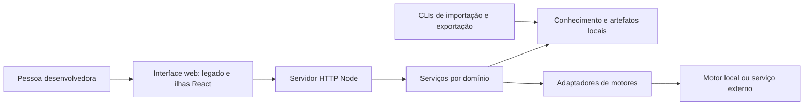

# Arquitetura e evolução: síntese para decisão

[English](PROJECT-STATUS.md) | Português

Revisão documental: 2026-11-16, commit de referência `675c574`. Esta síntese combina registros versionados e a validação recente; não equivale a uma nova auditoria funcional de todos os épicos. Alterações locais não commitadas não são consideradas entregas.

## O produto em uma página

O Harness organiza conhecimento e trabalho assistido por IA por projeto: instruções, memória, contexto, conversas, artefatos visuais e atividades de entrega. O valor pretendido é permitir continuidade entre motores e sessões, mantendo supervisão humana e rastreabilidade.

Referências: [resumo do produto](../PROJECT-BRIEF.pt-BR.md), [registro de rotas](../../ui/server/routes/index.js), [adaptadores](../../tools/lib/engines/index.js), [manifesto](../../package.json). Armazenamento local não significa que chamadas a motores externos permaneçam na máquina.

## O que podemos afirmar

| Classificação | Evidência e limite |
|---|---|
| Validado recentemente | Instalação pelo lockfile, build React, TypeScript, lint, criação de projeto de exemplo e HTTP passaram em clone independente no mesmo computador. E2E passou na repetição. |
| Suíte automatizada aprovada | 2.696 testes passaram, 4 ignorados, com a correção de isolamento Git posteriormente integrada. Não demonstra aceite visual de todos os módulos. |
| Capacidades registradas como concluídas | Chat, Scrum, Studio, artefatos, workflows, sessões, deploy, auditoria, memória e estado de telas aparecem no registro de progresso. São status documentados, não revalidação nesta síntese. |
| Contrato concluído, experiência parcial | EP-01 e EP-04 registram UI pendente; EP-12 registra piloto e Studio pendentes; EP-03 contém simultaneamente conclusão de contrato e atividade em andamento. |
| Em revisão | EP-20: edição móvel implementada, com aceite visual em 320, 375 e 768 px pendente no registro. |
| Planejado / em andamento | EP-17: 0/13; EP-21: 2/13, conforme o registro consultado. |
| Não validado por esta iniciativa | Login com contas novas, importação/exportação real e instalação em outro computador. |

Fontes: [validação reproduzida](../setup/VALIDATION-2026-11-16.md), [progresso aceito](../harness-evolution/05-progress/progress.md), [índice mestre](../harness-evolution/00-index.md).

## Contagens reconciliadas e limites do indicador

Em 2026-11-16, a tabela de progresso foi reconciliada com o índice mestre: faltava a linha do EP-19, cujas nove histórias já estavam marcadas como concluídas e continham referências de testes. As 19 linhas agora somam **141/166**, como o índice. Foi corrigida uma omissão documental, sem conceder novo aceite. Esse total inclui contratos com interface pendente e não representa um percentual de produto utilizável.

Permanece uma divergência sem correção automática: o frontmatter do README do EP-19 diz `em andamento`, embora sua tabela e as nove histórias digam `concluida`. A declaração do épico requer confirmação do responsável; a reconciliação preserva os status das histórias.

O rastreador de lacunas foi produzido em 2026-10-24 por análises de modelos e pede verificação antes de agir. As análises de arquitetura são de 2026-11-13. Nenhuma dessas datas autoriza tratar todas as lacunas como defeitos atuais. Preserve o status aceito e confira história, código, teste e interface antes de alterá-lo.

Fontes: [lacunas históricas](../harness-evolution/05-progress/epic-gaps.md), [análises de arquitetura](pt-BR/README.md). Esta síntese não modifica contagens nem aceita histórias em nome do responsável pelo produto.

## Sequência recomendada, ainda sem compromisso de datas

| Ordem | Trabalho | Critério de saída |
|---|---|---|
| 1 | Conciliar índice, progresso e histórias | Cada história com status, evidência e mesma contagem nos índices; distinguir contrato de fluxo utilizável. |
| 2 | Validar continuidade de contexto | Criar/abrir artefato, conversar, atualizar a página e retomar preservando projeto e artefato; reavaliar EP-17 e lacunas de contexto. |
| 3 | Fechar os fluxos visuais parciais | Demonstração reproduzível dos módulos com contrato aceito e UI pendente, incluindo revisão móvel. |
| 4 | Consolidar configuração e validações | Reavaliar resolutores duplicados, configuração de gates e evidências de uso do Design System antes de planejar implementação. |
| 5 | Expandir diagramas e automação | Priorizar as histórias restantes do EP-21 após as dependências anteriores e registrar aceite por fluxo. |

Esta ordem é uma recomendação editorial baseada nos riscos documentados, não um roadmap aprovado. Métricas propostas: fluxos críticos aprovados/avaliados, histórias com evidência verificável e retomadas de contexto bem-sucedidas. Ainda não há baseline medido dessas métricas.

## Base para o white paper e os slides

Narrativa sugerida: problema de fragmentação → proposta e público → arquitetura atual → demonstração validada → capacidades parciais → prioridades e critérios de sucesso → riscos e decisões pendentes.

Use dois documentos como pacote mínimo para outra LLM: o resumo do produto e esta síntese. Acrescente o relatório de validação para perguntas sobre instalação e qualidade. Para uma proposta de implementação, inclua a história e o mapa do módulo correspondente.

Antes de publicar: conciliar os números; confirmar os estados com responsáveis; identificar cada afirmação como observada, registrada ou proposta; produzir versões equivalentes em português e inglês. Não prometer prazo, custo ou autonomia sem evidências e aprovação.
