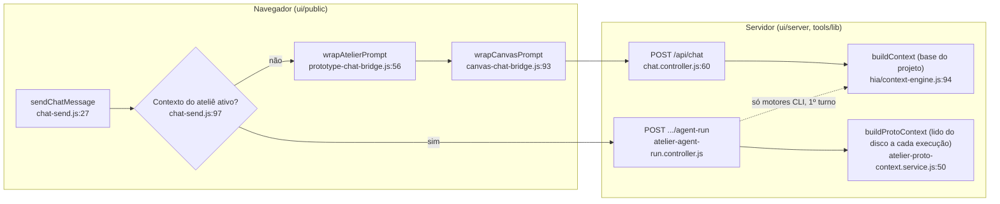
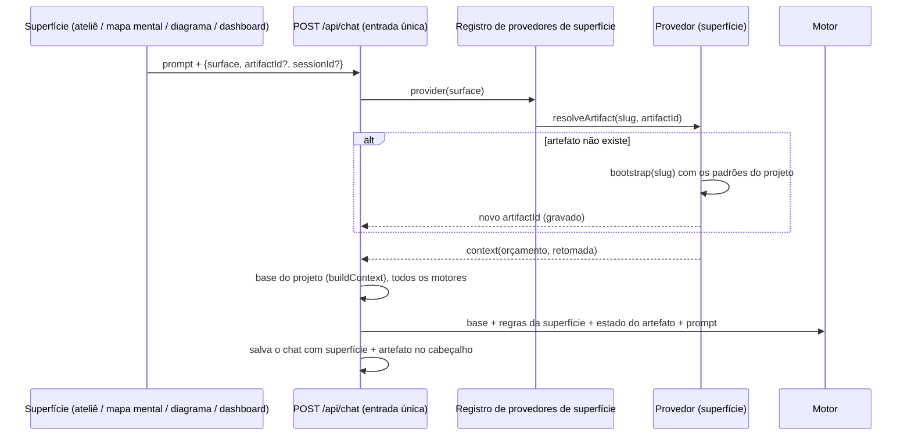

# Contexto do chat por superfície

Como o chat recebe contexto em cada tela do harness, o que ele lembra entre sessões e as lacunas em relação ao
comportamento desejado. Situação em 2026-11-13. As referências apontam para o código de cada etapa.

## Comportamento desejado

O chat é um componente único que abre em várias telas (superfícies). Em cada uma ele deve:

1. Carregar a **base do projeto**: instruções globais e do projeto, e a memória.
2. Carregar o **contexto da superfície**: para que serve a tela e quais são as regras dela. Por exemplo, as
   configurações de implementação do ateliê ou o formato de resposta do mapa mental.
3. Reconhecer o **artefato atual**: o protótipo, mapa mental ou diagrama na tela.
   - Se ainda não existir, montar o artefato inicial e gravá-lo.
   - A próxima sessão, no mesmo chat ou em outro, deve encontrá-lo e reutilizá-lo.
4. Permitir **iniciar uma conversa nova ou retomar uma em andamento**. A conversa retomada deve reabrir no artefato dela.

## Comportamento atual, em resumo

| Superfície | Base do projeto | Contexto da superfície | Artefato atual | Nova / retomar |
|---|---|---|---|---|
| Dashboard inicial, mini dock, Studio | Sim, no servidor. Entra só no 1º turno; sessão nativa retomada já tem a base | Nenhum. O Studio pode inserir blocos `<contexto-codigo>` / `<contexto-elemento>` | n/a | Nova: `resetChatSession` (`chat-continue.js:104`). Retomar: a última conversa volta sozinha (só no escopo geral, `chat-scope.js:61-69`), ou pela lista "continuar" (`chat-persist.js:103`) |
| Ateliê (protótipos) | Só motores CLI, 1º turno (`atelier-cli-engine-turn.service.js:58`). OpenCode e API Gemini **não recebem** | Catálogo de ferramentas (`TOOL_INSTRUCTION`), contrato de navegação, regras de continuação | **Sim.** Mapa do protótipo, telas, chaves de storage e `proto.css`, relidos do disco a cada execução | Sessão do motor por (slug, chat, escopo) no localStorage |
| Mapa mental | Sim (`/api/chat`) | Regras de resposta `<mindmap>` (`canvas-chat-bridge.js:93-108`) | **Em parte.** Resumo do mapa inteiro mais o nó selecionado, enviados pelo cliente. Pulado se a ilha ainda não publicou | Igual ao dashboard. O quadro escolhido não é gravado |
| Quadro de diagramas (Excalidraw) | Sim (`/api/chat`) | Regras de resposta `<board>` em Mermaid | **Em parte.** Resumo dos elementos, sem seleção | Igual ao mapa mental |
| Quadros dos tipos `diagram` / `flow` | — | **Sem chat** | — | — |
| Chat da mesa no escritório | Sim, em toda mensagem (sem estado) | Nenhum | n/a | Nada é gravado |
| Modo comparar | Sim | **Nenhum** (prompt cru, `chat-send-compare.js:58`) | Não | — |

## Superfície por superfície

### Dashboard inicial

- Abre por `openInteractiveChat` (`chat-stream-ui.js:24`), pelo mini dock (`chat-mini.js:232`) e pelo Studio
  (`studio-chat.js:115`). Os três chamam `sendChatMessage`.
- O servidor monta `<contexto_do_harness>` com `buildContext(slug, {scope, daiAgent})`
  (`tools/lib/hia/context-engine.js:94-176`). Ele inclui:
  - o papel do agente DAI;
  - as instruções globais e do projeto, e a memória;
  - a URL do `app.json`;
  - seções do mapa, quando pedidas;
  - as regras de segurança.
- `HIA_CONTEXT_SCOPE` pode reduzir esse contexto: none, minimal, project_only, full.
- O Claude Code CLI, fora da interface, recebe a mesma base pelo hook `.claude/hooks/load-project.ps1:47-70`.

### Ateliê

- `prototype-atelier.js:97-107` liga o chat ao protótipo com `setChatArtifact("prototypes", protoId)` e
  `setAtelierChatContext(...)`.
- A partir daí, toda mensagem vai para o loop de agente
  (`POST /api/project/:slug/design/prototypes/:protoId/agent-run`).
- O protótipo é **reconhecido e mantido**. `buildProtoContext` lê `projects/<slug>/design/prototypes/<id>/` a cada
  execução, então um chat novo ou uma sessão nova recebe o estado atual. O estado fica no disco, não no chat.
- **Lacunas:** três coisas não chegam à execução do agente:
  - o perfil de design system e de implementação do projeto (`getProjectDesignContext`);
  - o prompt de qualidade (índice e tokens do DS, `prototype-prompt-quality.js:88`);
  - a regra do MCP do design system.

  Elas ficam em `wrapAtelierPrompt`, que o caminho do agent-run pula (`chat-send.js:97-123`). Por isso o agente do
  ateliê prototipa sem as configurações de implementação que o usuário espera.

### Mapa mental e quadro de diagramas

- `design-canvas-workspace.js:59-95` monta o catálogo de quadros, o dock do chat e a ilha React.
- A ilha publica seu estado no evento `harness:canvas-state` (`useCanvasChatBridge.ts:57`, `useBoardChatBridge.ts:37`).
- O cliente embrulha o prompt:
  - **primeiro turno:** regras completas mais o mapa ou quadro atual;
  - **turnos seguintes:** um lembrete de uma linha, mais o mapa de novo se o hash dele mudou.
- O chat responde com blocos `<mindmap>` ou `<board>`, que `applyCanvasReply` devolve para a ilha.
- **Lacunas:**
  - O quadro escolhido por visão fica num `Map` em memória (`design-canvas-workspace.js:20`). Depois de recarregar a
    página, abre o primeiro quadro da lista.
  - O controle de "já enviado" também fica em memória. Depois de um F5, a próxima mensagem reenvia tudo.
  - O pacote de contexto da seleção (`AgentGroup.tsx:15-30`) só copia para a área de transferência.

## Onde as conversas ficam

| O quê | Onde | Chave |
|---|---|---|
| Rascunho / turnos em andamento | localStorage `harness_active_chat_<slug>[::<scope>]` (`shared/state.js:183`) | escopo: `""`, `design:<view>` ou `design:<view>:<artifactId>` |
| Ids de sessão do motor | localStorage `harness:engine-sessions:v1` (`chat-session-store.js:9`), limite de 60 | `<slug>::<chatFile\|draft>[:<scope>]` |
| Conversas salvas | `projects/<slug>/chats/<data>-<titulo>-<sid8>.md` (`tools/lib/chat-save.js:12`) | só o id da sessão. **Sem superfície nem artefato** |
| Motor, modelo, esforço | estado de tela `chats` (`screen-state/registry.js:37`) | projeto |
| Estado da interface do ateliê | estado de tela `prototypes` | projeto |

Efeito:
- Uma conversa salva não sabe a que superfície ou artefato pertence.
- A lista "continuar" mistura conversas de todas as superfícies.
- Retomar uma conversa não reabre o protótipo ou o quadro dela.
- As conversas de artefato só existem no navegador que as criou.

## Lacunas

1. **G-CTX-1**: Não existe um "provedor de contexto de superfície" comum. Cada superfície tem seu transporte e seu
   embrulho próprios (uma cadeia de `if` fixa em `prototype-chat-bridge.js`).
2. **G-CTX-2**: O agente do ateliê não recebe o perfil de design system / implementação do projeto, o prompt de
   qualidade nem a regra do MCP.
3. **G-CTX-3**: No caminho do agent-run, OpenCode e API Gemini não recebem instruções nem memória do projeto.
4. **G-CTX-4**: As conversas salvas perdem a ligação com a superfície e o artefato.
5. **G-CTX-5**: A seleção do mapa mental e do quadro não é gravada. Se a ilha não publicou, nenhum contexto é enviado.
6. **G-CTX-6**: Os quadros `diagram` e `flow` não têm chat.
7. **G-CTX-7**: Não existe etapa de "bootstrap". Quando a superfície ainda não tem artefato, o chat não cria e não
   registra o inicial com os padrões do projeto.

## Desenho alvo (proposta)

Um contrato único que toda superfície implementa, montado **no servidor**. O ateliê já lê do disco no servidor, e é
esse o padrão a manter.

Contrato do provedor (um arquivo por superfície, cerca de 100 linhas cada):

| Método | Ateliê | Mapa mental | Diagrama | Dashboard |
|---|---|---|---|---|
| `resolveArtifact` | pasta do protótipo | quadro do canvas `kind: mindmap` | quadro do canvas `board/diagram/flow` | nenhum |
| `bootstrap` | protótipo novo a partir do perfil de design, tokens do DS e template | quadro com nó raiz = projeto ou história | quadro vazio no estilo do projeto | nenhum |
| `context` | mapa do protótipo + **perfil de design + índice do DS + regra do MCP** | resumo do mapa + nó selecionado | resumo dos elementos | nenhum |
| `rules` | ferramentas do agente | formato `<mindmap>` | formato `<board>` | nenhum |
| `applyReply` | chamadas de ferramenta | `harness:canvas-apply` | `harness:canvas-apply` | nenhum |

Mudanças de persistência necessárias:

- O cabeçalho da conversa salva ganha `superficie:` e `artefato:`. A mudança de formato fica só em
  `tools/lib/chat-format.js`. Com isso, o "continuar" pode filtrar por superfície e reabrir o artefato.
- O último artefato de cada superfície passa a ficar no estado de tela do servidor (`design:<view>.lastArtifact`), no
  lugar do `Map` em memória.
- A base do projeto entra para todos os motores, em todos os caminhos. A checagem de "o motor já tem a base" passa para
  o servidor.

Isto muda contrato, então segue a **rota completa** (`docs/delivery/rota-curta.md`).
