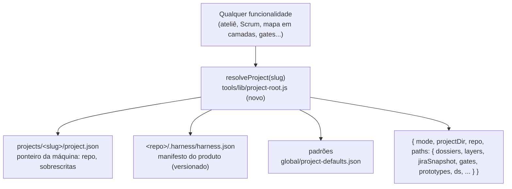

# Configuração do projeto: no harness, no repositório do projeto, ou nos dois

Qualquer projeto pode usar todas as funcionalidades do harness: Studio, ateliê, mapa mental, diagramas, Scrum, mapa
em camadas e gates.
- Alguns projetos guardam essa configuração dentro do harness (`projects/<slug>/`).
- Outros guardam no próprio repositório. É o caso do `saude-dispensacao`, que aponta para `saude/dispensacao`.

Esta página descreve como funciona hoje e propõe um padrão único para os dois casos. Situação em 2026-11-13.

## Como um projeto aponta para o repositório hoje

- **Ponteiro:** `projects/<slug>/mcp.json` → `"repo"` (mais `servidores`, os servidores MCP). Documentado em
  `tools/lib/project-mcp.js:5-11`. No DIS: `"repo": "C:/Users/.../git/saude/dispensacao"`.
- **Alternativa secundária:** `app.json` → `"repo"`, lido por apenas dois resolvedores.
- **A adoção não grava o ponteiro.**
  - `tools/adopt-project.js:73-87` cria `instructions.md`, `memory.md`, `chats/`, `context/` e `scheduled/`, mas não o
    `mcp.json`.
  - `docs/setup/05-adopt-existing-projects.md` não menciona `repo`.

## Onde cada funcionalidade procura

| Funcionalidade | Fica em | Resolvida por | Observações |
|---|---|---|---|
| Chats, memória, rotinas, quadros do canvas (mapa mental, diagramas) | Harness | `state.paths`, `memory/store.js:22`, `canvas-store.js:50` | Só no harness |
| Protótipos do ateliê, `design.json`, registro do DS | Harness `projects/<slug>/design/` | caminhos fixos sobre `projectDir` (`atelier-proto-context.service.js:51`, `design-registry.service.js:39`) | O repositório recebe só um snapshot para o G10 |
| Perfil de design | Harness `design/profile.json` → `global/design/design-systems/<ref>.json` → `global/design/defaults.json` | `resolveProjectDesignProfile` (`design-profile-resolver.service.js:54`) | Os caminhos de `docs` são aplicados sobre `repo \|\| projectDir` |
| MCP do design system | Código do servidor no repositório; declarado no `.mcp.json` do repositório | `loadProjectConfig` (`project-mcp.js:38`) | **Circular:** o env do repositório aponta de volta para a pasta do harness `projects/saude-dispensacao/design/ds` |
| Quadro Scrum | `scrum.json` no harness + `doc/scrum/*` do repositório, mesclados | `loadProjectScrum` (`project-scrum-persist.js:68`) | `_jira-dis.json` está fixo em 4 lugares |
| Mapa em camadas | Repositório `doc/sistema/features/<f>/mapa-camadas.json`, `_prototipos.json` | `docs.layers` do perfil em alguns lugares; fixo em `project-screens-features.js:31`, `project-screens-prototypes.js:19` | Misto |
| Painel histórias ↔ arquivos | Repositório `doc/scrum/_historias-arquivos.json` | `story-files.service.js:6` | Fixo no código |
| Dossiês das funcionalidades | Repositório `docs/features` → sobrescrita por `dossier.json` → alternativa no harness | `resolveDossierRoot` (`workflow-dossier-paths.js:55`) | Resolvedor próprio |
| Gate de rastreio G1-G9 | Config no harness `rastreio.config.json`; dados no repositório | `carregaConfig` (`tools/rastreio/config.mjs:14`) | A config não tem `root`, então o CLI precisa de `--root` |
| harness-gates G10-G13 | Repositório: `harness-gates.json`, `tools/harness-gates/` (versão travada pelo lock) | só pelo argumento `--repo` | O ADR-016 diz que a config fica no repositório, mas a **cópia do harness continua existindo** |
| Serviços do Studio | `app.json` no harness; código no repositório | `getProjectRepoInfo` + `resolveWorkspace` | `cwd` relativo ao repositório |
| pacote-revisao | `pacote-revisao.json` no harness | `tools/pacote-revisao/config.js:22` | A pasta de saída é um caminho absoluto da Área de Trabalho |
| Deploy | Global, `global/deployments.json` | `deploy-config.service.js:7` | Não é por projeto |

## Problemas

1. **Pelo menos sete resolvedores** leem `repo`, cada um de um jeito:
   - `getProjectRepoInfo` fica num controller (`inspect.controller.js:11`) e não confere se a pasta existe.
   - `loadProjectConfig` lança erro quando a pasta não existe.
   - `proc-manager-config`, `jira-snapshot`, `jira-refresh` e `pacote-revisao` têm cada um a sua cópia.
2. **A pasta de projetos é resolvida de três jeitos.** `config.getProjects()` respeita `HARNESS_PROJECTS_DIR`; os
   outros montam `ROOT/projects`. Por isso worktrees e testes podem divergir.
3. **Caminhos do repositório fixos no código** ignoram a configuração `docs` do perfil: `doc/sistema/features`,
   `_prototipos.json`, `_historias-arquivos.json`, `_jira-dis.json` (um nome do DIS dentro de código genérico) e
   `docs/logic`.
4. **Configuração duplicada:** `rastreio.config.json` (harness) e `harness-gates.json` (repositório) têm os mesmos
   blocos, com caminhos diferentes.
5. **Caminhos absolutos da máquina:**
   - `audit-layers-drift.js:26-27`;
   - o env do `.mcp.json` do repositório;
   - `pacote-revisao.json`.
6. **Os motores discordam do diretório de trabalho:** o Claude roda no repositório, o Codex roda na pasta do projeto no
   harness.

## Padrão: ponteiro, não cópia

**Decidido em 2026-11-16:** aceito no
[ADR-017](../../harness-evolution/03-decisions/ADR-017-project-config-pointer-not-copy.md). A migração abaixo ainda não
começou.

**Regra de decisão.** Quem é dono do artefato decide onde ele mora.

| Tipo | Fica em | Exemplos |
|---|---|---|
| **Artefatos do produto**: versionados com o código e necessários sem o harness | Repositório do projeto | dossiês, `rastreio.yml`, `regras.md`, `mapa-camadas.json`, config e lock dos gates, snapshot do protótipo, servidor MCP do DS |
| **Estado de trabalho do harness**: sobre como trabalhamos, não sobre o produto | Harness `projects/<slug>/` | chats, memória, quadros do canvas, rotinas, histórico de execuções, estado de tela, cópias de trabalho do ateliê |
| **Específico da máquina** | Harness, nunca commitado no repositório | caminho absoluto do repositório, pastas de saída, credenciais (variáveis de ambiente) |

O harness **nunca copia** um artefato do produto; ele guarda um ponteiro. Um projeto sem repositório (só no harness)
usa o mesmo layout dentro de `projects/<slug>/`, então as funcionalidades não veem diferença.



**Precedência:**
1. Sobrescrita no harness (`projects/<slug>/project.json`), só para valores da máquina.
2. Manifesto do repositório (`<repo>/.harness/harness.json`).
3. Padrões.

**Modos**, deduzidos do que for encontrado:

| Modo | Quando | Artefatos do produto resolvem para |
|---|---|---|
| `harness` | sem `repo` | `projects/<slug>/` |
| `repo` | `repo` definido e o repositório tem `.harness/harness.json` | o repositório, com os caminhos do manifesto |
| `hybrid` | `repo` definido, ainda sem manifesto | o repositório para os caminhos que existem lá; senão, o harness. Cada alternativa usada aparece em `node tools/project.js doctor` |

Esboço do manifesto do repositório (só caminhos relativos, seguro para commitar):

```json
{
  "version": 1,
  "paths": {
    "dossiers": "docs/features",
    "layers": "doc/sistema/features",
    "scrumDocs": "doc/scrum",
    "jiraSnapshot": "doc/scrum/_jira-snapshot.json",
    "storyFiles": "doc/scrum/_historias-arquivos.json",
    "prototypesSnapshot": "design/prototipos",
    "gates": "harness-gates.json"
  },
  "designSystem": { "ref": "procempa-dis", "mcpServer": "dis-design-system" }
}
```

## Migração (incremental, cada passo entregável sozinho)

1. Criar `tools/lib/project-root.js` com `resolveProject(slug)`. Ele usa `getProjects()` e respeita
   `HARNESS_PROJECTS_DIR`. `getProjectRepoInfo` e `project-mcp.js` passam a delegar para ele.
2. Trocar as seis cópias nas ferramentas e os caminhos fixos por `resolveProject(slug).paths.<nome>`.
3. O `adopt-project` pergunta o caminho do repositório, grava o ponteiro e oferece criar `.harness/harness.json`.
4. Aposentar o `rastreio.config.json` do harness e manter o `harness-gates.json` no repositório, como o ADR-016 planeja
   (linha 95).
5. Tornar o env do MCP do DS relativo ao repositório, ou resolvê-lo na inicialização a partir do ponteiro. Isso quebra o
   caminho circular.
6. Registrar a regra num ADR (próximo número em `docs/harness-evolution/03-decisions/`).

Os passos 1 e 2 mexem em mais de 3 arquivos e mudam um contrato interno, então seguem a **rota completa**.
