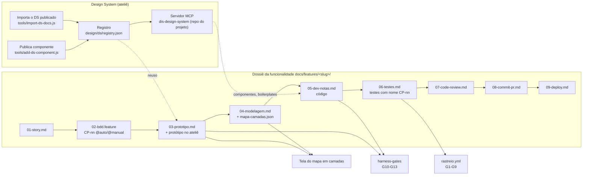
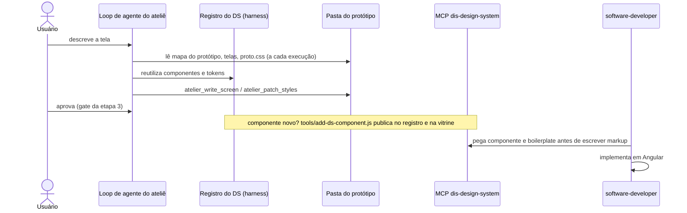
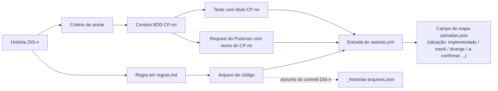
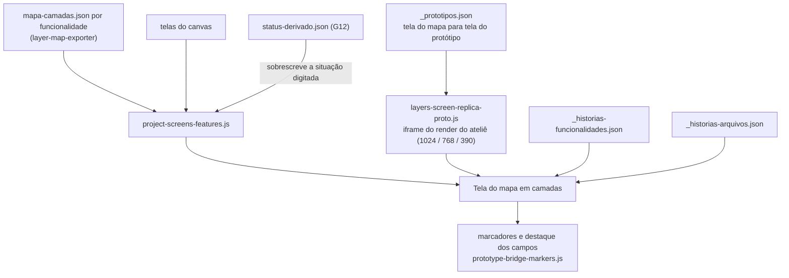

# Pipeline de entrega: do protótipo ao mapa em camadas

Como uma funcionalidade vai da ideia ao código entregue, com entregáveis rastreáveis. Esta página mostra também qual
agente atua em cada etapa e como os entregáveis são reaproveitados na documentação e no mapa em camadas. Situação em
2026-11-13.

Marcadores de situação:
- **[pronto]**: implementado, com código e testes.
- **[parcial]**.
- **[planejado]**: só documentado.
- **[ausente]**.

## O fluxo completo

- O catálogo de etapas está em `ui/server/services/orchestration/agent-stage-definitions.js:58-178`.
- A fonte do workflow é `~/.claude/skills/sdlc-pipeline/workflows/global/feature-delivery/WORKFLOW.md`.
- Todas as etapas leem e escrevem o mesmo dossiê.

## Etapa por etapa

| # | Etapa | Agente (executor + apoio) | Skills | Entregável | Gate | Situação |
|---|---|---|---|---|---|---|
| 0 | início | sessão | `sdlc-pipeline` | `_status.md` (chave `story:`) | — | [pronto] |
| 1 | história | business-analyst + product-owner | `requirements-engineering`, `jira-story-publishing` | `01-story.md`, critérios de aceite na história | critérios presentes | [pronto] |
| 2 | bdd | qa-engineer | `bdd-scenarios` | `02-bdd.feature`, cenários `CP-nn` | `tests/bdd-traceability.test.js` | [pronto] |
| 3 | protótipo | ux-ui-designer | `ux-design-process`, agente do ateliê | `03-prototipo.md` + protótipo no ateliê | **aprovação do usuário** | [pronto] |
| 4 | modelagem | software-architect | `obsidian-feature-modeler`, `layer-map-exporter` | `04-modelagem.md`, `mapa-camadas.json` | — | [pronto] |
| 5 | dev | software-developer | `feature-implementation`, skills da stack | código, `05-dev-notas.md` | build + lint | [pronto] |
| 6 | testes | qa-engineer | `tdd-test-driven`, `postman-bdd-tests` | testes com título `CP-nn`, `pm.test` no Postman, `06-testes.md` | rastreio G1-G9 | [pronto] |
| 7 | revisão | code review nativo | `code-review-checklist` | `07-code-review.md` | — | [pronto] |
| 8 | commit-pr | sessão | `commit`, `conventional-commits` | `08-commit-pr.md` | aprovação do usuário | [pronto] |
| 9 | deploy | devops-engineer | `release-operations` | `09-deploy.md` | — | [pronto] |
| — | saída | sessão | — | — | `node tools/scrum.js story done-check <id>` | [pronto] |

**Rota curta** (até 3 arquivos de código, sem tela nova, sem mudança de contrato):
- A modelagem é pulada.
- O protótipo também, a menos que haja elemento visual novo (`workflow-definitions.js:32-41`).
- A regra está em `docs/delivery/rota-curta.md`.

**Inconsistência conhecida:** `docs/playbook/stages.json:91-139` coloca a modelagem antes do protótipo, enquanto o código
do workflow coloca o protótipo antes. É preciso escolher uma ordem e alinhar os dois.

## 1. Prototipação no ateliê com o Design System

- **[pronto]**
  - Importação do DS a partir do site publicado.
  - Registro do DS e publicador de componentes com validação do manifesto.
  - Contexto do protótipo a cada execução (`atelier-proto-context.service.js:3-6`).
- **[parcial]** Chamadas via MCP durante a implementação:
  - A regra existe só em texto: instruções do projeto, `AGENTS.md` do handoff (`handoff-docs.service.js:38`) e playbook.
  - Nenhuma skill ou gate confere se a etapa de dev usou o MCP.
  - O próprio agente do ateliê não recebe o perfil do DS nem a regra do MCP (ver
    [01-contexto-do-chat-por-superficie.md](01-contexto-do-chat-por-superficie.md), G-CTX-2).

## 2. Entregáveis rastreáveis

Todo entregável carrega um id, e por isso pode ser seguido nos dois sentidos:

Essas ligações são verificadas por:
- `bdd-traceability.test.js`: cenário ↔ teste.
- rastreio G1-G9: rastreio, código, testes, Postman e mapa em camadas.
- `done-check`: etapas do dossiê.

As evidências do done-check (`--tests --lint --browser`) são **declaradas, não auditadas**.

## 3. Documentação a partir dos entregáveis

| Saída | Agente | Skill | Feita a partir de |
|---|---|---|---|
| Dossiê da funcionalidade com diagramas Mermaid | software-architect / documentation-engineer | `obsidian-feature-modeler` | história, BDD, código |
| `mapa-camadas.json` | documentation-engineer | `layer-map-exporter` | dossiê `01`-`06`, coleção do Postman, `02-bdd.feature`, código |
| README, ADR, runbook | documentation-engineer | `technical-writing` | dossiê, decisões |
| Comentários no código | documentation-engineer | `code-documenter-ts-angular` | código-fonte |
| Pacote de handoff (README, AGENTS.md, MAPA.md, `.mcp.json`) | harness | `handoff-docs.service.js` | protótipos + DS |
| Pacote de revisão (quadro de histórias + mapa em camadas) | harness | `tools/pacote-revisao` | Scrum + mapa em camadas |

- **[parcial]** A atualização automática da documentação no pre-commit do projeto (só quando o dossiê é mais antigo que o
  código) está descrita em `.agents/skills/rastreio-adocao/workflows/gate-local.md`. Ainda não está ligada nos
  repositórios dos projetos.

## 4. Montagem do mapa em camadas

- **[pronto]** O mapa em camadas **não redesenha o design**:
  - Ele incorpora o protótipo aprovado do ateliê (`/design/prototypes/<id>/render/<screen>?part=content`) em modo play.
  - Marca cada campo mapeado sobre ele.
- Telas sem protótipo mapeado usam uma réplica genérica (`layers-screen-replica.js:227`).
- Cada campo mostra suas camadas (interface, regra, API e dados) com uma situação. Campo sem evidência no código fica
  `a-confirmar`.

O passo seguinte, comparar esse protótipo com o código rodando, está em
[04-validacao-e-gates.md](04-validacao-e-gates.md).
