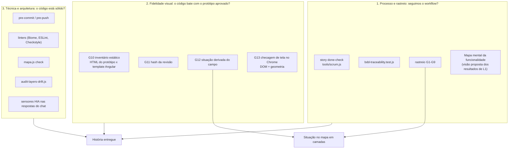
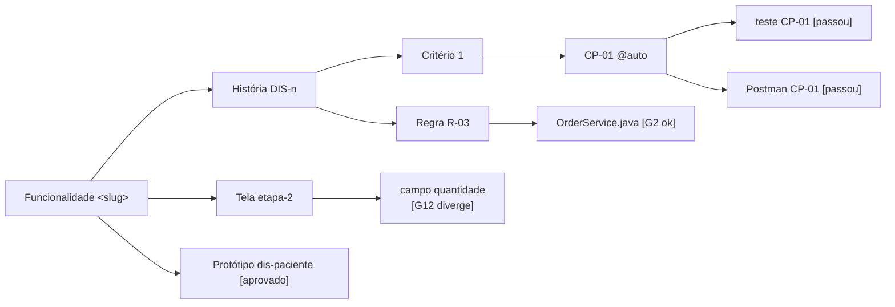
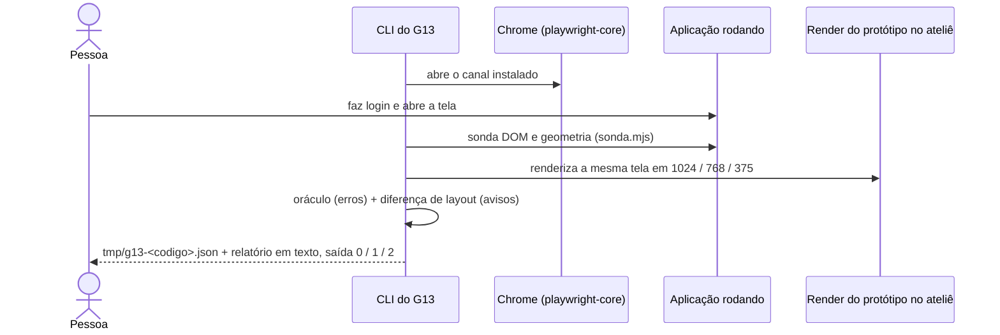

# Validação: mapa mental, protótipo × código, checagens técnicas

O que verifica uma entrega, em três camadas. Situação em 2026-11-13.

Marcadores:
- **[pronto]**
- **[parcial]**
- **[planejado]**
- **[ausente]**

## 1. Processo e rastreio

| Checagem | O que comprova | Situação |
|---|---|---|
| `node tools/scrum.js story done-check <id>` | Cada etapa do dossiê está `done`, ou `skipped` com motivo. Os critérios de aceite existem. Sai com código 3 enquanto houver pendência (`tools/lib/scrum-cli/done-check.js:32`) | [pronto]. As evidências são declaradas, não auditadas |
| `tests/bdd-traceability.test.js` | Todo cenário `@auto` `CP-nn` tem um teste com o seu id | [pronto] |
| rastreio G1-G9 (`tools/rastreio/cli.mjs`) | rastreio.yml × código, testes (JUnit, Karma, pytest), Postman, `regras.md` e mapa em camadas | [pronto] como CLI. A ligação com pre-commit e CI nos repositórios dos projetos está [parcial] |
| Orquestrador de entrega (EP-18) | Uma máquina de estados única entre o Scrum e o dossiê | [planejado]: `docs/scrum-traceability/04-ARQUITETURA-PROPOSTA.md` |

| Gate | Falha quando |
|---|---|
| G1 | entrada sem prova |
| G2 | regra sem código ou prova |
| G3 | link quebrado |
| G4 | arquivo de teste, request ou código ausente |
| G5 | id provisório |
| G6 | teste sem ligação (aviso) |
| G7 | id reutilizado |
| G8 | contagem desatualizada (aviso) |
| G9 | mapa em camadas fora de sincronia com o rastreio |

### Validação pelo mapa mental: [ausente], decidida como visão somente leitura

**Decidido em 2026-11-16 (opção A):** o mapa mental da funcionalidade é uma visão **somente leitura**, regerada a partir
dos arquivos.
- Editar o mapa nunca altera os entregáveis.
- As mudanças passam pelo chat ou pelos arquivos, e o mapa é sincronizado de novo em seguida.

A edição de mão dupla foi avaliada e descartada: duas fontes da verdade, conflitos de sincronização e nós sem
entregável real por trás.

Hoje nenhum fluxo valida uma funcionalidade por um mapa mental. O que existe:
- `tools/epic-canvas.js` projeta a pasta de um **épico** num quadro `mindmap@1`, em mão única: as histórias são a fonte.
- O pacote de contexto transforma um ramo selecionado em prompt para agentes, mas só copia para a área de transferência.

O mapa mental **não tem ligação** com `docs/features/<slug>`, `rastreio.yml` ou `mapa-camadas.json`.

**Proposta: o mapa mental da funcionalidade como visão somente leitura da cadeia de rastreio.** Segue o mesmo padrão do
`epic-canvas-sync`: os arquivos continuam sendo a fonte da verdade e o mapa é regerado.

- **Fonte:**
  - o dossiê (`_status.md`, `01`, `02`);
  - o `rastreio.yml` e a saída JSON do rastreio;
  - o `mapa-camadas.json` mais o G12.
- **Situação de cada nó:** a cor vem da última execução dos gates (passou / aviso / falhou / não rodou). Cada achado de
  gate vira uma nota no nó correspondente.
- **Comando:** `node tools/feature-canvas.js sync <slug>`, gêmeo do `epic-canvas.js`. O painel da história no Scrum e o
  mapa em camadas ganham o link "Ver no mapa mental".
- **Chat:** o provedor de superfície do mapa mental ([01](01-contexto-do-chat-por-superficie.md)) envia os ramos
  vermelhos como contexto.
  - O agente trabalha nos arquivos dos entregáveis, nunca no mapa.
  - Depois o mapa é sincronizado de novo.

## 2. Protótipo × código rodando

| Gate | Como | Compara | Situação |
|---|---|---|---|
| G10 | Estático. Inventário do HTML do protótipo e dos templates Angular (`tools/gates/fidelidade/*`) | rótulos, ícones, larguras e presença, descontadas as diferenças declaradas em `pareamento.json` | [pronto]. Ordem dos campos e geometria ainda não são comparadas |
| G11 | Hash dos arquivos de código citados × revisão gravada | se o código mudou desde a revisão | [pronto] |
| G12 | Situação do campo derivada do G10 → `status-derivado.json` | situação digitada × derivada no mapa em camadas | [pronto] |
| G13 | **playwright-core + Chrome/Edge instalado** (`tools/gates/g13/navegador.mjs`), sem baixar nada | texto do DOM, rótulos, avisos e geometria (`getBoundingClientRect`) contra o oráculo de valores esperados (erros) e o protótipo renderizado em 1024 / 768 / 375 px (avisos) | [parcial]: uma tela piloto (DIS etapa 2), um medicamento por execução, uma pessoa faz login e navega |
| Screenshot / diff de pixels | — | — | [ausente] |

Próximos passos, por ordem de valor:
1. Um roteiro gravado de login e navegação por tela, para o G13 rodar sem uma pessoa.
2. As telas listadas a partir do `_prototipos.json`, em vez de fixas numa só.
3. Screenshot dos dois lados com diff de pixels, anexado como evidência ao campo do mapa em camadas. No começo, só como
   relatório.
4. Fatia 4 de `docs/harness-gates/01-execution-plan.md`: um segundo projeto e o adaptador `react-jsx`.

## 3. Checagens técnicas e de arquitetura

| Checagem | Cobre | Bloqueia? | Situação |
|---|---|---|---|
| `scripts/pre-commit.js` | dados do projeto e segredos, arquivos fora do mapa, sintaxe e JSON, gates das ilhas (Biome, tsc, npm audit), testes afetados | sim | [pronto] (repo do harness) |
| `.githooks/pre-push` | suíte completa de testes | sim | [pronto] |
| `node tools/mapa.js check` | frontmatter do mapa, tamanho, globs mortos, arquivos órfãos | sim (no pre-commit) | [pronto] |
| `tools/audit-layers-drift.js` | dossiê × mapa em camadas × fontes Java/Angular × componentes do DS (divergência de API, UI e testes) | relatório | [pronto]. Tem caminhos do DIS fixos no código ([02](02-configuracao-hibrida-do-projeto.md)) |
| `cobertura.mjs` (lado do projeto) | um dono por arquivo, sem ciclos de dependência entre funcionalidades | sim | [pronto] |
| Sensores HIA | respostas do chat: Biome, `ast.parse`, `javac`, segredos, emoji, Mermaid | não (só relatório) | [pronto] |
| Checkstyle | estilo Java e controle de imports entre camadas | — | [parcial]: só a skill. `project-audit.service.js:133-141` informa um `PASS` fixo |
| done-check `--lint` | o lint rodou | — | só declarado |

**Corrigir logo:** o `PASS` fixo do Checkstyle informa uma checagem que nunca rodou. Rode o Checkstyle pelo wrapper
Maven ou Gradle do projeto, ou informe `not-run`.
