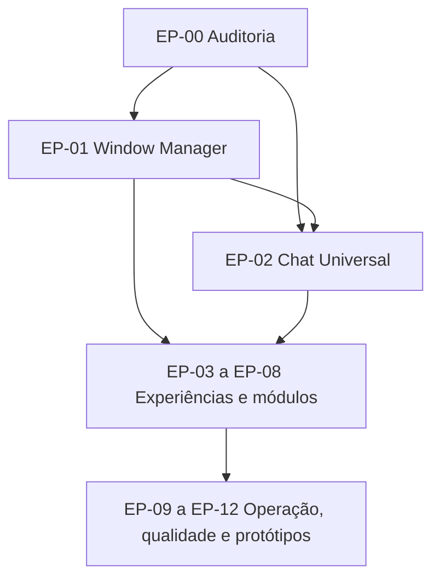

# Harness Leca: índice mestre de implementação

Documento mestre do programa de evolução. Cada entrega aceita tem um documento próprio em `02-epics/`, para que um agente receba só a história que vai implementar e as dependências dela.

> Snapshot verificado em 2026-10-21: 89/104 entregas concluídas e links locais válidos. Para evitar divergência entre agentes, este arquivo define o backlog, [progress.md](05-progress/progress.md) define o status aceito e [multi-agent-sync.md](05-progress/multi-agent-sync.md) registra a coordenação das frentes.

## Como usar

1. Confirme a próxima entrega em [Trabalho disponível agora](#trabalho-disponível-agora).
2. Abra o README do épico e o documento da história.
3. Leia só as dependências listadas na seção Identificação.
4. Implemente seguindo o [contrato de história](_templates/story-template.md).
5. Registre as evidências na história e atualize [05-progress](05-progress/progress.md).
6. Antes de editar, confira a frente e os arquivos sob coordenação em [multi-agent-sync](05-progress/multi-agent-sync.md).

Uma caixa só pode ser marcada com aceite e evidência registrados na história. Código existente ou parcialmente implementado não conta, por si só, como história concluída. O status oficial fica em `05-progress/progress.md`.

## 1. Épicos

| ID | Épico | Prioridade | Situação atual | Entregas aceitas |
|---|---|---|---|---|
| [EP-00](02-epics/EP-00-auditoria/README.md) | Auditoria e arquitetura existente | P0 | Concluído | 4/4 |
| [EP-01](02-epics/EP-01-window-manager/README.md) | Window Manager híbrido | P0 | Concluído | 10/10 |
| [EP-02](02-epics/EP-02-chat/README.md) | Chat universal e conversas | P0 | Concluído | 8/8 |
| [EP-03](02-epics/EP-03-escritorio/README.md) | Escritório 2.5D/3D | P1 | Concluído | 9/9 |
| [EP-04](02-epics/EP-04-projetos-workspaces/README.md) | Projetos e workspaces | P1 | Concluído | 5/5 |
| [EP-05](02-epics/EP-05-scrum/README.md) | Scrum & Sprints | P1 | Concluído | 6/6 |
| [EP-06](02-epics/EP-06-studio/README.md) | Studio, código e preview | P1 | Concluído | 5/5 |
| [EP-07](02-epics/EP-07-artefatos/README.md) | Artefatos e documentação | P1 | Concluído | 5/5 |
| [EP-08](02-epics/EP-08-agentes/README.md) | Agentes, skills e workflows | P1 | Concluído | 5/5 |
| [EP-09](02-epics/EP-09-observabilidade/README.md) | Central de sessões, observabilidade e orquestração | P1 | Especificado; 09.01 detalhada, implementação não iniciada | 0/5 |
| [EP-10](02-epics/EP-10-deploy/README.md) | Datacenter e deploys | P2 | Planejado; estação existente | 0/5 |
| [EP-11](02-epics/EP-11-auditoria-qualidade/README.md) | Auditoria, testes e Design System | P2 | Planejado; base existente | 0/5 |
| [EP-12](02-epics/EP-12-prototype-engine/README.md) | Prototype Engine & Design System Multiframework | P1 | Concluído | 32/32 |

## 2. Dependências

A ordem sugerida está em [dependency-map](01-architecture/dependency-map.md). Ela não obriga a executar todos os épicos em sequência.

## 3. Backlog (89/104)

Títulos ainda não detalhados de EP-02 a EP-11 permanecem provisórios até a criação e o aceite do documento da história. EP-12 detalha as 32 histórias do motor multiframework. `HAR-xxx` indica o item equivalente do [backlog da Fase 0](08-prioritized-backlog.md).

### EP-00 Auditoria e arquitetura (4/4)
- [x] [00.01](02-epics/EP-00-auditoria/00.01-inventario.md) Inventário de componentes, rotas e serviços (HAR-001)
- [x] [00.02](02-epics/EP-00-auditoria/00.02-mapa-paineis.md) Mapeamento dos painéis existentes
- [x] [00.03](02-epics/EP-00-auditoria/00.03-contratos-permissoes.md) Contratos compartilhados e permissões (HAR-002)
- [x] [00.04](02-epics/EP-00-auditoria/00.04-baseline-testes.md) Baseline de testes e regressão visual (HAR-018)

### EP-01 Window Manager (10/10)
- [x] [01.01](02-epics/EP-01-window-manager/01.01-registro-modulos.md) Registro de módulos e janelas
- [x] [01.02](02-epics/EP-01-window-manager/01.02-adaptador-estacoes.md) Adaptador das estações existentes
- [x] [01.03](02-epics/EP-01-window-manager/01.03-foco-camadas-camera.md) Foco, camadas e integração com câmera
- [x] [01.04](02-epics/EP-01-window-manager/01.04-minimizar-restaurar.md) Minimizar, restaurar e fechar (HAR-005)
- [x] [01.05](02-epics/EP-01-window-manager/01.05-barra-tarefas.md) Barra de tarefas
- [x] [01.06](02-epics/EP-01-window-manager/01.06-mover-redimensionar.md) Mover, redimensionar e maximizar
- [x] [01.07](02-epics/EP-01-window-manager/01.07-docking-abas.md) Docking, abas e divisão de tela
- [x] [01.08](02-epics/EP-01-window-manager/01.08-persistencia.md) Persistência e restauração
- [x] [01.09](02-epics/EP-01-window-manager/01.09-layouts-responsivos.md) Layouts responsivos
- [x] [01.10](02-epics/EP-01-window-manager/01.10-workspaces-nomeados.md) Workspaces nomeados

### EP-02 Chat e conversas (8/8)
- [x] [02.01](02-epics/EP-02-chat/02.01-inventario-chat.md) Inventário da lógica de chat duplicada
- [x] [02.02](02-epics/EP-02-chat/02.02-modelo-mensagens.md) Modelo separado de mensagens, sessões e execuções (HAR-003)
- [x] [02.03](02-epics/EP-02-chat/02.03-apresentacao-compacta.md) Apresentação compacta
- [x] [02.04](02-epics/EP-02-chat/02.04-apresentacao-lateral.md) Apresentação lateral
- [x] [02.05](02-epics/EP-02-chat/02.05-apresentacao-completa.md) Apresentação completa
- [x] [02.06](02-epics/EP-02-chat/02.06-historico-continuidade.md) Histórico por motor e continuidade de conversa
- [x] [02.07](02-epics/EP-02-chat/02.07-rolagem-ancorada.md) Rolagem ancorada na última mensagem
- [x] [02.08](02-epics/EP-02-chat/02.08-sincronizacao-estados.md) Sincronização com estados reais de execução e hardening

### EP-03 Escritório 2.5D/3D (9/9)
- [x] [03.01](02-epics/EP-03-escritorio/03.01-catalogo-objetos.md) Catálogo canônico de objetos interativos
- [x] [03.02](02-epics/EP-03-escritorio/03.02-contrato-acoes.md) Contrato padrão de ações dos objetos
- [x] [03.03](02-epics/EP-03-escritorio/03.03-estacoes-janelas.md) Estações abrindo janelas pelo Window Manager
- [x] [03.04](02-epics/EP-03-escritorio/03.04-presets-teloes.md) Presets dos telões
- [x] [03.05](02-epics/EP-03-escritorio/03.05-estado-real-agentes.md) Estado real dos agentes na cena
- [x] [03.06](02-epics/EP-03-escritorio/03.06-iluminacao-funcional.md) Iluminação funcional
- [x] [03.07](02-epics/EP-03-escritorio/03.07-alternancia-3d-diorama-25d.md) Alternância 3D, diorama e 2.5D sem perda de contexto
- [x] [03.08](02-epics/EP-03-escritorio/03.08-paridade-modo-25d.md) Paridade do modo 2.5D
- [x] [03.09](02-epics/EP-03-escritorio/03.09-desempenho-acessibilidade-cena.md) Desempenho e acessibilidade da cena

### EP-04 Projetos e workspaces (5/5)
- [x] [04.01](02-epics/EP-04-projetos-workspaces/04.01-selecao-projeto-centralizada.md) Seleção de projeto centralizada
- [x] [04.02](02-epics/EP-04-projetos-workspaces/04.02-layouts-nomeados.md) Layouts nomeados
- [x] [04.03](02-epics/EP-04-projetos-workspaces/04.03-persistencia-contexto-workspace.md) Persistência de janelas, filtros e recursos selecionados
- [x] [04.04](02-epics/EP-04-projetos-workspaces/04.04-templates-workspace.md) Templates: Desenvolvimento, Planejamento, Qualidade e Operações
- [x] [04.05](02-epics/EP-04-projetos-workspaces/04.05-protecao-alteracoes-nao-salvas.md) Proteção de alterações não salvas na troca de workspace

### EP-05 Scrum & Sprints (6/6)
- [x] [05.01](02-epics/EP-05-scrum/05.01-migracao-compativel-status.md) Migração compatível de status (HAR-008)
- [x] [05.02](02-epics/EP-05-scrum/05.02-doze-raias-configuraveis.md) Doze raias configuráveis (HAR-009)
- [x] [05.03](02-epics/EP-05-scrum/05.03-reordenacao-horizontal.md) Reordenação horizontal persistida por projeto (HAR-010)
- [x] [05.04](02-epics/EP-05-scrum/05.04-movimentacao-transicoes.md) Movimentação de histórias e transições (HAR-011)
- [x] [05.05](02-epics/EP-05-scrum/05.05-impedimentos-filtros-metricas.md) Impedimentos, filtros e métricas
- [x] [05.06](02-epics/EP-05-scrum/05.06-projecao-kanban-telao.md) Projeção do Kanban no telão

### EP-06 Studio, código e preview (5/5)
- [x] [06.01](02-epics/EP-06-studio/06.01-layout-responsivo.md) Layout responsivo e redimensionamento (HAR-006)
- [x] [06.02](02-epics/EP-06-studio/06.02-chat-compartilhado.md) Chat compartilhado no Studio
- [x] [06.03](02-epics/EP-06-studio/06.03-visualizacoes-codigo-design-preview.md) Visualizações Código, Design e Preview
- [x] [06.04](02-epics/EP-06-studio/06.04-preservacao-alteracoes-selecao.md) Preservação de alterações e seleção contextual
- [x] [06.05](02-epics/EP-06-studio/06.05-mapeamento-elementos-visuais.md) Mapeamento de elementos visuais para arquivos e componentes

### EP-07 Artefatos e documentação (5/5)
- [x] [07.01](02-epics/EP-07-artefatos/07.01-inventario-artefatos.md) Inventário de artefatos por projeto
- [x] [07.02](02-epics/EP-07-artefatos/07.02-importacao-arquivos-pastas.md) Importação de arquivos e pastas
- [x] [07.03](02-epics/EP-07-artefatos/07.03-metadados-origem-controle-acesso.md) Metadados de origem e controle de acesso
- [x] [07.04](02-epics/EP-07-artefatos/07.04-previews-seguros.md) Previews seguros
- [x] [07.05](02-epics/EP-07-artefatos/07.05-relacionamentos-mapa-camadas.md) Relacionamentos e Mapa em Camadas (HAR-012, HAR-013)

### EP-08 Agentes, skills e workflows (5/5)
- [x] [08.01](02-epics/EP-08-agentes/08.01-catalogo-capacidades.md) Catálogo padronizado de capacidades
- [x] [08.02](02-epics/EP-08-agentes/08.02-agentes-por-etapa-sdlc.md) Agentes associados às etapas do SDLC
- [x] [08.03](02-epics/EP-08-agentes/08.03-skills-projeto-raia.md) Vínculo de skills por projeto e raia (HAR-016)
- [x] [08.04](02-epics/EP-08-agentes/08.04-execucao-workflows.md) Execução de workflows
- [x] [08.05](02-epics/EP-08-agentes/08.05-rotinas-aprovacao-historico.md) Rotinas com aprovação e histórico (HAR-017)

### EP-09 Central de sessões, observabilidade e orquestração (0/5)
- [ ] [09.01](02-epics/EP-09-observabilidade/09.01-descoberta-registro-canonico.md) Descoberta e registro canônico de sessões (detalhada)
- [ ] 09.02 Event log persistente, projeções e recuperação SSE
- [ ] 09.03 Central pesquisável em lista e Kanban
- [ ] 09.04 Navegação, retomada e integração com Chat/Escritório
- [ ] 09.05 Atenção necessária, notificações e fila de aprovações

### EP-10 Deploy e Datacenter (0/5)
- [ ] 10.01 Integração de pipelines
- [ ] 10.02 Ambientes e indicadores de saúde
- [ ] 10.03 Histórico e logs de deploy
- [ ] 10.04 Ações de deploy autorizadas com confirmação
- [ ] 10.05 Paridade entre painel tradicional e escritório

### EP-11 Auditoria e qualidade (0/5)
- [ ] 11.01 Matriz de auditoria com evidências (HAR-015)
- [ ] 11.02 Testes gerados, executados e aprovados como estados distintos
- [ ] 11.03 Integração do Quadro de Componentes (HAR-014)
- [ ] 11.04 Design System e inconsistências visuais (HAR-002, HAR-019)
- [ ] 11.05 Regressão automatizada (HAR-018)

### EP-12 Prototype Engine & Design System Multiframework (32/32) [Concluído - Marco M3 Homologado]
- [x] [12.01](02-epics/EP-12-prototype-engine/stories/12.01-auditar-htmls-mcp.md) Auditar HTMLs monolíticos, MCP e snapshots
- [x] [12.02](02-epics/EP-12-prototype-engine/stories/12.02-auditar-atelie-inspetor.md) Auditar Ateliê, importador, renderer e inspetor
- [x] [12.03](02-epics/EP-12-prototype-engine/stories/12.03-contratos-reutilizaveis.md) Identificar contratos e funcionalidades reutilizáveis
- [x] [12.04](02-epics/EP-12-prototype-engine/stories/12.04-baseline-visual-funcional.md) Registrar baseline visual e funcional
- [x] [12.05](02-epics/EP-12-prototype-engine/stories/12.05-manifesto-identidade-componentes.md) Manifesto de identidade e contrato de componentes
- [x] [12.06](02-epics/EP-12-prototype-engine/stories/12.06-extracao-componentes-ds.md) Extração automatizada de componentes do Design System
- [x] [12.07](02-epics/EP-12-prototype-engine/stories/12.07-registro-frameworks-dependencias.md) Registro centralizado e persistente do Design System
- [x] [12.08](02-epics/EP-12-prototype-engine/stories/12.08-api-consulta-compartilhada.md) API REST compartilhada para consulta de componentes
- [x] [12.09](02-epics/EP-12-prototype-engine/stories/12.09-isolar-tokens-css.md) Isolamento de tokens e variáveis CSS do Design System
- [x] [12.10](02-epics/EP-12-prototype-engine/stories/12.10-boilerplates-vanilla-componentes.md) Boilerplates modulares Vanilla dos componentes
- [x] [12.11](02-epics/EP-12-prototype-engine/stories/12.11-harness-renderizacao-isolada.md) Sandbox isolada para preview de componentes
- [x] [12.12](02-epics/EP-12-prototype-engine/stories/12.12-validacao-suite-componentes.md) Homologação formal do Marco M1 (Extração Confiável)
- [x] [12.13](02-epics/EP-12-prototype-engine/stories/12.13-schema-semantico-proto-json.md) Schema JSON formal v2.0.0 do Prototype Engine
- [x] [12.14](02-epics/EP-12-prototype-engine/stories/12.14-slots-eventos-bindings-navegacao.md) Manipulação de nós, slots nomeados e navegação declarativa
- [x] [12.15](02-epics/EP-12-prototype-engine/stories/12.15-schema-estado-mocks-dados.md) Schema de estado reativo e mocks de dados clínicos
- [x] [12.16](02-epics/EP-12-prototype-engine/stories/12.16-validador-schema-testes.md) Validador estrito de integridade referencial do schema v2
- [x] [12.17](02-epics/EP-12-prototype-engine/stories/12.17-parsing-semantico-legado.md) Pipeline de parsing semântico do DOM legado
- [x] [12.18](02-epics/EP-12-prototype-engine/stories/12.18-decompositor-telas.md) Decompositor de telas e injeção de nós canônicos data-node-id
- [x] [12.19](02-epics/EP-12-prototype-engine/stories/12.19-gerador-manifesto-proto-json.md) Orquestrador de reconstrução de protótipo estruturado
- [x] [12.20](02-epics/EP-12-prototype-engine/stories/12.20-reconstrucao-prototipo-dis.md) Reconstrução desacoplada do protótipo clínico DIS (dis-modular)
- [x] [12.21](02-epics/EP-12-prototype-engine/stories/12.21-engine-renderizacao-sandbox.md) Engine de renderização em sandbox iframe com CSP e nonces
- [x] [12.22](02-epics/EP-12-prototype-engine/stories/12.22-ponte-comunicacao-bidirecional.md) Ponte client-side tipada postMessage (data-node-id e data-pid)
- [x] [12.23](02-epics/EP-12-prototype-engine/stories/12.23-inspetor-arvore-selecao-bidirecional.md) Inspetor de árvore de camadas com seleção bidirecional tela <-> árvore
- [x] [12.24](02-epics/EP-12-prototype-engine/stories/12.24-painel-propriedades-mutacao.md) Mutação não destrutiva de tela/props e Homologação do Marco M2
- [x] [12.25](02-epics/EP-12-prototype-engine/stories/12.25-adaptador-geracao-vanilla.md) Adaptador de geração Vanilla HTML/CSS e ES Modules
- [x] [12.26](02-epics/EP-12-prototype-engine/stories/12.26-adaptador-angular18.md) Adaptador Angular 18 (Signals & Standalone Components)
- [x] [12.27](02-epics/EP-12-prototype-engine/stories/12.27-adaptador-react18.md) Adaptador React 18+ (Hooks & Componentes Funcionais TSX)
- [x] [12.28](02-epics/EP-12-prototype-engine/stories/12.28-matriz-paridade-multiframework.md) Fábrica unificada e matriz de paridade entre frameworks
- [x] [12.29](02-epics/EP-12-prototype-engine/stories/12.29-integracao-motor-studio.md) Integração da árvore do motor ao Studio unificado
- [x] [12.30](02-epics/EP-12-prototype-engine/stories/12.30-rastreabilidade-end-to-end.md) Rastreabilidade end-to-end: tela, nó, componente e código
- [x] [12.31](02-epics/EP-12-prototype-engine/stories/12.31-piloto-completo-dis.md) Piloto completo do fluxo DIS Dispensação de Medicamentos
- [x] [12.32](02-epics/EP-12-prototype-engine/stories/12.32-homologacao-marco-m3.md) Documentação, kits de componentes e homologação final (Marco M3 Homologado)

## Trabalho disponível agora

1. **Frente Escritório/Studio (Chat A):** EP-03 encerrado (9/9) e EP-06 encerrado (5/5); 89/104 global. Sem história pendente na alocação atual; aguardar definição da próxima frente.
2. **Codex / Chat B:** EP-05 encerrado (6/6), EP-07 encerrado (5/5) e EP-08 encerrado (5/5); 89/104 global. Próxima história: implementar a 09.01 (registro canônico de sessões, já detalhada) ou iniciar o EP-11, conforme o gate de dependências.
3. A próxima história de EP-09/EP-11 deve ser criada e aceita a partir do template antes da implementação.
4. Código parcial já existente em EP-02, EP-04, EP-05 e EP-06 deve ser reconciliado com os critérios da respectiva história antes de alterar qualquer contador.
5. A divisão completa e os handoffs obrigatórios estão no [painel Gemini + Codex](05-progress/multi-agent-sync.md).

EP-00, EP-01, EP-02, EP-03, EP-04, EP-05, EP-06, EP-07, EP-08 e EP-12 estão encerrados.

## Estrutura

| Pasta | Conteúdo |
|---|---|
| `01-architecture/` | Estado atual, arquitetura-alvo e mapa de dependências |
| `02-epics/` | Um README por épico e um documento por história |
| `03-decisions/` | ADRs |
| `04-test-plans/` | Planos de teste por épico ou vertical |
| `05-progress/` | Status real, evidências e próximos passos |
| `_templates/` | Modelos de história, ADR e plano de teste |

Os documentos `01` a `08` na raiz desta pasta são o diagnóstico da Fase 0 e continuam válidos como fonte.
