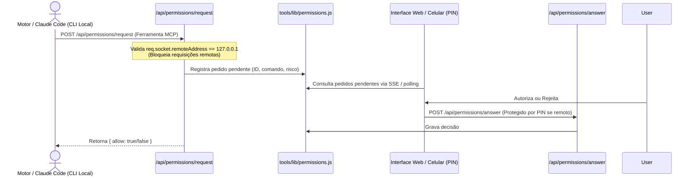

# Contratos compartilhados e permissões (2026-10-19, commit 152b06f)

Documento gerado na execução da história [00.03](../../02-epics/EP-00-auditoria/00.03-contratos-permissoes.md).
Mapeia os modelos de dados compartilhados, divergências entre interfaces e o modelo de segurança e autorização da aplicação.

## 1. Tipos e Declarações Estáticas

| Arquivo | Tipos Declarados | Finalidade / Usado em |
|---|---|---|
| `ui/public/js/types/office.d.ts` | `OfficeState`, `OfficeObject`, `OfficeMeshConfig`, `OfficeMode`, `ScreenTab` | Tipagem do estado do escritório virtual, objetos interativos e telões |
| JSDoc `@typedef` em `tools/lib/engines/index.js` | `{ id: string, stream: Function, status: Function }` | Contrato universal dos motores de IA (Claude, Gemini, Opencode, Codex) |
| JSDoc `@typedef` em `ui/server/services/orchestration/` | `EventEnvelope`, `ExecutionRecord`, `OperationCommand` | Contrato de eventos SSE e comandos da orquestração DAI HQ |

## 2. Entidades com Formatos Divergentes (Pontos de Atenção)

| Entidade | Forma A (Interface Principal) | Forma B (Escritório / Legacy) | Impacto / Divergência |
|---|---|---|---|
| **Turno de Chat** | Objeto estruturado `{ id, role, text, engine, attachments, timestamp, executionId }` (`chat-store.js`) | Apenas texto direto em elementos DOM (`office-desk-interaction.js:20-40`) | Falta de histórico durável e streaming estruturado no escritório |
| **Histórias Scrum** | Objeto `{ id, title, description, status, epicId, sprintId, tags, blocker }` (`scrum.service.js`) | Status simplificado de 4 raias (`todo`, `doing`, `review`, `done`) em `scrum.json` | Necessidade de migração para 12 raias SDLC sem quebrar o formato existente |
| **Agentes** | Catalogo JSON dinâmico (`catalog.json`) consumido via `/api/engines` | Metadados hardcoded com roles e cores em `office-desk-dossier.js:14-35` | Inconsistência caso um motor seja adicionado ou alterado |

## 3. Formatos Persistidos em Disco

| Arquivo / Destino | Escrito por | Possui Versão? | Observação |
|---|---|---|---|
| `projects/<slug>/scrum.json` | `project-scrum.service.js` | Não (sem `schemaVersion`) | Armazena histórias, épicos e sprints. Precisa de versionamento no EP-05 |
| `projects/<slug>/memory.md` | `project.controller.js` / reviews | Não (Markdown livre) | Fatos duráveis no formato `- [AAAA-MM-DD] fato` |
| `projects/<slug>/groups.json` | `project.controller.js` | Não | Agrupamento de conversas |
| `chats/*.md` | `chat.controller.js` (`/api/chat/save`) | Não (Markdown com frontmatter) | Conversas sincronizadas e exportáveis |
| `global/deployments.json` | `deploy.service.js` | Não | Ambientes e configurações de deploy |
| `global/deploy-history.json` | `deploy.service.js` | Não | Histórico de execuções de deploy |

## 4. Fluxo de Autorização e Permissões (Security Model)

## 5. Proteção de Rotas que Alteram Estado (POST / PUT / DELETE)

Todas as rotas da aplicação (exceto `/api/app/ping` e `/api/remote/pin`) passam pelo middleware global de PIN no despachante (`ui/server/router.js:200-210`):
- **Localhost direto:** acesso irrestrito, desde que o socket seja loopback, não haja cabeçalho de proxy/túnel (`X-Forwarded-For`, `CF-Connecting-IP`, `Forwarded`, `Via`...) e o `Host` seja loopback (`tools/lib/network-access.js`, `isLocalhostRequest`). O túnel Cloudflare conecta do loopback, por isso não conta como local.
- **Rede Externa / Túnel:** exige cookie de sessão `harness_session` (assinado, HttpOnly, SameSite=Strict) ou PIN (`?pin=` com redirecionamento que o remove, ou header `x-harness-pin`), com limite de tentativas por cliente e global (`tools/lib/network-auth.js`, `network-throttle.js`). Servidor exposto sem PIN de 6+ caracteres sorteia um PIN. Sem PIN configurado, tráfego por proxy/túnel é recusado.
- **Ações Críticas:**
  - `POST /api/permissions/request`: Exige estritamente IP loopback (`127.0.0.1`, `::1`).
  - `POST /api/permissions/answer`: Autorizado apenas pelo operador autenticado.
  - `POST /api/deploy/trigger`: Requer autenticação do operador.

## 6. Riscos Identificados para o Window Manager

1. **Inexistência de `schemaVersion` em arquivos de estado:** Ao implementar a persistência de layouts e janelas do Window Manager (`EP-01.08`), é mandatória a inclusão de `{ version: 1, layout: ... }` para prevenir corrupção no `localStorage`.
2. **Hardcoded Agent Metadata:** As mesas do escritório definem nomes e ícones localmente. O Window Manager deve consumir metadados do `/api/engines` para manter paridade.
