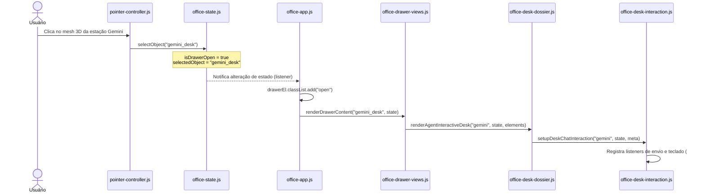

# Painéis existentes (2026-10-19, commit 152b06f)

Documento gerado na execução da história [00.02](../../02-epics/EP-00-auditoria/00.02-mapa-paineis.md).
Mapeia a arquitetura real de painéis e gavetas (drawers) no escritório virtual e sua relação com a interface principal.

## 1. Tabela de Painéis do Escritório Virtual

Todos os painéis do escritório compartilham o mesmo container lateral DOM (`#officeDrawer` em `ui/public/office.html:150-160`), controlado pelo estado global `officeState` (`ui/public/js/office-state.js`). Apenas um painel pode estar aberto por vez no modelo atual.

| Painel / Estação | Gatilho 3D | Gatilho 2.5D | Ação no Estado | Renderizador | Fonte de Dados | Evidência |
|---|---|---|---|---|---|---|
| **Estação Gemini** | Clique no mesh `gemini_desk` ou `war_room_gemini_station` | Interação com objeto `gemini_desk` | `officeState.selectObject("gemini_desk")` | `renderDrawerContent` (`case "gemini_desk"`) & `renderAgentInteractiveDesk` | API `/api/agents/active`, chat local via `fetch('/api/chat')` | `office-drawer-views.js:46`, `office-desk-dossier.js:12` |
| **Estação Claude** | Clique no mesh `claude_desk` ou `war_room_claude_station` | Interação com objeto `claude_desk` | `officeState.selectObject("claude_desk")` | `renderDrawerContent` (`case "claude_desk"`) & `renderAgentInteractiveDesk` | API `/api/agents/active`, sessões via `tools/import-claude-code-chats` | `office-drawer-views.js:37`, `office-desk-interaction.js:70` |
| **Estação OpenCode** | Clique no mesh `opencode_desk` ou `war_room_opencode_station` | Interação com objeto `opencode_desk` | `officeState.selectObject("opencode_desk")` | `renderDrawerContent` (`case "opencode_desk"`) & `renderAgentInteractiveDesk` | API `/api/agents/active`, endpoint local porta 63186 | `office-drawer-views.js:55`, `office-desk-dossier.js:30` |
| **DAI HQ / Orquestração** | Clique na mesa `war_room_table_console`, `war_room_main_panel` ou `orch_core` | Interação com terminal central | `officeState.selectObject("war_room_main_panel")` ou `openWarRoomDrawer(tab)` | `renderDrawerContent` & `getOrchestrationDrawerData` | API `/api/orchestration/state`, `/api/orchestration/events` | `office-orchestration-panel.js:16`, `office-3d-controls.js:60` |
| **Datacenter / Servidores** | Clique no mesh `server_rack` | Interação com rack de servidores | `officeState.selectObject("server_rack")` | `renderDrawerContent` (`case "server_rack"`) | APIs `/api/deploy/config`, `/api/deploy/history` | `office-drawer-views.js:80-95` |
| **Diário / Arquivo** | Clique no mesh `file_cabinet` | Interação com gaveteiro de arquivos | `officeState.selectObject("file_cabinet")` | `renderDrawerContent` (`case "file_cabinet"`) | API `/api/project/:slug/journal` | `office-drawer-views.js:18-28` |
| **Quadro Branco (Scrum)** | Clique no mesh `whiteboard` | Interação com lousa | `officeState.selectObject("whiteboard")` | `renderDrawerContent` (`case "whiteboard"`) | API `/api/project/:slug/scrum` | `office-drawer-views.js:30-35` |

## 2. Sequência: Abertura da Estação Gemini

## 3. Matriz de Foco e Conflito de Teclado (WASD / Câmera)

| Listener de Teclado | Arquivo e Linha | Escuta Teclas | Guarda de Campo de Texto | Risco de Conflito ao Digitar |
|---|---|---|---|---|
| `avatar-movement.js` | Linhas 24-25, 35-36 | `W`, `A`, `S`, `D`, Setas, `Shift` | `activeTag === "input" \|\| activeTag === "textarea"` | **Médio**: Se o foco for para um elemento `contenteditable` ou botão, as teclas movem o avatar |
| `office-shortcuts.js` | Linhas 5-7 | `1`, `2`, `3`, `M`, `C`, `Esc` | `activeTag === "input" \|\| activeTag === "textarea" \|\| isContentEditable` | **Baixo**: Guarda estrita implementada |
| `browser-screen.js` | Linhas 145-146 | `Enter` | Específico do `#monitorBrowserUrl` | **Nenhum**: Listener local |
| `office-desk-interaction.js` | Linha 142 | `Enter` (com/sem `Shift`) | Específico do `#deskChatInput` | **Nenhum**: Listener local |

## 4. Persistência de Estado por Painel

No código inspecionado:
- O estado de abertura do drawer (`isDrawerOpen`) **não é salvo no localStorage** (`office-state.js:160-173`). Ao recarregar a página (`F5`), o drawer sempre inicia fechado.
- As mensagens trocadas no chat do drawer (`office-desk-interaction.js`) **ficam apenas no DOM em memória**. Se o drawer for fechado e reaberto, ou se a página for recarregada, as mensagens do mini-chat da mesa são perdidas (ao contrário do chat universal em `chat-store.js` que persiste rascunhos e histórico por projeto).

## 5. Equivalência entre Painéis do Escritório e Módulos Principais

| Painel do Escritório | Equivalente na Interface Principal | Relação Arquitetural | Evidência |
|---|---|---|---|
| Chat da Estação (Gemini/Claude) | Chat Universal (`modules/chat.js`) | **Duplicação Isolada**: O escritório tem implementação própria simplificada em `office-desk-interaction.js` (apenas envia POST para `/api/chat`), sem SSE nem persistência | `office-desk-interaction.js:35-65` vs `modules/chat.js` |
| Orquestração DAI HQ | Central de Orquestração (`overview.html`) | **Parcialmente Compartilhado**: Ambos consultam `/api/orchestration/state`, mas renderizadores de DOM são distintos | `office-orchestration-panel.js` vs `overview.html` |
| Datacenter / Deploy | Painel de Deploy (`deploy.html`) | **Duplicação de UI**: Ambos consomem `/api/deploy/*`, mas com templates HTML diferentes | `office-drawer-views.js:80` vs `deploy.html` |
| Diário de Bordo | Diário (`diario.html`) | **Duplicação de UI**: Ambos consomem `/api/project/:slug/journal` | `office-drawer-views.js:20` vs `diario.html` |

## 6. Consequências para o Window Manager (EP-01)

1. **Substituição do Drawer Único:** O `#officeDrawer` monolítico deve ser envelopado ou substituído pelo Window Manager, permitindo que Estação Gemini, DAI HQ e Datacenter fiquem abertos simultaneamente.
2. **Reuso do Chat Universal:** A história `01.02` deve plugar o componente real `modules/chat.js` no container da Estação Gemini em vez de usar `office-desk-interaction.js`.
3. **Trava de Foco:** O Window Manager precisa ativar uma camada de `pointer-lock` ou captura de foco que suspenda `avatar-movement.js` sempre que uma janela flutuante estiver ativa.
