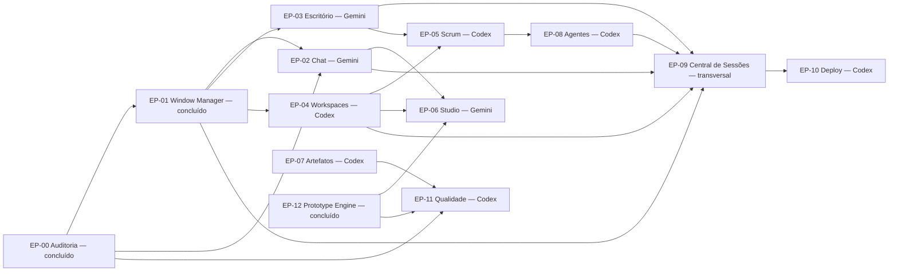

# Mapa de dependências

Ordem sugerida, não obrigatória. Uma seta indica que o destino usa algo entregue pela origem.

## Trilhas de execução

| Chat | Sequência principal | Esperas externas |
|---|---|---|
| Gemini / Antigravity | EP-02 → EP-03 → EP-06 → EP-09 | EP-06 espera EP-04; consumidores visuais do EP-09 esperam contratos de EP-08 |
| Codex | EP-04 → EP-05/EP-07 → EP-08/EP-11 → EP-10 | EP-05.06 espera EP-03.04; EP-10 espera EP-09 |

O EP-09 é transversal: a implementação só começa após definição de ownership dos arquivos. O pacote arquitetural já especifica os contratos, mas não altera a divisão atual das frentes.

As barras indicam frentes que podem trocar de ordem conforme o desbloqueio, mas o Codex mantém somente uma história de implementação em andamento por vez.

## Dependências entre histórias críticas

| História | Depende de | Motivo |
|---|---|---|
| 01.01 | 00.01, 00.02 | Registro precisa conhecer os módulos e painéis reais |
| 01.02 | 01.01 | Adaptador registra estações no registro |
| 01.03 | 01.02 | Foco só existe depois que há janelas adaptadas |
| 01.05 | 01.04 | Barra de tarefas exibe janelas minimizadas |
| 01.08 | 01.06 | Persistência salva posição e tamanho |
| 01.10 | 01.08, 04.01 | Workspace salva layout dentro de um projeto |
| 02.03 a 02.05 | 01.02, 02.02 | Apresentações são janelas sobre o mesmo modelo de chat |
| 03.03 | 01.02 | Estações abrem janelas pelo Window Manager |
| 05.06 | 03.04, 05.02 | Telão projeta o Kanban já configurado |
| 09.05 | 09.01 | Indicadores dependem de execuções separadas de eventos |
| 10.04 | 08.05 | Deploy reaproveita o fluxo de aprovação |
| 11.02 | 00.04 | Estados de teste partem do baseline |

## Itens transversais
Segurança, acessibilidade e Design System (HAR-019, HAR-002) se aplicam a todas as histórias como requisitos não funcionais do [template](../_templates/story-template.md).
