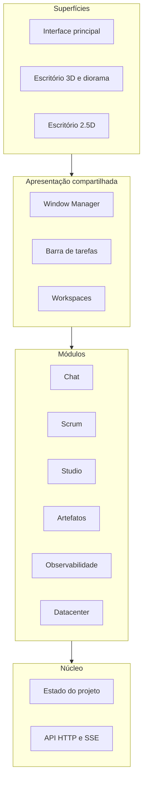

# Arquitetura-alvo

Complementa a [arquitetura-alvo da Fase 0](../03-target-architecture.md) com a camada de apresentação compartilhada.

## Camadas

## Princípios
- **Módulo não sabe onde está.** Um módulo recebe um container e um contexto (`projectId`, `resourceId`). Lateral, flutuante, acoplado ou maximizado é decisão do Window Manager.
- **Um estado por recurso.** A mesma conversa aberta em duas superfícies lê a mesma fonte; não há cópia.
- **Superfície só traduz entrada.** Clicar numa estação ou num item de menu vira o mesmo comando `open(moduleId, resourceId)`.
- **Foco é explícito.** Quando uma janela tem foco, a câmera e o avatar não recebem teclado.
- **Nada de sucesso fictício.** Indicadores só mudam com confirmação da operação.

## Contrato conceitual
Definido no [EP-01](../02-epics/EP-01-window-manager/README.md#contratos-iniciais). Só será implementado depois que o EP-00 confirmar como os módulos são representados hoje.

## Decisões pendentes
| Tema | Registrar em |
|---|---|
| Onde fica o estado das janelas (store global ou módulo próprio) | ADR-001 |
| Formato e versão do layout persistido | ADR-002 |
| Estratégia de foco entre DOM e canvas | ADR-003 |
