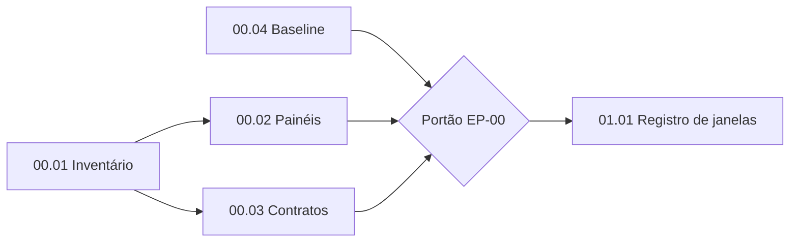

# EP-00: Auditoria e arquitetura existente

[Voltar ao índice](../../00-index.md)

## Objetivo
Estabelecer o estado real da aplicação antes de alterar a arquitetura.

## Execução
- Mapear rotas, componentes, painéis, serviços, estados, persistência, APIs e integrações.
- Identificar o componente responsável pelos painéis da Estação Gemini, DAI HQ e Datacenter.
- Executar os testes existentes (`npm test`, `npm run check`, `npm run types`) e registrar o resultado.
- Registrar capturas de referência dos três modos do escritório e da interface principal.

## Entrega
Inventário técnico, mapa de dependências, decisões arquiteturais e baseline de testes. Os resultados atualizam [current-state](../../01-architecture/current-state.md) e geram ADRs em `03-decisions/`.

## Aceite
- Nenhuma conclusão arquitetural sem evidência no código (arquivo e linha).
- Nenhuma alteração funcional nesta etapa.

## Histórias
| ID | Título | Depende de |
|---|---|---|
| [00.01](00.01-inventario.md) | Inventário de componentes, rotas e serviços | nenhuma |
| [00.02](00.02-mapa-paineis.md) | Mapeamento dos painéis existentes | 00.01 |
| [00.03](00.03-contratos-permissoes.md) | Contratos compartilhados e permissões | 00.01 |
| [00.04](00.04-baseline-testes.md) | Baseline de testes e regressão visual | nenhuma |

## Ponto de partida
A Fase 0 já produziu um inventário em [01-current-state-audit](../../01-current-state-audit.md). O EP-00 o completa com o escritório, os painéis e as permissões, que ficaram de fora.

## Execução pelo agente
Cada história é um roteiro executável. Entregue ao agente só o arquivo da história e este README.

00.01 e 00.04 podem rodar em paralelo. 00.02 e 00.03 usam a saída da 00.01.

### Convenções
- Comandos em PowerShell, na raiz do repositório.
- `git grep` só lê arquivos rastreados. Se `git status --short` mostrar arquivos novos (`??`) em `ui/` ou `tools/`, acrescente `--untracked` aos comandos.
- Saídas ficam em `docs/harness-evolution/01-architecture/audit/` e `04-test-plans/`.
- Toda afirmação cita `arquivo:linha`. O que não foi confirmado vai para a seção "Não verificado".
- Não copiar segredos, PIN ou conteúdo de `.env` para a documentação.

### Portão de aprovação
O EP-00 termina, e o EP-01 pode começar, quando:
- [x] As quatro saídas existem: [inventory.md](../../01-architecture/audit/inventory.md), [panels.md](../../01-architecture/audit/panels.md), [contracts.md](../../01-architecture/audit/contracts.md), [TP-00-baseline.md](../../04-test-plans/TP-00-baseline.md).
- [x] `git status --short` não mostra alterações do EP-00 fora de `docs/harness-evolution/`.
- [x] [current-state](../../01-architecture/current-state.md) foi atualizado: hipóteses confirmadas viram fatos com evidência.
- [x] As 5 perguntas abertas de current-state foram integralmente respondidas com evidências de código.
- [x] Pronto para início do EP-01 (Window Manager).
