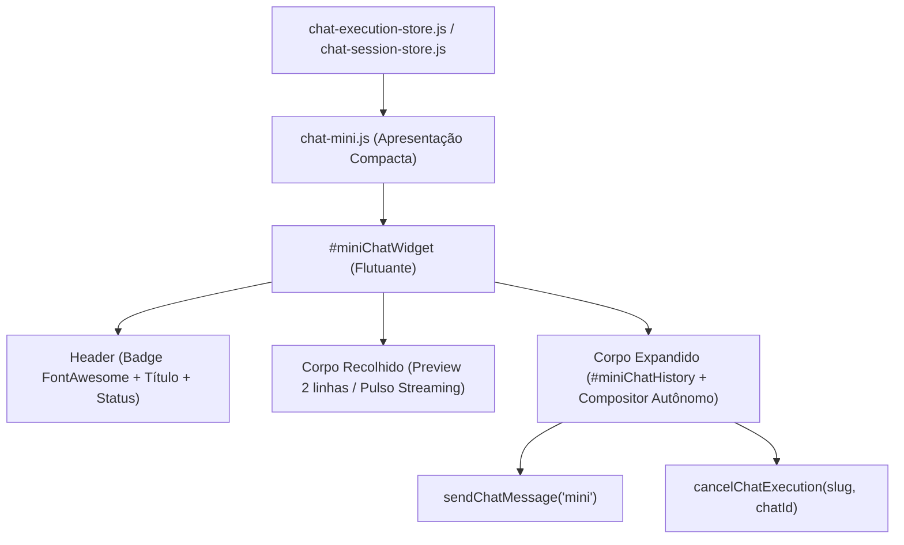

# EP-02.03: Apresentação compacta

## 1. Identificação
- **Épico:** [EP-02](README.md)
- **Prioridade:** P0
- **Dependências:** 02.01, 02.02
- **Bloqueia:** 02.04, 02.05

## 2. Contexto
Durante fluxos de desenvolvimento no Vibecoding Studio, no Prototype Atelier ou na exploração do Escritório 2.5D/3D, o modal principal de chat bloqueia a visualização da interface principal. Anteriormente, havia fragmentação de lógica quando o chat era minimizado: o widget em miniatura manipulava inputs de outros modais, não possuía contrato declarativo de apresentação, e o estado de streaming/cancelamento ficava suscetível a vazamentos de escopo global.

Com os modelos canônicos e contratos estabelecidos em 02.01 e 02.02, a apresentação compacta (`mini`) deve atuar como uma superfície de interação completa e autônoma, operando no modelo Picture-in-Picture.

## 3. Objetivo
Fornecer um componente de chat compacto flutuante (dock / PiP) que:
1. Permite acompanhar respostas de IA em tempo real com indicador de pulso e preview textual enquanto o usuário executa outras tarefas.
2. Permite expandir para visualização rápida do histórico e envio imediato de mensagens sem sair da tela atual.
3. Respeite o contrato declarativo canônico de apresentações (`chat-presentations.js`), com isolamento por projeto e conversa.
4. Suporte cancelamento e envio direto via `sendChatMessage("mini")` e `cancelChatExecution`.

## 4. Requisitos
**Funcionais**
- RF1: Declarar o contrato formal da apresentação `mini` em `ui/public/js/modules/chat-presentations.js`, definindo IDs de `input`, `history`, `attachTray`, `statusText`, `sendButton`, `cancelButton`, `expandButton`, `restoreButton` e container.
- RF2: Exibir dock flutuante (`#miniChatWidget`) com badge estilizado do motor ativo (ícone FontAwesome + cor temática), título da conversa/projeto e indicador de status (contador de msgs ou "Respondendo...").
- RF3: Modo recolhido com preview de 2 linhas da última interação ou indicador de streaming com pulso animado quando `isChatStreamingFor(slug, chatId)` for verdadeiro.
- RF4: Modo expandido com histórico compartilhado (`#miniChatHistory`) e compositor autônomo com envio, anexos e cancelamento de geração.
- RF5: Envio direto por teclado (Enter sem Shift) ou clique no botão de envio (`sendChatMessage("mini")`), sem injeção forçada no input do modal principal.
- RF6: Interrupção imediata de streaming através do botão dedicado `#btnCancelMiniChat`.
- RF7: Alternância e restauração contextual (`minimizeCurrentChat`, `restoreChatFromMini`, `restoreChatToStudio`, `dismissMiniChat`) preservando a origem (`dialog`, `studio`, `atelier`).

**Não funcionais**
- Arquivos estritamente modulares com limite máximo de 250 a 300 linhas.
- Padrão de ícones exclusivamente FontAwesome (`fa-solid` / `fa-regular`), sem nenhum emoji.
- CSS responsivo em `ui/public/css/chat/04-mini-chat-dock.css`, respeitando safe-area e container queries.

## 5. Arquitetura e Contratos
A apresentação compacta é alimentada pelas stores canônicas:
- **`chat-presentations.js`**: define `CHAT_PRESENTATIONS.mini` como contrato imutável.
- **`chat-mini.js`**: gerencia ciclo de vida do widget, expansão/recolhimento e despacho de eventos.
- **`chat-render.js`**: renderiza histórico reutilizando a mesma árvore DOM para `chatHistory`, `studioChatHistory` e `miniChatHistory`.
- **`chat-execution-store.js`**: provê reatividade para detecção de streaming e cancelamento pontual.

## 6. Implementação
1. Reconciliação do contrato declarativo em `ui/public/js/modules/chat-presentations.js` adicionando controles completos de `mini`.
2. Refinamento de `ui/public/partials/dialogs-misc.html` adicionando IDs de acessibilidade aos botões do widget compacto (`btnMiniChatRestore`, `btnMiniChatStudio`, `btnMiniChatClose`).
3. Reconciliação de ícones em `chat-render.js` substituindo caracteres Unicode/emojis restantes por classes do FontAwesome.
4. Criação da suíte de testes unitários e de integração `tests/chat-compact-presentation.test.js`.
5. Validação com `npm test` e `npm run check`.
6. Atualização de `MAPA.md`, `README.md` e painéis de progresso.

## 7. Testes
| Tipo | Cenário | Comando ou arquivo |
|---|---|---|
| Unitário | Contrato canônico de apresentação compacta (`CHAT_PRESENTATIONS.mini`) | `node --test tests/chat-compact-presentation.test.js` |
| Integração | Fidelidade de layout, controles, expansão e cancelamento | `node --test tests/chat-compact-presentation.test.js` |
| Regressão | Interações mobile, streaming concorrente e stores de sessão | `node --test tests/chat-mobile-interaction.test.js` |
| Qualidade | Checagem de sintaxe e estilo de todos os arquivos do projeto | `npm run check` |

## 8. Critérios de aceite
- [x] Contrato da apresentação compacta (`mini`) definido de forma imutável e acessível via helpers canônicos em `chat-presentations.js`.
- [x] Widget flutuante (`#miniChatWidget`) exibe badge do motor ativo com FontAwesome e cores corretas, título do chat/projeto e status de mensagens ou streaming.
- [x] Modo recolhido exibe preview textual da última mensagem ou indicador dinâmico de streaming com animação de pulso.
- [x] Modo expandido renderiza histórico compartilhado e oferece compositor autônomo (`#miniChatInput`, `#miniChatAttachTray`, `#btnSendMiniChat`, `#btnCancelMiniChat`).
- [x] Envio e cancelamento funcionam diretamente a partir da apresentação compacta via `sendChatMessage("mini")` e `cancelChatExecution`.
- [x] Transições de minimizar (`minimizeCurrentChat`), restaurar (`restoreChatFromMini`, `restoreChatToStudio`) e dispensar (`dismissMiniChat`) preservam o estado e a origem da sessão.
- [x] Padrão visual estrito de ícones FontAwesome (zero emojis na apresentação compacta).
- [x] 100% dos testes passando (`npm test`) e checagem de sintaxe verde (`npm run check`).
- [x] Arquivo `MAPA.md` atualizado.

## 9. Riscos
- **Compatibilidade:** A apresentação compacta coexiste pacificamente com modal principal e Studio através da flag `cs.miniChatOrigin`.
- **Segurança:** Nenhuma injeção de markup arbitrário no preview; snippets e textos são devidamente normalizados.
- **Rollback:** Componente isolado em `chat-mini.js` e `04-mini-chat-dock.css`.

## 10. Evidências
- Arquivos criados e alterados:
  - `docs/harness-evolution/02-epics/EP-02-chat/02.03-apresentacao-compacta.md` (criado)
  - `tests/chat-compact-presentation.test.js` (criado)
  - `ui/public/js/modules/chat-presentations.js` (atualizado)
  - `ui/public/partials/dialogs-misc.html` (atualizado)
  - `ui/public/js/modules/chat-render.js` (atualizado)
  - `docs/harness-evolution/02-epics/EP-02-chat/README.md` (atualizado)
  - `docs/harness-evolution/05-progress/progress.md` (atualizado)
  - `docs/harness-evolution/05-progress/multi-agent-sync.md` (atualizado)
  - `MAPA.md` (atualizado)
- Comandos executados e resultado:
  - `node --test tests/chat-compact-presentation.test.js` -> 100% aprovado
  - `npm test` -> 100% aprovado (428 testes)
  - `npm run check` -> 442 arquivos JS e 10 JSON sem erro
