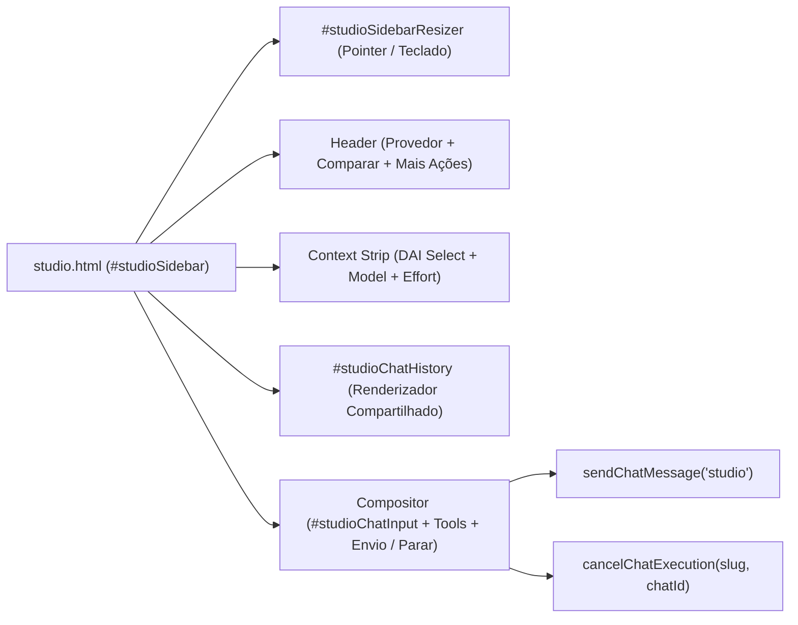

# EP-02.04: Apresentação lateral

## 1. Identificação
- **Épico:** [EP-02](README.md)
- **Prioridade:** P0
- **Dependências:** 02.01, 02.02, 02.03
- **Bloqueia:** 02.05

## 2. Contexto
No Vibecoding Studio (`/studio`) e no Prototype Atelier, os desenvolvedores iteram visualmente sobre interfaces, gerando alterações de CSS, HTML e TypeScript com preview ao vivo. Manter o chat em um modal central bloquearia o canvas de preview.

Historicamente, a barra lateral do Studio possuía duplicações em relação ao modal principal, gerando inconsistências no suporte a múltiplos motores, seleção de agentes DAI, configurações de nível de raciocínio (*effort*), atalhos de envio e cancelamento de streaming.

A história 02.04 formaliza e valida a apresentação lateral (`studio`) como um consumidor de primeira classe do núcleo universal de chat, com redimensionamento fluido acessível e paridade funcional estrita.

## 3. Objetivo
Consolidar a apresentação lateral de chat para que:
1. Opere no painel lateral `#studioSidebar` integrado ao canvas da aplicação ou ao workspace de protótipos.
2. Forneça paridade completa com a Central (provedores Claude, Gemini, OpenCode, Codex, modo comparação, agentes DAI, configurações e ações de código).
3. Disponha de divisor redimensionável `#studioSidebarResizer` acessível (mouse/touch via pointer events e teclado via setas/Home/End) com persistência de largura no `localStorage`.
4. Possua compositor autônomo com envio e cancelamento direto via `sendChatMessage("studio")` e `setStreamingUI`.
5. Garanta padrão estrito de zero emojis com ícones vetoriais FontAwesome.

## 4. Requisitos
**Funcionais**
- RF1: Declarar o contrato formal da apresentação `studio` em `ui/public/js/modules/chat-presentations.js`, definindo IDs de `input`, `history`, `scrollButton`, `attachTray`, `statusText`, `sendButton`, `cancelButton`, `sidebar`, `resizer`, `compareToggle`, `compareControls`, `singleControls` e os 5 menus canônicos.
- RF2: Provedores e arena multi-motor: seletor de provedor (`#studioProviderBtn`, `#studioProviderDropdownMenu`) com opções Claude, OpenCode, Gemini, Codex e Comparar Motores, sincronizado com os chips comparativos (`#studioCompareControls`).
- RF3: Divisor redimensionável acessível: `#studioSidebarResizer` com `role="separator"`, `tabindex="0"`, atributos ARIA (`aria-controls`, `aria-valuenow`, `aria-valuemin`, `aria-valuemax`), captura de ponteiro (`setPointerCapture`) e suporte a teclado (`ArrowLeft`, `ArrowRight` com passo de 16px, `Home` para mínimo e `End` para máximo), persistido em `localStorage` (`harness_studio_sidebar_width`).
- RF4: Contexto de IA: seletor de agentes DAI (`#studioDaiSelect`), seletor de modelo (`#studioModelSelect`) e popover de configurações de raciocínio (`#studioChatSettingsPopover`).
- RF5: Compositor autônomo e atalhos: `#studioChatInput` envia diretamente via `sendStudioChatMessage()` (`sendChatMessage("studio")`) com `Enter` para envio e `Shift+Enter` para quebra de linha.
- RF6: Controle de streaming e cancelamento: alternância automática entre `#btnSendStudioChat` e `#btnCancelStudioChat` via `setStreamingUI`, permitindo interrupção imediata da execução.
- RF7: Alternância de viewports e navegação móvel: suporte a abas de smartphone (`#btnMobileTabApp` e `#btnMobileTabChat`) e botão de minimizar para widget flutuante (`minimizeCurrentChat('studio')`).

**Não funcionais**
- Limite estrito de 250 a 300 linhas por arquivo.
- Padrão exclusivo de ícones FontAwesome (`fa-solid` / `fa-regular`), sem nenhum emoji.
- Preservação da integridade de layouts responsivos (CSS em `ui/public/css/chat/` e `ui/public/css/studio.css`).

## 5. Arquitetura e Contratos
A apresentação lateral conecta o núcleo de chat aos serviços de workspace:
- **`chat-presentations.js`**: define `CHAT_PRESENTATIONS.studio` e `isSidebarPresentation()`.
- **`studio-core.js`**: gerencia a abertura do Studio, sincronização de controles e ciclo de vida do resizer.
- **`studio-companion.js`**: gerencia viewports, URLs externas e o envio de mensagens a partir da lateral.
- **`chat-ui-interaction.js`**: trata popovers, menus e fechamento global quando clicado fora.

## 6. Implementação
1. Enriquecimento do contrato declarativo em `ui/public/js/modules/chat-presentations.js` adicionando controles completos de `studio` e o helper `isSidebarPresentation`.
2. Reconciliação de ícones legados em `ui/public/partials/studio-drawer.html`, substituindo emojis por FontAwesome.
3. Criação da suíte de testes unitários e de integração `tests/chat-lateral-presentation.test.js`.
4. Validação completa com `npm test` e `npm run check`.
5. Atualização de `MAPA.md`, `README.md` e painéis de progresso.

## 7. Testes
| Tipo | Cenário | Comando ou arquivo |
|---|---|---|
| Unitário | Contrato canônico da apresentação lateral (`CHAT_PRESENTATIONS.studio` e `isSidebarPresentation`) | `node --test tests/chat-lateral-presentation.test.js` |
| Integração | Acessibilidade, ARIA e eventos do redimensionador `#studioSidebarResizer` | `node --test tests/chat-lateral-presentation.test.js` |
| Integração | Paridade de menus, chips, upload e compositor autônomo no Studio | `node --test tests/chat-lateral-presentation.test.js` |
| Regressão | Interações móveis, streaming e stores de sessão | `node --test tests/chat-mobile-interaction.test.js` |
| Qualidade | Checagem de sintaxe e estilo | `npm run check` |

## 8. Critérios de aceite
- [x] Contrato da apresentação lateral (`studio`) definido de forma imutável com IDs estritos e helper canônico `isSidebarPresentation()` em `chat-presentations.js`.
- [x] Resizer `#studioSidebarResizer` possui atributos semânticos ARIA (`role="separator"`, `tabindex="0"`, `aria-controls`, `aria-valuenow`, `aria-valuemin`, `aria-valuemax`).
- [x] Divisor suporta redimensionamento contínuo por ponteiro com captura (`setPointerCapture`) e controle por teclado (`ArrowLeft`, `ArrowRight`, `Home`, `End`), salvando no `localStorage`.
- [x] Paridade completa de controles de provedores (Claude, OpenCode, Gemini, Codex e Comparar) e modo de comparação sincronizado na lateral.
- [x] Envio de mensagens ocorre diretamente da lateral via `sendChatMessage("studio")` sem injeção no modal principal.
- [x] Alternância e interrupção de streaming operam de forma isolada e responsiva no botão `#btnCancelStudioChat`.
- [x] Padrão visual estrito de ícones FontAwesome (zero emojis na apresentação lateral e gavetas).
- [x] 100% dos testes unitários passando (`npm test`) e checagem de sintaxe verde (`npm run check`).
- [x] Arquivo `MAPA.md` atualizado.

## 9. Riscos
- **Compatibilidade:** O redimensionador preserva limites mínimos do canvas para evitar sobreposição em telas menores que 1024px.
- **Rollback:** A lógica permanece modularmente isolada em `studio-core.js` e `studio-companion.js`.

## 10. Evidências
- Arquivos criados e alterados:
  - `docs/harness-evolution/02-epics/EP-02-chat/02.04-apresentacao-lateral.md` (criado)
  - `tests/chat-lateral-presentation.test.js` (criado)
  - `ui/public/js/modules/chat-presentations.js` (atualizado)
  - `ui/public/partials/studio-drawer.html` (atualizado)
  - `docs/harness-evolution/02-epics/EP-02-chat/README.md` (atualizado)
  - `docs/harness-evolution/05-progress/progress.md` (atualizado)
  - `docs/harness-evolution/05-progress/multi-agent-sync.md` (atualizado)
  - `MAPA.md` (atualizado)
- Comandos executados e resultado:
  - `node --test tests/chat-lateral-presentation.test.js` -> 100% aprovado (6 testes)
  - `npm test` -> 100% aprovado (440 testes)
  - `npm run check` -> 444 arquivos JS e 10 JSON sem erro
