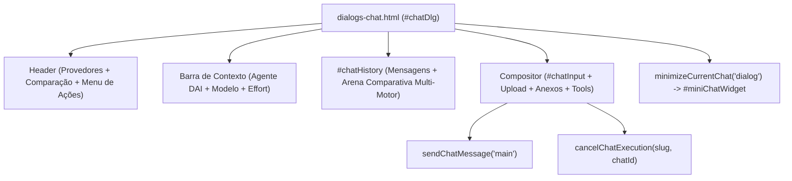

# EP-02.05: Apresentação completa

## 1. Identificação
- **Épico:** [EP-02](README.md)
- **Prioridade:** P0
- **Dependências:** 02.01, 02.02, 02.03, 02.04
- **Bloqueia:** 02.06, 02.07, 02.08

## 2. Contexto
A Central de Conversas é o ponto de entrada primário do Harness Leca para planejamento, desenvolvimento com agentes especializados DAI e sessões interativas complexas. Ela se manifesta através do diálogo em tela cheia/modal `#chatDlg` (`ui/public/partials/dialogs-chat.html`).

Anteriormente mapeado no inventário 02.01, o modal principal misturava comandos globais ad-hoc com listeners dispersos. Com as apresentações compacta (02.03) e lateral (02.04) estabilizadas sobre os modelos de mensagens de 02.02, a apresentação completa (`main`) deve consolidar todo o conjunto de funcionalidades ricas do chat:
- Arena de comparação simultânea entre múltiplos motores (Claude, Gemini, OpenCode, Codex).
- Seleção e chaveamento de agentes DAI com carregamento de instruções e memórias.
- Raciocínio interno (*thinking*) com detalhes colapsáveis e medição de tempo de resposta.
- Renderização de blocos de código acionáveis com cópia e aplicação imediata no projeto.
- Minimização bidirecional para o widget flutuante (Picture-in-Picture) e alternância fluida para o Vibecoding Studio.

## 3. Objetivo
Consolidar a apresentação completa (`main`) de chat para que:
1. Opere no container modal `#chatDlg` (`dialogs-chat.html`) com inicialização reativa via `openInteractiveChat()`.
2. Forneça cabeçalho de controle com seletor de motores (Claude, Gemini, OpenCode, Codex e Comparar), atalho para modo comparação, menu de 8 ações e retorno ao dashboard.
3. Disponibilize arena de comparação multi-motor com timers individuais, badges de status (*thinking*, *connecting*, *answering*) e cancelamento granular por motor.
4. Suporte upload de múltiplos arquivos, seleção de agentes DAI (`#modalDaiSelect`), seletor de modelo (`#chatModelSelect`) e controle de *effort* (`#chatSettingsPopover`).
5. Garanta envio e cancelamento direto via compositor autônomo (`#chatInput`, `#btnSendChat`, `#btnCancelChat`), respeitando a trava de streaming isolada por projeto e conversa.
6. Respeite o padrão estrito de zero emojis com ícones FontAwesome e limite de 300 linhas por módulo.

## 4. Requisitos
**Funcionais**
- RF1: Declarar o contrato formal da apresentação `main` em `ui/public/js/modules/chat-presentations.js`, definindo IDs de `input`, `history`, `scrollButton`, `attachTray`, `statusText`, `sendButton`, `cancelButton`, `dialog`, `compareToggle`, `compareControls`, `singleControls`, `fileInput`, `dashboardButton` e os 5 menus canônicos.
- RF2: Provedores e arena multi-motor: seletor de provedor (`#chatProviderBtn`, `#providerDropdownMenu`) com opções Claude, OpenCode, Gemini, Codex e Comparar Motores, sincronizado com os chips comparativos (`#compareControls`).
- RF3: Grade comparativa e estados de motor: suporte a renderização de colunas por motor com cronômetro em tempo real, details colapsável de raciocínio interno (*thinking*), placeholders de conexão e cancelamento individual via `cancelEngineStream()`.
- RF4: Contexto de IA: seletor de agentes DAI (`#modalDaiSelect`), seletor de modelos (`#chatModelSelect`), chips de agentes (`#modalDaiChips`) e popover de configurações de raciocínio (*effort* em `#effortToggle`).
- RF5: Compositor com suporte a anexos: `#chatInput` com suporte a `Enter` (envio), `Shift+Enter` (nova linha), paste de arquivos/imagens e bandeja `#chatAttachTray`.
- RF6: Controle de streaming e cancelamento: alternância automática entre `#btnSendChat` e `#btnCancelChat` via `setStreamingUI`, acionando `cancelChatExecution(slug, chatId)`.
- RF7: Minimização e transições: suporte a minimizar para o dock flutuante (`minimizeCurrentChat('dialog')`) preservando rascunhos e estado da conversa ativa, e abertura no Studio (`toggleStudioMode(true)`).

**Não funcionais**
- Limite estrito de 250 a 300 linhas por arquivo.
- Padrão exclusivo de ícones FontAwesome (`fa-solid` / `fa-regular`), sem nenhum emoji.
- Layouts responsivos suportados em `ui/public/css/chat/` e `chat-mobile.css`.

## 5. Arquitetura e Contratos
A apresentação completa é a base da Central de Conversas:
- **`chat-presentations.js`**: define `CHAT_PRESENTATIONS.main` e `isMainPresentation()`.
- **`chat-stream-ui.js`**: orquestra abertura do diálogo (`openInteractiveChat`), envio, status e interface de streaming.
- **`chat-render.js`**: renderiza histórico em `#chatHistory`, incluindo grade comparativa e mensagens editoriais.
- **`chat-code-actions.js`**: provê cópia e aplicação de blocos de código extraídos do Markdown.

## 6. Implementação
1. Enriquecimento do contrato declarativo em `ui/public/js/modules/chat-presentations.js` adicionando controles completos de `main` e o helper `isMainPresentation`.
2. Validação da marcação canônica em `ui/public/partials/dialogs-chat.html` com verificação de zero emojis.
3. Criação da suíte de testes unitários e de integração `tests/chat-complete-presentation.test.js`.
4. Validação completa com `npm test` e `npm run check`.
5. Atualização de `MAPA.md`, `README.md` e painéis de progresso.

## 7. Testes
| Tipo | Cenário | Comando ou arquivo |
|---|---|---|
| Unitário | Contrato canônico da apresentação completa (`CHAT_PRESENTATIONS.main` e `isMainPresentation`) | `node --test tests/chat-complete-presentation.test.js` |
| Integração | Fidelidade de layout, menus, chips comparativos e popover de settings | `node --test tests/chat-complete-presentation.test.js` |
| Integração | Compositor, anexos, streaming e cancelamento | `node --test tests/chat-complete-presentation.test.js` |
| Regressão | Interações móveis, streaming concorrente e apresentações compacta/lateral | `node --test tests/chat-mobile-interaction.test.js` |
| Qualidade | Checagem de sintaxe e estilo | `npm run check` |

## 8. Critérios de aceite
- [x] Contrato da apresentação completa (`main`) definido de forma imutável com IDs estritos e helper canônico `isMainPresentation()` em `chat-presentations.js`.
- [x] Marcação em `dialogs-chat.html` possui todos os controles, menus, popovers e arena comparativa de 4 motores (Claude, OpenCode, Gemini, Codex).
- [x] Histórico renderiza mensagens no container `#chatHistory` com suporte a grid comparativa, timers e details de *thinking*.
- [x] Compositor opera de forma autônoma via `#chatInput`, com suporte a upload de arquivos e ações rápidas.
- [x] Alternância e cancelamento de streaming funcionam pontualmente via `#btnCancelChat` e `cancelChatExecution`.
- [x] Transições para widget compacto (`minimizeCurrentChat('dialog')`) preservam rascunho e sessão sem vazar estado.
- [x] Padrão visual estrito de ícones FontAwesome (zero emojis na apresentação completa).
- [x] 100% dos testes unitários passando (`npm test`) e checagem de sintaxe verde (`npm run check`).
- [x] Arquivo `MAPA.md` atualizado.

## 9. Riscos
- **Compatibilidade:** A apresentação completa compartilha as mesmas stores de sessão e execução que o Studio e o Mini Widget.
- **Rollback:** A lógica permanece estritamente modularizada nos submódulos de chat.

## 10. Evidências
- Arquivos criados e alterados:
  - `docs/harness-evolution/02-epics/EP-02-chat/02.05-apresentacao-completa.md` (criado)
  - `tests/chat-complete-presentation.test.js` (criado)
  - `ui/public/js/modules/chat-presentations.js` (atualizado)
  - `docs/harness-evolution/02-epics/EP-02-chat/README.md` (atualizado)
  - `docs/harness-evolution/05-progress/progress.md` (atualizado)
  - `docs/harness-evolution/05-progress/multi-agent-sync.md` (atualizado)
  - `MAPA.md` (atualizado)
- Comandos executados e resultado:
  - `node --test tests/chat-complete-presentation.test.js` -> 100% aprovado (6 testes)
  - `npm test` -> 100% aprovado (451 testes)
  - `npm run check` -> 448 arquivos JS e 10 JSON sem erro
