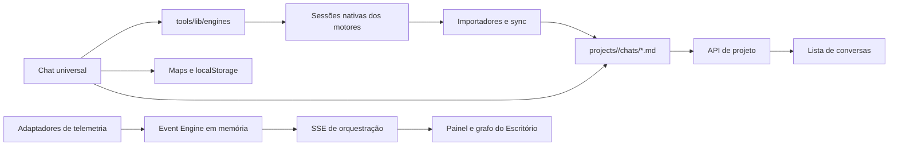

# Diagnóstico da arquitetura atual

## Resumo

O Harness já possui as peças necessárias para iniciar a Central, mas elas operam como modelos paralelos: conversa Markdown, sessão mantida no navegador, execução projetada em memória e permissão vinculada ao stream do Claude. A lacuna principal é um registro canônico persistente que una essas identidades sem apagar suas diferenças.

## Fluxos atuais

## Diagnóstico por requisito

| Requisito | Situação atual | Lacuna |
|---|---|---|
| Descoberta | Importadores para quatro motores; telemetria para três | Não há consulta unificada nem adaptador Codex no Event Engine |
| Consolidação | `ChatSession` no frontend e `ExecutionRecord` implícito | Identidades, proveniência e capacidades não convergem |
| Pesquisa | Conversas do projeto filtradas no navegador | Não pesquisa sessões nativas, todos os projetos ou atenção necessária |
| Navegação | Arquivo abre na Central; janela de chat pode abrir no Escritório | Falta um comando canônico de navegação por sessão |
| Retomada | Claude, Codex e OpenCode possuem mecanismos distintos | A UI não expressa retomada nativa, contextual ou indisponível |
| Workflow | Scrum e DAI possuem conceitos próprios | Não há estado de workflow vinculado à sessão |
| Falhas/bloqueios | Execuções aceitam falha; tarefas aceitam bloqueio | Não há regra persistente de atenção nem confirmação de recuperação |
| Notificações | Toasts e cartões locais | Não existe caixa central, preferência ou deduplicação |
| Aprovações | Pedidos do Claude vivem no stream do chat | Não há consulta global; fechar o chat nega o pedido |
| Escritório | Módulo `orchestration` e painel com quatro abas | Dados e ações ainda não usam um modelo de sessão comum |

## Inconsistências confirmadas

1. O Event Engine mantém histórico e projeções apenas em memória, apesar da decisão anterior mencionar persistência.
2. IDs como `claude-exec-<sessão>` são reutilizados entre coletas; a deduplicação por ID pode descartar mudanças posteriores.
3. Eventos de integração sem `sourceEventId` podem ocupar o buffer a cada heartbeat.
4. Sessões Gemini e OpenCode podem receber o projeto atualmente selecionado, ainda que a fonte não comprove essa associação.
5. O endpoint de capacidades é estático, não inclui Codex e não qualifica cancelamento por origem da execução.
6. O armazenamento de sessões por conversa é volátil e não é restaurado pelo estado ativo do navegador.
7. O formato Markdown guarda somente um par `agente`/`sessao`, insuficiente para uma conversa multi-motor.
8. O salvamento da interface trata Codex como Claude no metadado e no rótulo do assistente.
9. `nova`, `alterada` e `ok` representam extração de conhecimento, não execução ou workflow.
10. A operação assíncrona de rotina responde `completed` antes da conclusão real.

## Lacunas de baseline resolvidas em 2026-10-19

1. A colisão entre Claude e Gemini foi removida: `chat-store` preserva `(agente, sessionId)` e desambigua apenas nomes conflitantes.
2. Sessões Claude repetidas em workspaces diferentes são reconciliadas por fonte mais recente, tamanho e caminho lexical.
3. O Claude passou a reutilizar `killTree` de `proc-manager-core`; o teste no Windows encerra pai e descendentes sem deixar o runner aberto.

## Evidência de sincronização (2026-10-19)

- a migração aditiva recuperou 69 representações Claude antes sobrescritas e preservou as 71 representações Gemini.
- extração local e diário foram atualizados; o estado final registrou 180 conversas materializadas.
- OpenCode não encontrou sessão raiz associada ao projeto e ignorou 398 diretórios sem correspondência.
- repetição `--dry-run --no-extract`: Claude 0/0/109 e Gemini 0/0/71.
- a identidade materializada agora preserva motor e ID nativo; correspondência semântica permanece responsabilidade do registro canônico.

## Evidência do baseline de testes (2026-10-19)

- `tests/orchestration.test.js`: 6/6 aprovados.
- suíte completa: 468/468 aprovada.
- `tests/engines.claude.test.js`: 7/7 aprovados, incluindo encerramento da árvore no Windows.
- `npm run check`: aprovado para 456 arquivos JavaScript e 10 JSON.
- `npm run types`: vermelho por dívida de tipagem já existente, inclusive em contratos de orquestração.

## Direcionadores arquiteturais

- execução local e autocontida, sem broker ou banco externo;
- Node.js nativo e frontend com ES Modules sem bundler;
- leitura não destrutiva das fontes dos motores;
- compatibilidade com Markdown, sync e sessões já existentes;
- distinção explícita entre fato, observação, inferência e desconhecido;
- zero capacidades inventadas;
- arquivos e serviços futuros coesos e abaixo do teto arquitetural;
- novos elementos visuais exclusivamente com FontAwesome.

## Requisitos não funcionais propostos

| Dimensão | Meta de implementação |
|---|---|
| Atualização | Sessão controlada pelo Harness refletida em até 2 s; fonte passiva em até 15 s |
| Consulta | p95 local abaixo de 500 ms para 1.000 sessões e filtros combinados |
| Recuperação | Reinício do servidor sem perda de sessões/eventos confirmados já persistidos |
| Compatibilidade | Nenhum Markdown, layout ou ID nativo reescrito durante a migração inicial |
| Segurança | Fontes externas somente leitura; comandos limitados a ações catalogadas |
| Auditabilidade | Toda mudança de estado com origem, confiança, correlação e timestamp |
| Acessibilidade | Lista e Kanban operáveis por teclado e sem depender apenas de cor |

## Conclusão

A evolução deve introduzir uma camada de leitura operacional entre fontes e interfaces. Importadores continuam responsáveis por materializar históricos em Markdown; a Central passa a consultar um registro canônico e projeções persistentes, sem chamar importadores como efeito colateral de uma leitura.
