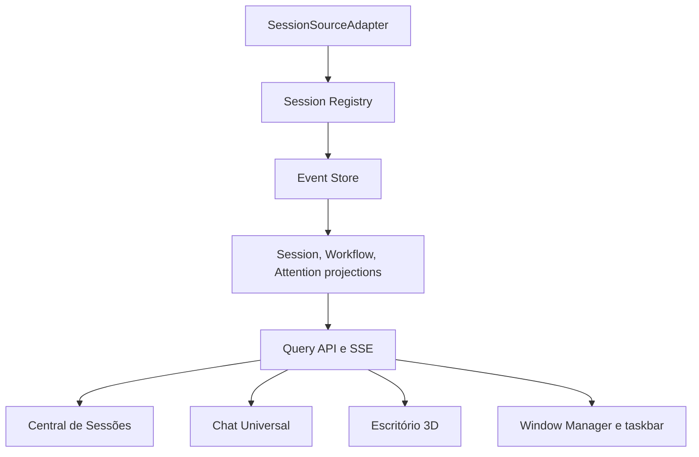

# Inventário de componentes reutilizáveis

## Backend e ferramentas

| Componente | Reuso proposto | Ajuste necessário |
|---|---|---|
| `tools/lib/engines/index.js` | Porta comum de envio e status | Publicar capacidades estruturadas por operação e contexto |
| `tools/lib/engines/{claude,gemini,opencode,codex}.js` | Execução e retomada verificadas | Separar `resume`, `cancel` e disponibilidade em capacidades consultáveis |
| `tools/import-*-chats.js` | Parsers de fontes nativas e normalização de histórico | Extrair descoberta/parsing puro; não executar importação para listar sessões |
| `tools/lib/chat-format.js` | Histórico legível e compatível | Suportar Codex e vínculo opcional a múltiplas sessões sem quebrar frontmatter antigo |
| `tools/lib/chat-save.js` | Persistência de conversas da interface | Corrigir Codex e não eleger arbitrariamente um motor em comparações |
| `tools/lib/permissions.js` | Decisão, escopos e regras de aprovação | Expor pedidos pendentes de forma segura e desacoplar entrega do cartão do stream |
| `ui/server/services/orchestration/event-contract.js` | Envelope, confiança e correlação | Acrescentar eventos de sessão, workflow, aprovação e notificação |
| `event-engine.js` e projeção | Ingestão, deduplicação e projeções | Persistência, cursor, versionamento e transições idempotentes |
| Adaptadores de orquestração | Telemetria de Claude, Gemini e OpenCode | Corrigir associação de projeto, ciclo terminal e adicionar Codex |
| `orchestration.controller.js` | REST, SSE e comandos catalogados | Separar consultas de coleta; adicionar paginação e cursor de retomada |
| `project.service.js` | Metadados de conversas materializadas | Ler metadados pelo parser canônico e não confundir extração com workflow |

## Frontend

| Componente | Reuso proposto | Ajuste necessário |
|---|---|---|
| `chat-models.js` | Base das entidades do chat | Referenciar `canonicalSessionId` e não carregar estado operacional completo |
| `chat-session-store.js` | Cache de IDs por motor/conversa | Hidratar pelo registro persistente; manter apenas cache de apresentação |
| `chat-execution-store.js` | Cancelamento de streams locais | Diferenciar execução local controlável de sessão externa observada |
| `chat-continue.js` / `chat-persist.js` | Carregamento e continuidade do histórico | Consumir a resolução de capacidade antes de exibir “Continuar” |
| `projects-chat-filters.js` | Padrões de busca, filtro e ordenação | Generalizar para projeto, motor, workflow, execução e atenção |
| Window Manager | Registro, foco, docking, taskbar e persistência | Reutilizar o módulo `orchestration`; não criar outro gerenciador de janelas |
| `office-orchestration-panel.js` | Fachada do painel do Escritório | Tornar consumidor da mesma Central e remover metadados duplicados |
| Abas `overview`, `journal`, `timeline`, `control` | Padrões de apresentação | Substituir HTML específico por projeções e ações canônicas |
| `office-state.js` | Seleção de projeto e conexão SSE | Guardar cursor, estado de conexão e resumo de atenção |
| Scrum/Kanban | Componentes de raia e cartão | Reutilizar somente apresentação; domínio e persistência permanecem separados |

## Persistências existentes a preservar

| Persistência | Papel após a evolução |
|---|---|
| `projects/<slug>/chats/*.md` | Histórico portátil e legível, associado à sessão canônica |
| Fontes nativas dos motores | Origem externa, somente leitura para descoberta |
| `projects/<slug>/permissions.json` | Regras duráveis de permissão por projeto |
| `localStorage` do Window Manager | Preferências e layouts, não estado operacional |
| `orchestration.db` planejado | Registro, eventos, projeções e caixa de atenção |

## Itens que não devem ser reutilizados como contrato

- strings hardcoded de tarefa ou papel do agente;
- `mtime` isolado como prova de execução ativa;
- status de extração como status de workflow;
- HTML inline com símbolos usados como ícones;
- IDs de eventos derivados apenas da sessão;
- objetos do Scrum persistidos como sessões de agente.

## Fronteiras propostas

