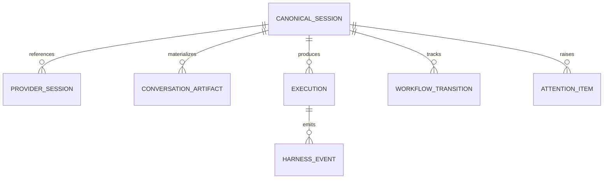

# Modelo canônico de sessão

## Princípio

Uma conversa materializada, uma sessão nativa e uma execução são entidades relacionadas, mas não equivalentes.

## Entidades

### CanonicalSession

| Campo | Tipo | Regra |
|---|---|---|
| `id` | UUID | Gerado pelo Harness e estável |
| `schemaVersion` | inteiro | Obrigatório para migração |
| `projectId` | string opcional | Somente quando associado |
| `projectConfidence` | enum | `explicit`, `observed`, `inferred`, `unknown` |
| `title` | string | Melhor título disponível, com origem registrada |
| `primaryProvider` | string | Motor principal sem impedir múltiplos vínculos |
| `executionStatus` | enum | Estado operacional projetado |
| `workflowStatus` | enum | Estado de trabalho controlado separadamente |
| `attentionStatus` | enum | Resumo derivado da caixa de atenção |
| `createdAt` | ISO | Menor timestamp confirmado |
| `lastObservedAt` | ISO | Última observação válida |
| `archivedAt` | ISO opcional | Arquivamento lógico, nunca exclusão implícita |

### ProviderSession

| Campo | Finalidade |
|---|---|
| `provider` | `claude`, `gemini`, `opencode`, `codex` |
| `nativeSessionId` | Identificador original, sem transformação destrutiva |
| `sourceKind` | `cli`, `api`, `ide_log`, `sqlite`, `bridge`, `markdown` |
| `sourceLocator` | Referência local protegida; não exposta integralmente à UI |
| `resumeMode` | `native`, `context_replay`, `unsupported`, `unknown` |
| `capabilities` | Snapshot resolvido para a sessão |
| `fingerprint` | Chave idempotente `provider + nativeSessionId + sourceKind` |

### ConversationArtifact

Relaciona a sessão a `projects/<slug>/chats/*.md`. Guarda caminho relativo, hash, agente declarado, sessão declarada e última sincronização. O Markdown permanece legível por versões anteriores.

### Execution

Representa uma tentativa concreta de enviar mensagem, executar rotina ou operar serviço. Possui `id`, `sessionId`, `provider`, `ownership`, status, início/fim, erro e correlação. Uma sessão pode possuir várias execuções.

### AttentionItem

Representa intervenção acionável: aprovação, bloqueio, falha, integração indisponível ou sessão estagnada. Possui severidade, prazo opcional, estado e referência ao evento causador.

## Identidade e reconciliação

Ordem de correspondência:

1. `provider + nativeSessionId + sourceKind` exatos;
2. metadado explícito no artefato Markdown;
3. origem/cwd reconciliado com `.sources.json`;
4. associação inferida, mantida como candidata e nunca aplicada silenciosamente;
5. sem evidência suficiente, sessão permanece sem projeto.

Não se deve fundir sessões apenas por título, data próxima ou conteúdo semelhante.

## Persistência e compatibilidade

- O registro canônico será persistido em SQLite local versionado.
- A primeira migração é somente aditiva e importa índices sem reescrever fontes.
- O frontmatter antigo continua válido.
- Extensões futuras devem usar um campo opcional versionado, por exemplo `harnessSession`, sem remover `sessao`.
- Uma conversa multi-motor relaciona vários `ProviderSession`; não elege silenciosamente o primeiro motor.
- Layouts do Window Manager continuam no navegador e referenciam apenas IDs canônicos.

## Consultas mínimas planejadas

- sessões por projeto, motor, estado de execução, workflow e atenção;
- sessão por ID canônico ou identidade nativa;
- execuções e eventos por sessão;
- capacidades atuais e motivo de indisponibilidade;
- artefatos Markdown associados;
- contagem por raia do workflow e fila de atenção.

Os contratos HTTP serão detalhados antes da implementação da história 09.01; este documento define o domínio, não presume endpoints.
