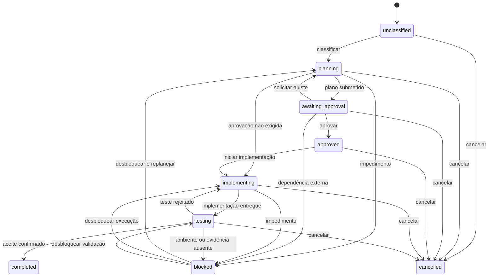

# Máquina de estados do workflow

## Estados ortogonais

A Central mantém três eixos independentes. Alterar um eixo não altera automaticamente os outros.

### Execução do motor

`unknown`, `queued`, `running`, `succeeded`, `failed`, `cancelled`

### Workflow

`unclassified`, `planning`, `awaiting_approval`, `approved`, `implementing`, `testing`, `completed`, `blocked`, `cancelled`

### Atenção

`none`, `action_required`, `approval_required`, `error`, `stale`

Exemplo: uma execução pode estar `succeeded`, enquanto o workflow permanece `awaiting_approval`. Sucesso técnico não equivale a conclusão do trabalho.

## Transições de workflow

## Regras de transição

| Origem | Destino | Evidência mínima |
|---|---|---|
| `planning` | `awaiting_approval` | Plano ou proposta referenciada |
| `awaiting_approval` | `approved` | Decisão explícita com autor e timestamp |
| `approved` | `implementing` | Execução ou ação de início identificada |
| `implementing` | `testing` | Entrega ou conjunto de mudanças referenciado |
| `testing` | `completed` | Critérios obrigatórios aceitos e evidências registradas |
| qualquer ativo | `blocked` | Motivo, origem e ação esperada |
| `blocked` | estado anterior | Evento de desbloqueio e estado de retorno preservado |

## Regras de projeção automática

Somente fatos verificáveis podem sugerir transições automáticas. Por padrão, a projeção gera uma sugestão, não altera o workflow:

- pedido de permissão aberto sugere `attention=approval_required`;
- `execution.failed` sugere `attention=error`, sem mover workflow para `blocked` automaticamente;
- `task.blocked` explícito pode mover para `blocked` se a tarefa estiver vinculada ao workflow;
- arquivo sem atualização não prova conclusão; após limiar configurado pode marcar `stale`;
- `execution.completed` nunca move diretamente para `completed`.

## Bloqueio e falha

- **Falha** pertence à execução e descreve resultado técnico.
- **Bloqueio** pertence ao workflow e descreve impossibilidade de avançar.
- Uma falha pode ser recuperada por nova execução sem sair do estado de workflow.
- Um bloqueio deve registrar `reason`, `expectedAction`, `owner` opcional e `blockedAt`.

## Kanban

As raias do Kanban são projeções de `workflowStatus`. `executionStatus` e `attentionStatus` aparecem como badges independentes. As raias não reutilizam os estados das histórias Scrum e não gravam em `scrum.json`.
