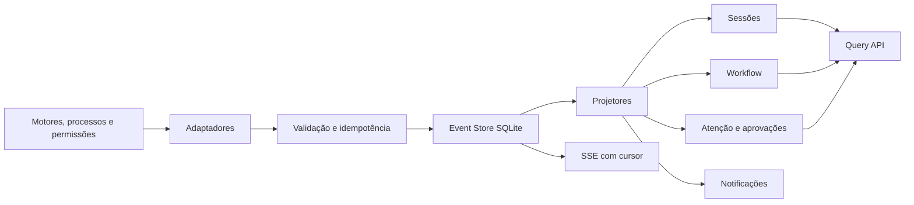

# Arquitetura de eventos, atenção e notificações

## Princípios

1. Eventos são fatos imutáveis; projeções podem ser reconstruídas.
2. Origem e confiança são obrigatórias.
3. Evento, execução, workflow, atenção e notificação são conceitos distintos.
4. Reprocessamento precisa ser idempotente.
5. Uma leitura da API não pode disparar coleta destrutiva ou importação.

## Fluxo proposto

## Famílias de eventos

| Família | Eventos mínimos |
|---|---|
| Sessão | `session.discovered`, `session.updated`, `session.linked`, `session.archived` |
| Execução | `execution.queued`, `execution.started`, `execution.progressed`, `execution.succeeded`, `execution.failed`, `execution.cancelled` |
| Workflow | `workflow.transition_requested`, `workflow.transitioned`, `workflow.blocked`, `workflow.unblocked` |
| Aprovação | `approval.requested`, `approval.resolved`, `approval.expired` |
| Atenção | `attention.opened`, `attention.acknowledged`, `attention.resolved` |
| Integração | `integration.status_changed`, `capability.changed` |
| Artefato | `artifact.linked`, `artifact.updated` |

O catálogo atual deve aceitar aliases durante uma migração, por exemplo `execution.completed` para `execution.succeeded`, sem reescrever eventos históricos.

## Envelope obrigatório

Além dos campos atuais, o envelope planejado deve incluir:

- `sequence`: cursor monotônico persistido;
- `sessionId`: identidade canônica opcional;
- `source.fingerprint`: chave idempotente da observação;
- `source.capability`: mecanismo que originou o fato;
- `payloadVersion`: versão do conteúdo específico;
- `visibility`: `project`, `local_operator` ou `internal`;
- correlação e causa preservadas.

## Deduplicação

- `event.id` identifica uma ocorrência, nunca uma sessão inteira.
- `source.fingerprint` identifica o mesmo fato reobservado.
- Uma mudança de `mtime`, status ou conteúdo gera nova ocorrência.
- O projetor ignora transições repetidas sem descartar eventos posteriores válidos.
- Eventos de heartbeat não são persistidos se não alterarem estado.

## SSE e recuperação

- O servidor entrega eventos após um cursor conhecido.
- Reconexão usa `Last-Event-ID` ou parâmetro equivalente.
- Se o cursor saiu da janela de retenção, o cliente recebe snapshot e novo cursor.
- O estado inicial e os deltas usam versões de schema explícitas.
- Um consumidor lento não bloqueia ingestão ou outros clientes.

## Caixa de atenção

Uma `AttentionItem` é aberta por política a partir de eventos verificáveis:

| Causa | Tipo | Severidade inicial |
|---|---|---|
| Aprovação pendente | `approval_required` | alta |
| Workflow bloqueado | `blocker` | alta |
| Execução falhou | `execution_error` | média ou alta |
| Integração indisponível | `integration_error` | média |
| Sessão sem atividade além do limiar | `stale_session` | baixa, inferida |

Itens possuem `open`, `acknowledged`, `resolved` ou `expired`. Resolver a causa pode fechar o item, mas o histórico permanece auditável.

## Fila central de aprovações

- Agrega pedidos do provedor sem remover a origem.
- A primeira implementação reutiliza as permissões Claude existentes.
- Listagem e resposta exigem as mesmas regras de autenticação/PIN já usadas pelo controller.
- Somente pedidos `pending` podem ser respondidos.
- Resposta registra decisão, escopo, operador, timestamp e evento causador.
- Fechar uma apresentação de chat não deve decidir pelo usuário; expiração segue timeout explícito.
- Motores sem aprovação integrada aparecem como `unsupported`, não como fila vazia equivalente.

## Notificações

A notificação é uma entrega derivada de atenção, não a fonte da verdade. Canais iniciais:

- badge na janela e taskbar;
- destaque na Central e no Escritório;
- toast apenas para evento novo de alta prioridade;
- notificação do navegador somente com consentimento futuro.

Deduplicação usa `attentionItemId + channel`; reconhecer uma notificação não resolve automaticamente o item de atenção.

## Retenção e privacidade

- Payloads não persistem prompts completos, segredos ou saídas extensas sem necessidade.
- Caminhos locais são armazenados em forma confinada ou redigida para apresentação.
- Eventos operacionais têm retenção configurável; sessões e decisões de aprovação permanecem enquanto referenciadas.
- Compactação preserva estado final, sequência, correlação e evidências de decisão.
