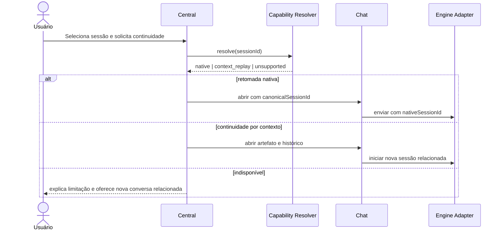

# Estratégia de integração com Escritório 3D, Chat e Window Manager

## Window Manager

O módulo existente `orchestration` permanece como identidade da Central. Não será criado um segundo módulo “sessions”. A mesma instância poderá usar apresentação flutuante, lateral, maximizada ou acoplada.

O estado persistido da janela guarda:

- projeto selecionado;
- visão `list` ou `kanban`;
- filtros e sessão selecionada;
- bounds, docking e visibilidade já suportados pelo Window Manager.

Dados operacionais não serão gravados no layout; ao restaurar, a janela consulta a projeção atual pelo ID canônico.

## Escritório 3D

Objetos existentes continuam como pontos de entrada:

| Objeto | Ação planejada |
|---|---|
| console/mesa de orquestração | abre a Central no contexto do projeto |
| estação de motor | abre Central filtrada pelo motor ou Chat para nova conversa |
| telão da Sala de Guerra | mostra resumo somente leitura de workflow e atenção |
| indicador de agente | abre detalhe das sessões desse provedor |

O grafo espacial recebe projeções resumidas; não executa regra de negócio nem calcula status. A cena não deve renderizar atividade simulada quando a telemetria estiver ausente.

## Chat Universal

Fluxo de retomada:

O Chat mantém renderização, composer e streaming. A Central decide navegação e fornece identidade; o backend revalida a capacidade no momento da ação.

## Projeto selecionado

`project-selection.js` continua sendo o contrato central. Uma sessão sem projeto pode ser inspecionada globalmente, mas só é associada após decisão explícita ou evidência confiável. Trocar de projeto atualiza filtros sem modificar a sessão nativa.

## Aprovações e taskbar

- a Central consulta a caixa de atenção;
- taskbar mostra contagem de itens de alta prioridade da janela de orquestração;
- clicar no badge abre a Central filtrada;
- responder usa o controller de aprovação, nunca uma função do DOM do cartão;
- o cartão correspondente no Chat recebe atualização pelo mesmo evento.

## Eventos entre módulos

Eventos de frontend sugeridos:

| Evento | Payload mínimo | Consumidores |
|---|---|---|
| `harness:session-open` | `sessionId`, `presentation` | Window Manager, Central |
| `harness:chat-open` | `sessionId`, `conversationArtifactId` | Chat, Escritório |
| `harness:attention-changed` | resumo por severidade | taskbar, HUD, Central |
| `harness:project-changed` | `projectId` | Central, Chat, Escritório |

Esses eventos são navegação/apresentação. Estado operacional continua vindo da API e do SSE.

## Compatibilidade e rollout

1. Central nova fica atrás de configuração enquanto o painel atual permanece disponível.
2. Janela `orchestration` troca apenas seu renderizador interno.
3. Chat antigo continua abrindo arquivos Markdown sem registro canônico, em modo compatível.
4. Sessões indexadas gradualmente ganham ID canônico sem renomear arquivos.
5. Rollback restaura o renderizador anterior; dados persistidos permanecem aditivos.

## Restrições de segurança

- escapar títulos, payloads e mensagens antes de inserir no DOM;
- não exibir caminhos absolutos ou conteúdo sensível em tooltips;
- revalidar PIN/autorização nas ações mutáveis;
- não aceitar ação arbitrária ou nome de comando vindo da sessão;
- restringir navegação de iframe às rotas locais permitidas.
