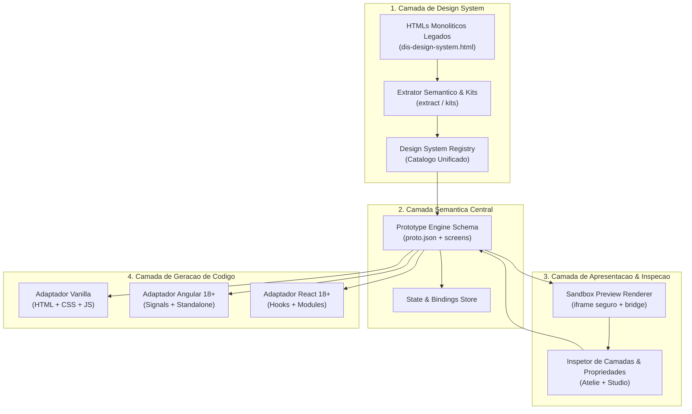

# Arquitetura — Prototype Engine & Design System Multiframework

[Voltar ao EP-12](README.md)

## 1. Visao geral do sistema

O Prototype Engine atua como o nucleo semantico que conecta o Design System extraido aos ambientes visuais (Atelie e Studio) e aos motores de IA (MCP). A arquitetura desacopla a representacao estrutural das telas da sua implementacao concreta em frameworks especificos.



## 2. Camadas da arquitetura

### 2.1. Camada de Design System (Registry)
- **Papel:** Centralizar todos os componentes do sistema com contratos estaveis e metadados completos.
- **Identificadores canonicos:** Todo componente possui um ID unico no padrao `<namespace>.<component-name>` (ex: `dis.annotation-list`, `dis.patient-header`).
- **Independencia de implementacao:** O Registry registra explicitamente quais frameworks possuem implementacao disponivel, gerada ou validada.
- **Integracao MCP:** Ferramentas MCP (`list_components`, `get_component`, `render_component_preview`) consultam essa camada para munir os agentes com componentes prontos.

### 2.2. Camada Semantica do Prototipo (Prototype Schema)
- **Papel:** Descrever telas, hierarquia de nos, propriedades, navegacao e ligacoes de dados (bindings) de forma agnostica.
- **Unidade basica (`proto.json`):**
  - Manifesto do prototipo com versao de schema, id, titulo e telas.
  - Cada tela contem sua arvore de componentes (`PrototypeNode`), slots e estado local.
  - Documentos `screens/<screen-id>.html` contem a casca semantica enriquecida com atributos `data-node-id` e `data-component-id`.

### 2.3. Camada de Preview e Inspecao (Renderer & Inspector)
- **Papel:** Renderizar a tela com isolamento estrito via `iframe`, permitindo inspecao visual bidirecional sem contaminacao de estilos do host (Atelie/Studio).
- **Protocolo de comunicacao:** Mensagens assincronas via `postMessage` com canal estruturado:
  - `HIGHLIGHT_NODE(nodeId)`: Destaque visual no canvas ao passar o mouse na arvore.
  - `SELECT_NODE(nodeId)`: Selecao de no no canvas sincronizada com o painel de propriedades.
  - `UPDATE_NODE_PROPS(nodeId, props)`: Mutacao a quente sem recarregar o iframe completo.
  - `TREE_MUTATED(tree)`: Notificacao da sandbox para atualizacao do painel de camadas.

### 2.4. Camada de Adaptadores Multiframework
- **Papel:** Converter a arvore semantica em codigo executavel com idiomaticidade propria de cada tecnologia.
- **Pipeline de geracao:**
  1. Leitura do `proto.json` e resolucao das dependencias no Registry.
  2. Validacao do schema da tela.
  3. Transformacao AST semantica para o framework alvo.
  4. Injecao dos boilerplates correspondentes (ex: Standalone Components no Angular, Functional Components no React).
  5. Emissao de arquivos limpos, sem rastros de ferramentas de edicao.

## 3. Rastreabilidade End-to-End

O motor garante rastreabilidade total em qualquer etapa do ciclo de vida:

```
[Tela no Studio/Atelie]
       |
       v (data-node-id="node-42")
[No Semantico (PrototypeNode)]
       |
       v (componentId="dis.annotation-list")
[Componente no Registry (DesignSystemComponent)]
       |
       v (implementations.angular)
[Arquivo Fonte / Boilerplate (src/components/annotation-list.component.ts)]
```
