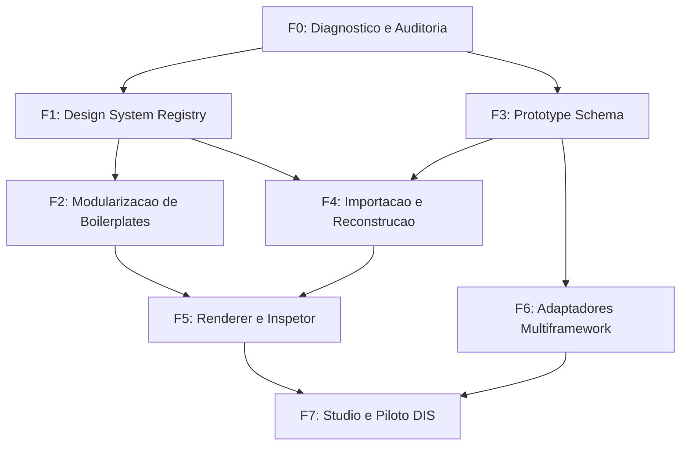

# Mapa de Dependencias — EP-12

[Voltar ao EP-12](README.md)

Este documento define as interdependencias tecnicas entre as 8 fases do EP-12 e o relacionamento com os outros epicos do Harness Leca.

---

## 1. Fluxo de Dependencias entre Fases

| Fase | Titulo | Dependencias Diretas | O que Desbloqueia |
|---|---|---|---|
| **F0** | Diagnostico e Contratos | Nenhuma (requer acesso aos arquivos legados) | F1, F3 |
| **F1** | Design System Registry | F0 | F2, F4 |
| **F2** | Modularizacao de Boilerplates | F1 | F5 |
| **F3** | Prototype Schema | F0 | F4, F6 |
| **F4** | Importacao e Reconstrucao | F1, F3 | F5 |
| **F5** | Renderer e Inspetor | F2, F4 | F7 |
| **F6** | Adaptadores Multiframework | F3 | F7 |
| **F7** | Studio e Piloto DIS | F5, F6 | Homologacao final e entrega de valor |

---

## 2. Integracao com outros Epicos

- **EP-00 (Auditoria e Arquitetura):** Fornece o inventario de servicos existentes e baseline de testes.
- **EP-06 (Studio, Codigo e Preview):** Consome diretamente o Renderer e Inspetor da F5 e a geracao de adaptadores da F6.
- **EP-07 (Artefatos e Documentacao):** Armazena os manifestos `proto.json`, snapshots e arquivos de componentes.
- **EP-11 (Auditoria e Qualidade):** Integra a matriz de paridade visual e testes de regressao automatizados.
