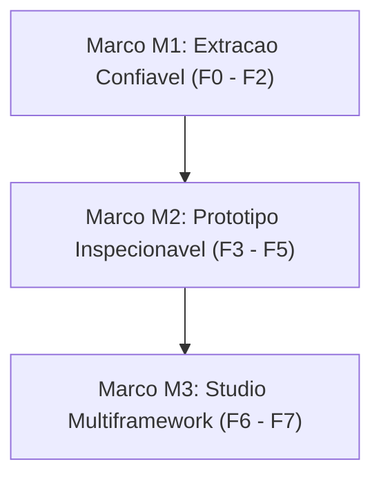

# EP-12: Prototype Engine & Design System Multiframework

[Voltar ao indice](../../00-index.md)

## 1. Visao geral

O objetivo do EP-12 nao e simplesmente fracionar os arquivos HTML monoliticos legados, mas construir uma infraestrutura robusta capaz de extrair, reconhecer, compor, renderizar, inspecionar e gerar componentes e prototipos de alta fidelidade. Essa arquitetura integra o Model Context Protocol (MCP), o Atelie de Prototipos, o Studio e os boilerplates existentes.

A solucao suporta nativamente **HTML/CSS/JavaScript**, **Angular** e **React**, preservando uma unica representacao semantica do prototipo baseada no contrato `proto.json`.

## 2. Principios arquiteturais

| Decisao | Diretriz |
|---|---|
| **Fonte de verdade do prototipo** | `proto.json` e documentos de tela estruturados (`screens/*.html`) |
| **Fonte dos componentes** | Registro extraido e consolidado do Design System (`design-system.json` / Registry) |
| **Integracao com agentes** | MCP evoluido (`project-mcp.js`), fornecendo catalogos e ferramentas de extracao |
| **Frameworks suportados** | Vanilla (HTML/CSS/JS), Angular (18+) e React (18+/Next) |
| **Editor visual unificado** | Atelie e Studio compartilhando o mesmo motor de preview, arvore e inspecao |
| **HTMLs originais** | Preservados intactos como referencia e fonte de migracao |
| **Geracao de codigo** | Por adaptadores semanticos orientados a schema, sem conversao cega |
| **Rastreabilidade** | Tela -> No (`PrototypeNode`) -> Componente (`DesignSystemComponent`) -> Boilerplate -> Arquivo |
| **Compatibilidade** | Aproveitamento de modulos e contratos existentes antes de criar novos servicos |

> **Regra fundamental:** O Design System descreve os componentes de forma atomica; o Prototype Engine descreve como eles sao combinados em telas, estados e fluxos de usuario interativos.

---

## 3. Indice mestre de entregas (8 Fases / 32 Historias)

Progresso: 32 / 32 historias concluidas (Fases F0 a F7 100% concluidas — Marco M3 Homologado).

### F0 — Diagnostico e Contratos Existentes (4/4)
- [x] [12.01](stories/12.01-auditar-htmls-mcp.md) Auditar HTMLs monoliticos, MCP e snapshots
- [x] [12.02](stories/12.02-auditar-atelie-inspetor.md) Auditar Atelie, importador, renderer e inspetor
- [x] [12.03](stories/12.03-contratos-reutilizaveis.md) Identificar contratos e funcionalidades reutilizaveis
- [x] [12.04](stories/12.04-baseline-visual-funcional.md) Registrar baseline visual e funcional

### F1 — Design System Registry (4/4)
- [x] [12.05](stories/12.05-manifesto-identidade-componentes.md) Definir manifesto e identidade dos componentes
- [x] [12.06](stories/12.06-extracao-componentes-ds.md) Evoluir extracao HTML, CSS e JavaScript
- [x] [12.07](stories/12.07-registro-frameworks-dependencias.md) Registrar Angular, React e dependencias
- [x] [12.08](stories/12.08-api-consulta-compartilhada.md) Criar API de consulta compartilhada

### F2 — Modularizacao dos Boilerplates (4/4)
- [x] [12.09](stories/12.09-isolar-tokens-css.md) Isolar CSS global, temas e tokens semanticos
- [x] [12.10](stories/12.10-boilerplates-vanilla-componentes.md) Fracionar componentes em boilerplates vanilla independentes
- [x] [12.11](stories/12.11-harness-renderizacao-isolada.md) Criar harness de renderizacao isolada por componente
- [x] [12.12](stories/12.12-validacao-suite-componentes.md) Validar suite de componentes vanilla com automacao [Marco M1 Homologado]

### F3 — Prototype Schema (4/4)
- [x] [12.13](stories/12.13-schema-semantico-proto-json.md) Especificar schema semantico estendido do `proto.json`
- [x] [12.14](stories/12.14-slots-eventos-bindings-navegacao.md) Modelar slots, eventos, bindings e navegacao de telas
- [x] [12.15](stories/12.15-schema-estado-mocks-dados.md) Schema de estado e mocks de dados dinamicos
- [x] [12.16](stories/12.16-validador-schema-testes.md) Validador de schema com JSON Schema e testes

### F4 — Importacao e Reconstrucao (4/4)
- [x] [12.17](stories/12.17-parsing-semantico-legado.md) Pipeline de parsing semantico do DOM legado
- [x] [12.18](stories/12.18-decompositor-telas.md) Decompositor de telas para `screens/*.html` estruturados
- [x] [12.19](stories/12.19-gerador-manifesto-proto-json.md) Gerador de manifesto de prototipo `proto.json`
- [x] [12.20](stories/12.20-reconstrucao-prototipo-dis.md) Reconstrucao do prototipo DIS Paciente no novo formato

### F5 — Renderer e Inspetor (4/4)
- [x] [12.21](stories/12.21-engine-renderizacao-sandbox.md) Engine de renderizacao em sandbox iframe segura
- [x] [12.22](stories/12.22-ponte-comunicacao-bidirecional.md) Ponte de comunicacao bidirecional (PostMessage / EventBus)
- [x] [12.23](stories/12.23-inspetor-arvore-selecao-bidirecional.md) Inspetor de arvore com selecao bidirecional tela <-> arvore
- [x] [12.24](stories/12.24-painel-propriedades-mutacao.md) Painel de propriedades e mutacao nao destrutiva do `proto.json` (Marco M2 Homologado)

### F6 — Adaptadores Multiframework (4/4)
- [x] [12.25](stories/12.25-adaptador-geracao-vanilla.md) Adaptador de geracao Vanilla HTML/CSS/JS
- [x] [12.26](stories/12.26-adaptador-angular18.md) Adaptador Angular 18 (Signals, Standalone Components)
- [x] [12.27](stories/12.27-adaptador-react18.md) Adaptador React 18+ (Hooks, CSS Modules / Tailwind)
- [x] [12.28](stories/12.28-matriz-paridade-multiframework.md) Matriz de paridade e testes de fidelidade entre frameworks

### F7 — Studio, Rastreabilidade e Piloto (4/4)
- [x] [12.29](stories/12.29-integracao-motor-studio.md) Integracao da arvore do motor ao Studio unificado
- [x] [12.30](stories/12.30-rastreabilidade-end-to-end.md) Rastreabilidade end-to-end: Tela -> No -> Componente -> Codigo
- [x] [12.31](stories/12.31-piloto-completo-dis.md) Piloto completo do fluxo DIS Dispensacao de Medicamentos
- [x] [12.32](stories/12.32-homologacao-marco-m3.md) Documentacao, kits de componentes e homologacao final (Marco M3 Homologado)

---

## 4. Marcos de validacao (Milestones)

1. **Marco M1 — Extracao confiavel (F0 a F2):**
   Um componente do HTML gigante legado pode ser consultado pelo MCP, modularizado e renderizado isoladamente com seus estilos e comportamentos funcionais.
2. **Marco M2 — Prototipo inspecionavel (F3 a F5):**
   Uma tela estruturada pode ser renderizada, selecionada visualmente, inspecionada, editada e salva sem perder navegabilidade ou fidelidade.
3. **Marco M3 — Studio multiframework (F6 e F7):**
   O Studio utiliza a mesma arvore semantica para consultar e gerar implementacoes Vanilla, Angular e React com validacao de paridade independente.

---

## 5. Documentos detalhados do epico

- [Arquitetura detalhada](ARCHITECTURE.md)
- [Contratos tecnicos de interfaces](CONTRACTS.md)
- [Decisoes arquiteturais](DECISIONS.md)
- [Mapa de dependencias](DEPENDENCIES.md)
- [Plano de migracao e piloto](MIGRATION-PLAN.md)
- [Plano de testes](TEST-PLAN.md)
- [Fase F0: Diagnostico e Auditoria](phases/F0-audit.md)
