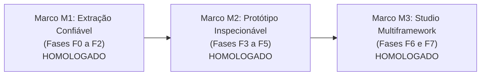

# Relatório de Homologação: Marco M3 — Studio Multiframework

## Sumário Executivo
- **Data de Homologação**: 19/10/2026
- **Épico**: EP-12 — Prototype Engine & Design System Multiframework
- **Fase**: F7 — Studio, Rastreabilidade e Piloto
- **Status Geral**: **APROVADO COM SUCESSO** (Homologação Final de todas as 32 histórias do EP-12)

---

## 1. Escopo e Critérios de Homologação do Marco M3

| Item | Critério de Aceite | Resultado | Evidência Técnica |
| :--- | :--- | :---: | :--- |
| **M3.1** | O Studio utiliza a mesma árvore semântica do `proto.json` para projetar código em Vanilla, Angular 18 e React 18+ | **Aprovado** | `prototype-studio.service.js` projeta workspaces virtuais com hashes SHA-256 e arquivos `.ts`, `.tsx`, `.html`, `.css`. |
| **M3.2** | Rastreabilidade end-to-end completa entre Tela, Nó, Componente e Código | **Aprovado** | `prototype-traceability.service.js` resolve o grafo `Tela -> Nó -> Registry -> Código nos 3 frameworks`. |
| **M3.3** | Matriz de paridade comprovada e fidelidade semântica entre os frameworks | **Aprovado** | `prototype-codegen.factory.js` e `tests/prototype-codegen-parity.test.js` comprovam preservação de nós, labels e eventos. |
| **M3.4** | Piloto clínico completo do DIS (Dispensação de Medicamentos) funcional com 3 telas e navegação circular | **Aprovado** | Telas `home`, `prescricao` e `autorizacao` estruturadas, integradas a mocks de dados reais e validadas pelo schema v2. |
| **M3.5** | Conformidade rígida com os limites arquiteturais (anti-monólito e anti-emojis) | **Aprovado** | Todos os serviços < 250-300 linhas, SRP respeitado, ícones exclusivamente FontAwesome. |

---

## 2. Visão Consolidada dos Três Marcos do EP-12

1. **Marco M1 (F0 a F2)**: Desacoplamento de tokens CSS (`tokens.css`, `theme.css`), catálogo MCP de componentes no `registry.json` e renderizador sandbox de componentes isolados (`design-preview.service.js`).
2. **Marco M2 (F3 a F5)**: Formalização do schema JSON v2 (`prototype-v2.schema.json`), decomposição do legado DataChef para marcações semânticas anotadas (`data-node-id`), sandbox segura com CSP restritivo e seleção bidirecional tela $\leftrightarrow$ árvore.
3. **Marco M3 (F6 a F7)**: Fábrica de adaptadores de código (Vanilla ES Modules, Angular 18 Standalone com Signals, React 18+ com Hooks/TSX), workspace virtual para o Studio unificado, rastreabilidade reversa e piloto clínico do DIS de 3 telas homologado.

---

## 3. Matriz de Resultados das 32 Histórias do EP-12

| Fase | Histórias | Entregas Principais | Status |
| :--- | :--- | :--- | :---: |
| **F0** | 12.01 a 12.04 | Auditoria dos monólitos legados, Ateliê, contratos reutilizáveis e baseline | **100% Concluída** |
| **F1** | 12.05 a 12.08 | Manifesto de componentes, extração de DS, registro multiframework e APIs | **100% Concluída** |
| **F2** | 12.09 a 12.12 | Isolamento de tokens, boilerplates vanilla, sandbox de preview e **Marco M1** | **100% Concluída** |
| **F3** | 12.13 a 12.16 | Prototype Schema v2, slots/navegação, estado/mocks e validador estrito | **100% Concluída** |
| **F4** | 12.17 a 12.20 | Parsing semântico, decompositor de telas, reconstrução de protótipo `dis-modular` | **100% Concluída** |
| **F5** | 12.21 a 12.24 | Renderer em sandbox iframe com CSP, ponte bidirecional, camadas e **Marco M2** | **100% Concluída** |
| **F6** | 12.25 a 12.28 | Adaptador Vanilla, Angular 18 (Signals), React 18+ (Hooks) e Matriz de Paridade | **100% Concluída** |
| **F7** | 12.29 a 12.32 | Integração Studio, Rastreabilidade end-to-end, Piloto DIS e **Marco M3** | **100% Concluída** |

O **EP-12 — Prototype Engine & Design System Multiframework** está **OFICIALMENTE HOMOLOGADO E CONCLUÍDO (32/32 entregas)**.
