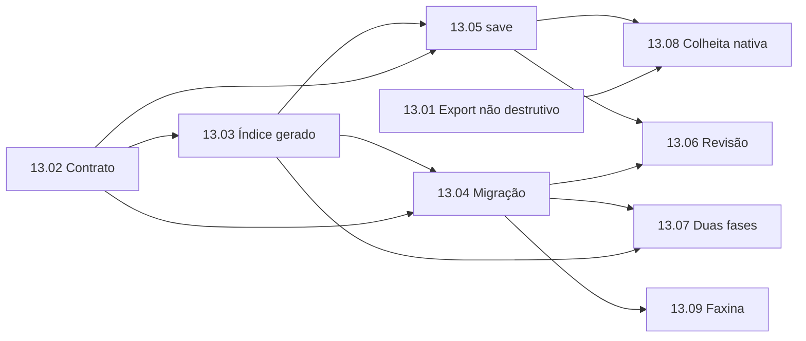

# EP-13: Memória e conhecimento dos agentes

[Voltar ao índice](../../00-index.md)

## Objetivo

Dar ao Harness uma memória curada única, com um fato por arquivo, índice gerado por script e carregamento em duas fases, projetada para cada motor (Claude Code, Gemini/Antigravity e Codex) sem sobrescrever o que o próprio motor aprendeu e sem empurrar sugestões não revisadas nem histórico bruto para o contexto.

## Problema em uma frase

Hoje a mesma memória chega duas vezes ao Claude, sugestões não revisadas e um índice de conversas de 140 KB chegam como "memória" ao Claude e ao Gemini, e cada `npm run export:context` apaga o que o Claude Code gravou na própria pasta de memória. Evidências em [00-diagnostico.md](00-diagnostico.md).

## Limites de responsabilidade

- A extração e a consolidação de sugestões (`tools/extract-artifacts.js`, `tools/consolidate-memory.js`, `tools/lib/consolidate.js`) continuam como estão: produzem candidatos e não são reescritas aqui.
- A revisão humana (`tools/lib/memory-review.js` e `ui/public/js/modules/review.js`) continua sendo o único caminho da oficina para a vitrine; o EP-13 só muda o formato de destino.
- `instructions.md` e `CLAUDE.md` continuam escritos pelo usuário. Memória não substitui instrução.
- O EP-09 continua dono do registro de sessões; o EP-13 só lê os chats salvos como fonte bruta.

## Entrega

1. Camadas separadas: fonte bruta, candidatos e memória curada. Só a curada chega aos motores.
2. Memória curada em `projects/<slug>/memory/<tipo>/<slug>.md` e `global/memory/`, com frontmatter.
3. `memory.md` passa a ser um índice gerado, com teto de linhas, mantendo compatibilidade com o hook e o `AGENTS.md`.
4. Uma ferramenta `save` com deduplicação por hash e por similaridade e recusa de segredos.
5. Exportação não destrutiva para cada motor e colheita das memórias nativas para a oficina.
6. Faxina periódica com relatório.

Arquitetura e contratos em [01-arquitetura-alvo.md](01-arquitetura-alvo.md). Decisão em [ADR-009](../../03-decisions/ADR-009-memoria-um-fato-por-arquivo.md).

## Aceite do épico

- Nenhuma execução do export apaga ou reescreve arquivo que o harness não gerou.
- Nenhum texto de `context/extraido-*.md` ou de `chats/` chega a um motor como memória.
- O contexto injetado por mensagem cai pelo menos 40% no projeto de maior memória (medido pela 13.01) sem perda de fato curado.
- Todo fato curado tem um único arquivo; o lint da 13.09 não aponta duplicata exata.
- `npm test` e o golden master em `tests/golden/` seguem verdes.

## Histórias

| ID | História | Prioridade | Depende de |
|---|---|---|---|
| [13.01](13.01-export-nao-destrutivo.md) | Export não destrutivo, sem sugestões e com medição de tokens | P0 | nenhuma |
| [13.02](13.02-contrato-item-memoria.md) | Contrato do item de memória (frontmatter, tipos, camadas) | P0 | nenhuma |
| [13.03](13.03-indice-gerado.md) | Índice gerado por script com teto | P0 | 13.02 |
| [13.04](13.04-migracao-deduplicacao.md) | Migração dos bullets e deduplicação | P1 | 13.02, 13.03 |
| [13.05](13.05-ferramenta-save.md) | Ferramenta `save` com upsert e recusa de segredos | P1 | 13.02, 13.03 |
| [13.06](13.06-revisao-novo-formato.md) | Revisão promove para o novo formato | P1 | 13.04, 13.05 |
| [13.07](13.07-carregamento-duas-fases.md) | Carregamento em duas fases e envelope de segurança | P1 | 13.03, 13.04 |
| [13.08](13.08-colheita-memorias-nativas.md) | Colheita das memórias nativas para a oficina | P2 | 13.01, 13.05 |
| [13.09](13.09-faxina-periodica.md) | Faxina periódica com relatório | P2 | 13.04 |

## Ondas sugeridas

| Onda | Histórias | Por quê |
|---|---|---|
| 1 | 13.01 e 13.02 em paralelo | 13.01 estanca o dano hoje; 13.02 só cria o contrato e não toca em comportamento. |
| 2 | 13.03, depois 13.04 e 13.05 em paralelo | A migração e o `save` usam o mesmo serializador e o mesmo gerador de índice. |
| 3 | 13.06 e 13.07 | Trocam o destino da revisão e o que o hook injeta. |
| 4 | 13.08 e 13.09 | Melhorias de manutenção; dependem do formato estável. |

## Frente

Frente `memoria`, aberta a qualquer motor (Claude, Codex, Gemini/Antigravity ou OpenCode). Quem assumir uma história se registra no ledger do [multi-agent-sync](../../05-progress/multi-agent-sync.md) como `<motor>/memoria` antes de editar. Histórias da mesma onda podem rodar em motores diferentes ao mesmo tempo, desde que não dividam arquivo: na onda 1, 13.01 mexe só em `tools/export-context.js` e `tools/lib/export/`, e 13.02 só em `tools/lib/memory/item.js`. Arquivos sob coordenação: `tools/export-context.js`, `tools/lib/memory-review.js`, `.claude/hooks/load-project.ps1`, `AGENTS.md` e `projects/*/memory.md`.
