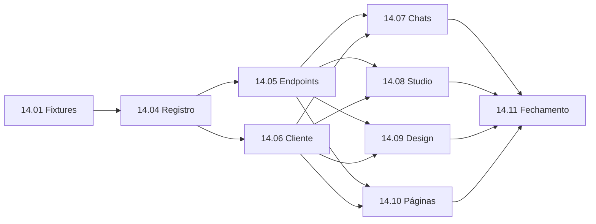

# EP-14: Estado das telas persistido no servidor

[Voltar ao índice](../../00-index.md)

## Objetivo
Cada tela do Harness tem um recurso próprio no servidor para o estado de uso e para o histórico de ações, de modo que o F5 não perca o contexto. A entrega também resolve dois bloqueios de processo (testes que dependem de dados locais e pre-commit lento) e cria o executor que permite delegar pacotes ao opencode.

## Problema em uma frase
O estado de uso vive em cerca de 15 chaves de `localStorage` espalhadas ou se perde no F5; só o histórico de chat (`/api/chat/save`) e o de deploy têm persistência no servidor.

## Decisões
- Um arquivo por tela e por projeto: `projects/<slug>/ui-state/<tela>.json` mais `.history.jsonl` (append-only, anel de 500). Evita contenção de escrita entre telas e mantém o boot leve. Se a escala exigir, troca-se o arquivo por SQLite dentro de `screen-state/store.js` sem mudar o contrato HTTP.
- Rota parametrizada com a lista de telas do registro, em vez de 13 rotas escritas à mão.
- Estado limitado a 64 KB; concorrência por `rev`; `localStorage` só como reserva offline.

## Histórias
| ID | História | Prioridade | Depende de |
|---|---|---|---|
| [14.01](14.01-fixtures-testes.md) | Fixtures de teste independentes de projects/ | P0 | nenhuma |
| [14.02](14.02-pre-commit-rapido.md) | Pre-commit rápido com testes afetados | P1 | nenhuma |
| [14.03](14.03-executor-opencode.md) | Executor de pacotes do opencode em worktree | P0 | nenhuma |
| [14.04](14.04-registro-telas.md) | Registro e catálogo das 13 telas | P0 | 14.01 |
| [14.05](14.05-endpoints-estado.md) | Serviço e endpoints de estado e histórico por tela | P0 | 14.04 |
| [14.06](14.06-cliente-estado.md) | Cliente de estado de tela | P0 | 14.04 |
| [14.07](14.07-telas-chat-grupos.md) | Adoção em chats, grupos, skills e projetos | P1 | 14.05, 14.06 |
| [14.08](14.08-telas-studio-atelie.md) | Adoção no Studio e no Ateliê | P1 | 14.05, 14.06 |
| [14.09](14.09-telas-design.md) | Adoção em scrum, layers, board, audit, artifacts e routines | P1 | 14.05, 14.06 |
| [14.10](14.10-telas-paginas.md) | Adoção em deploy, office, overview e diário | P1 | 14.05, 14.06 |
| [14.11](14.11-fechamento-ep14.md) | Fechamento: documentação, MAPA e verificação | P2 | 14.07, 14.08, 14.09, 14.10 |

14.02 (pre-commit rápido) e 14.03 (executor do opencode) não bloqueiam as demais, mas aceleram a onda 1 em diante.

## Ondas e branches
Cada história roda numa branch `ep14/<id>-<slug>`, com um worktree e um agente. A integração é por merge na branch `ep14/integracao`, um pacote por vez, com `npm test` entre eles.

| Onda | Histórias | Por quê |
|---|---|---|
| 0 | 14.01, 14.02 e 14.03 em paralelo | Infraestrutura sem arquivo em comum. A 14.03 fica com o Claude, pois habilita os demais agentes. |
| 1 | 14.04 | Contrato do registro, usado por todas as demais. |
| 2 | 14.05 e 14.06 em paralelo | Servidor e cliente não dividem arquivo. |
| 3 | 14.07, 14.08, 14.09 e 14.10 em paralelo | Telas distintas; cada uma só toca os módulos da sua lista. |
| 4 | 14.11 | Fechamento. |

## Regras de coordenação
- Cada agente se registra no ledger do [multi-agent-sync](../../05-progress/multi-agent-sync.md) como `<motor>/<id>` antes de editar.
- Cada agente só toca nos arquivos da lista da sua história e não commita na `main`.
- Conflito entre branches é resolvido no merge, não pelos agentes.
- `ui/server/router.js` recebe uma única linha (spread de `screens.routes.js`), feita na 14.05.

## Aceite do épico
- F5 em qualquer das 13 telas restaura o estado de uso.
- Cada tela tem endpoints de estado e de histórico, com concorrência por `rev` e limite de tamanho.
- Nenhuma chave de uso fica no `localStorage`, exceto a reserva offline justificada.
- Nenhum teste depende de `projects/` real; o pre-commit leva segundos.
