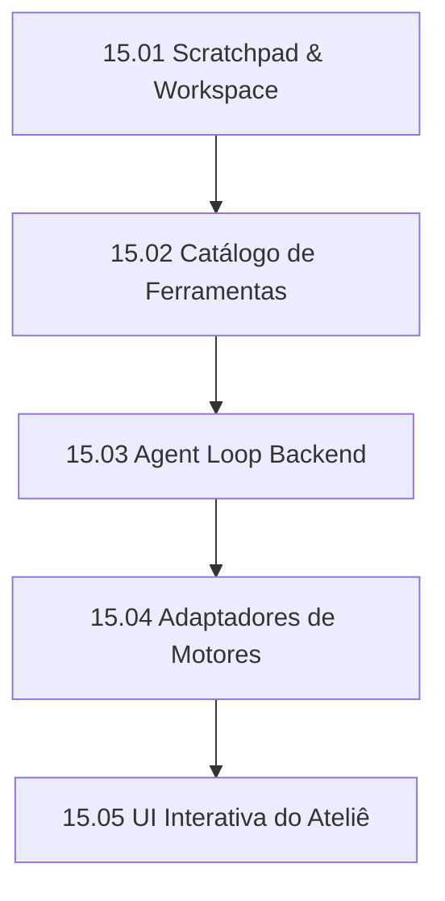

# EP-15: Atelier Agent Runtime & Incremental Prototyping

## 1. Visão Geral

Substitui o mecanismo legado de geração de protótipos de turno único (*One-Shot*) por um **Agent Loop Multi-turnos com Ferramentas e Workspace de Scratchpad**.

O objetivo é eliminar definitivamente:
1. Cortes de código no meio de arquivos causados pelo estouro de `maxOutputTokens` (8k tokens).
2. Erros de indisponibilidade e timeouts de streaming longo.
3. Incapacidade do modelo de planejar, validar suposições ou tirar dúvidas com o usuário antes de gerar.

## 2. Metas de Arquitetura

- **Limite de 300 linhas por arquivo:** Toda a implementação modularizada em serviços coesos (`runtime`, `tools`, `scratchpad`, `ui-adapters`).
- **Sem emojis:** Todos os ícones visuais usando exclusivamente FontAwesome (`fa-solid` / `fa-regular`).
- **Single Responsibility Principle (SRP):**
  - `atelier-scratchpad.service.js`: Gestão de arquivos de trabalho e rascunho temporário.
  - `atelier-tools.service.js`: Catálogo de ferramentas executáveis do Ateliê.
  - `atelier-agent-loop.service.js`: Loop de orquestração multi-turnos com controle de passos e rollback.
  - `prototype-atelier-chat.js`: Componente visual do chat que renderiza o plano, ferramentas e perguntas.

## 3. Histórias de Usuário (Entregas Atômicas)

| ID | Título | Foco | Dependências |
|---|---|---|---|
| **15.01** | **Scratchpad & Workspace Temporário do Protótipo** | Criação e ciclo de vida da pasta `scratch/` dentro do protótipo ativo para planos, notas e arquivos intermediários. | Nenhuma |
| **15.02** | **Catálogo de Ferramentas Nativas do Ateliê** | Definição das ferramentas: `atelier_plan`, `atelier_write_screen`, `atelier_patch_styles`, `atelier_ask_user`, `atelier_complete`. | 15.01 |
| **15.03** | **Atelier Agent Loop & Tool Dispatcher (Backend)** | Orquestrador de turnos contínuos no backend que despacha as ferramentas, executa validações locais e acumula estado. | 15.02 |
| **15.04** | **Adaptadores de Motores (Gemini, OpenCode e Claude)** | Envelopamento de tool-calling nativo para Gemini e OpenCode, com fallback resiliente para formato estruturado. | 15.03 |
| **15.05** | **Interface Interativa do Ateliê (Frontend)** | Renderização visual do plano de construção, accordion de ferramentas executadas e cartão de interação/resposta do usuário. | 15.04 |

## 4. Grafo de Dependências

## 5. Critérios de Aceite Globais

1. Nenhum protótipo complexo tem seu código corrompido ou truncado por limite de tokens.
2. O usuário pode acompanhar em tempo real o plano de telas sendo construído passo a passo.
3. Se o modelo tiver dúvidas sobre o briefing, ele emite `atelier_ask_user` gerando um cartão interativo na tela antes de escrever código.
4. Cobertura completa de testes automatizados com `node --test`.
