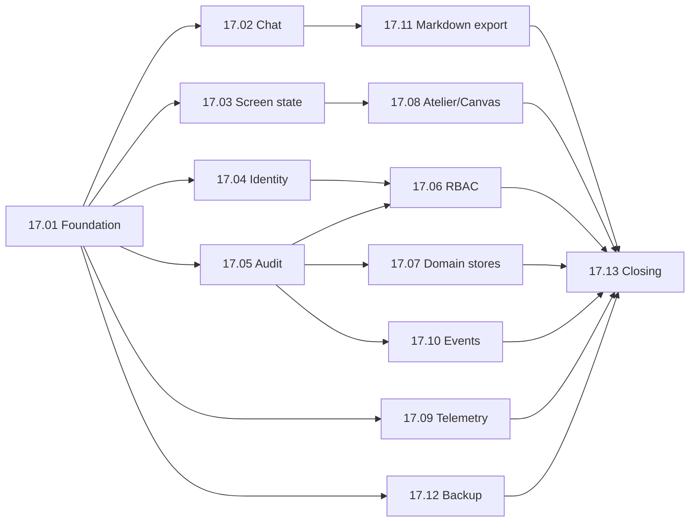

# EP-17: SQLite as system of record, with RBAC and audit trail

[Back to index](../../00-index.md)

## Objective
Move durable application state from `localStorage`, scattered JSON/JSONL files and markdown transcripts into one SQLite database (`data/harness.sqlite`), so a browser refresh can never lose context. On the same foundation, add local identity, role-based access control and a tamper-evident audit trail of every action.

## Problem in one sentence
Engine session ids live only in the browser and about 15 server stores write files non-atomically without locks, so Ctrl+F5 lost an OpenCode conversation on 2026-11-01 and the system has no authenticated actor to audit.

## Decisions
- [ADR-012](../../03-decisions/ADR-012-sqlite-sistema-de-registro.md): single global database, `node:sqlite`, vertical slices behind unchanged HTTP contracts, importer plus rollback flag per slice.
- [ADR-013](../../03-decisions/ADR-013-identidade-rbac-auditoria.md): local users and sessions, permission-per-route RBAC (fail closed), hash-chained append-only audit log exempt from retention.
- Stays on disk: curated memory, instructions, `context/`, Atelier source files, docs, and the multi-agent ledger (re-evaluated in 17.13).
- Inventory and evidence: [sqlite-migration-inventory](../../01-architecture/sqlite-migration-inventory.md).

## Stories
| ID | Story | Priority | Depends on |
|---|---|---|---|
| [17.01](17.01-fundacao-banco.md) | Database foundation: connection, migrations, repositories | P0 | none |
| [17.02](17.02-chat-sessoes-mensagens.md) | Chat sessions and messages in the database (fixes the F5 loss) | P0 | 17.01 |
| [17.03](17.03-estado-telas-sqlite.md) | Screen state and history in the database | P0 | 17.01 |
| [17.04](17.04-identidade-sessoes.md) | Local identity and server sessions | P0 | 17.01 |
| [17.05](17.05-trilha-auditoria.md) | Hash-chained audit trail for every mutating action | P0 | 17.01 |
| [17.06](17.06-rbac.md) | RBAC: roles, permissions and route enforcement | P0 | 17.04, 17.05 |
| [17.07](17.07-stores-dominio.md) | Domain stores: scrum, projects, permissions, deploy, routines | P1 | 17.01, 17.05 |
| [17.08](17.08-atelie-canvas-metadados.md) | Atelier and Canvas metadata and history | P1 | 17.01, 17.03 |
| [17.09](17.09-telemetria-jsonl.md) | Telemetry and run logs from JSONL to tables | P1 | 17.01 |
| [17.10](17.10-eventos-sessoes-canonicas.md) | Event store and canonical sessions consolidation | P1 | 17.01, 17.05 |
| [17.11](17.11-exportacao-markdown.md) | Markdown export and import projection | P1 | 17.02 |
| [17.12](17.12-backup-integridade.md) | Backup, restore and integrity checks | P1 | 17.01 |
| [17.13](17.13-avaliacao-restante-fechamento.md) | Remaining-system evaluation and closing | P2 | all |

## Waves
1. **Wave 1 (P0, fix and foundation):** 17.01, then 17.02 and 17.03 in parallel with 17.05. 17.02 closes the F5 incident.
2. **Wave 2 (control):** 17.04, then 17.06. RBAC runs `report-only` before `enforce`.
3. **Wave 3 (breadth):** 17.07 to 17.12, parallelizable by owner paths (each story names its files).
4. **Wave 4:** 17.13 evaluates what is left, including whether the coordination ledger should move.

## Reserved migration numbers
`001` 17.01, `002` 17.02, `003` 17.03, `004` 17.04, `005` 17.05, `006` 17.06, `007` 17.10, `008` 17.07, `009` 17.08, `010` 17.09. A story may add more files only with a number after its own, reserved here first. Every story declares `owns:` globs in its frontmatter, so `node tools/coordination.js` can refuse overlapping claims.

## How an agent starts
1. Read this README, then only the story you claim and the ADRs it cites (ADR-012, ADR-013) and the [inventory](../../01-architecture/sqlite-migration-inventory.md).
2. Start with 17.01 (everything depends on it); then claim by the scope-checked flow in `.agents/skills/multi-agent-coordination/references/scrum-multiagent-flow.md` (`claim --worktree`, one worktree per story).
3. Keep delegated stories to about 3 files or split them; review combo diffs and re-run their tests.

## Rules for every story
- Each slice keeps the existing HTTP contract, ships an idempotent importer and a rollback flag, and leaves `npm test` green.
- Run `npm test` before touching importers (golden master in `tests/golden/`); chat format changes only in `tools/lib/chat-format.js`.
- No deletion of old files without explicit user confirmation.
- Files stay at 250 to 300 lines; repositories split by aggregate. No emojis; FontAwesome only.
- Update the file map (`docs/mapa/...`) in the same task, then `node tools/mapa.js check`.
- Sensitive data: chat content passes the redaction pipeline on write; the audit log stores identifiers, never content.
