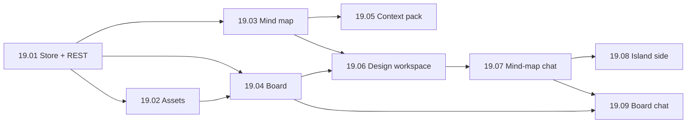

# EP-19: Canvas: whiteboard and mind maps

[Back to index](../../00-index.md)

## Objective
Give each project a visual workspace: free-form boards (Excalidraw) and Whimsical-style mind maps, stored per project on the server, whose selections can be handed to agents as a deterministic context pack.

## Why a new epic
The Canvas stories were first labelled 16.01 to 16.05 in ADR-011 and in commits. EP-16 is Atelier navigation, EP-17 is SQLite and EP-18 is Scrum trace, so the labels collided. This epic holds the canonical numbers 19.01 to 19.09 (19.06 to 19.09 were added while integrating the canvas with the Design workspace and the chat). Foundation work for the React/Vite pipeline (ADR-011 step 1, "story 16.00") is not renumbered here.

| Old label (ADR-011, commits) | Canonical |
|---|---|
| 16.01 | 19.01 |
| 16.02 | 19.02 |
| 16.03 | 19.03 |
| 16.04 | 19.04 |
| 16.05 | 19.05 |

## Decisions
- [ADR-011](../../03-decisions/ADR-011-frontend-react-typescript-vite.md): React 19 + TypeScript + Vite islands; Canvas is the first island.
- Boards live in `projects/<slug>/canvas/`, not in screen-state (32 KB cap). Map: `docs/mapa/backend/canvas/canvas-store.md`.
- EP-17 story 17.08 (Atelier and Canvas metadata in SQLite) will later move board metadata; the REST contract of 19.01 stays unchanged.

## Stories
| ID | Story | Priority | Status | Depends on |
|---|---|---|---|---|
| [19.01](19.01-board-store-rest.md) | Board store and REST | P0 | concluida | foundation (ADR-011 step 1) |
| [19.02](19.02-assets-content-addressed.md) | Content-addressed assets | P0 | concluida | 19.01 |
| [19.03](19.03-mindmap-island.md) | Mind-map island | P1 | concluida | foundation, 19.01 |
| [19.04](19.04-board-island-excalidraw.md) | Board island with Excalidraw | P1 | concluida | 19.01, 19.02 |
| [19.05](19.05-selection-context-pack.md) | Selection to agent context pack | P1 | concluida | 19.03 |
| [19.06](19.06-canvas-no-workspace-do-design.md) | Canvas inside the Design workspace | P1 | concluida | 19.03, 19.04 |
| [19.07](19.07-chat-mapa-mental-parser-e-ponte.md) | Mind-map chat: outline parser and chat bridge | P1 | concluida | 19.03, 19.06 |
| [19.08](19.08-chat-mapa-mental-lado-da-ilha.md) | Mind-map chat: island side | P1 | concluida | 19.07 |
| [19.09](19.09-chat-quadro-diagramas-mermaid.md) | Board chat: Mermaid diagrams | P1 | planejada | 19.04, 19.07 |

## Rules for every story
- Files stay at 150 to 250 lines (max 300), including `.ts`/`.tsx`. No emojis; FontAwesome only.
- Update the file map (`docs/mapa/...`) in the same task, then `node tools/mapa.js check`.
- Islands follow the mount/unmount contract in ADR-011 and talk to legacy code only through the router and `harness:*` events.
