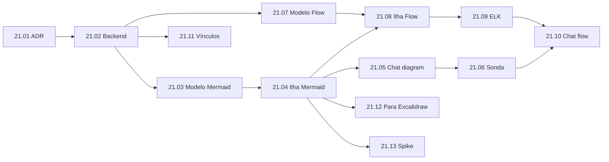

# EP-21: Diagramas estruturados no Visual Workspace

[Voltar ao índice](../../00-index.md)

## Objetivo
Ampliar o Canvas (EP-19) com tipos de diagrama estruturados, sem duplicar o mapa mental e o Excalidraw, permitindo criação visual e geração por agentes de IA.

## Inventário (verificado em 2026-11-06)

| Capacidade | Estado no repositório | Lacuna |
|---|---|---|
| Excalidraw 0.18.1 | Ilha `canvas-board` (19.04), lazy, autosave, assets, export PNG/SVG | Nenhuma |
| Mapa mental | Ilha `canvas-mindmap` (19.03) com `@xyflow/react` + `d3-hierarchy` | Nenhuma |
| React Flow (`@xyflow/react` ^12) | Já é dependência; usado só pelo mapa mental | Falta editor de fluxo genérico (nós tipados, portas, validação) |
| Mermaid | Só `@excalidraw/mermaid-to-excalidraw` 2.2.2: converte flowchart, sequence e class em desenho Excalidraw (19.09), em um sentido e com perda | Não existe `mermaid` (renderer/parser), nem `kind` próprio que guarde o texto-fonte; state, ER, gantt são recusados |
| Layout automático | `d3-hierarchy` (só árvores) | Sem ELK.js (grafos gerais, DAG, camadas) |
| Armazenamento | `projects/<slug>/canvas/<uuid>.json`, `kind` + `data` opaco (4 MB), `rev`, assets por sha256, migrações | `KINDS` fixo em `canvas-validate.js`; sem metadado de vínculo (história, agente) |
| Ponte do chat | Blocos `<mindmap>` e `<board>` (`canvas-chat-bridge.js`, 167 linhas); sonda `tools/canvas-chat-probe.js` (14 cenários) | Sonda registrada como P-109: até a última nota que encontrei, só respostas simuladas foram testadas; não achei relatório com modelos reais |
| PlantUML, Graphviz, D2, BPMN.io | Ausentes | Ver decisões abaixo |

Duas premissas da proposta original mudam: React Flow não é "próxima ferramenta", já está no bundle; e Mermaid já existe de forma parcial, mas só como atalho para desenhar no Excalidraw.

## Decisões propostas

Registradas no [ADR-014](../../03-decisions/ADR-014-diagramas-formato-nativo.md) (proposta).

1. **Formato nativo por `kind`.** Novos kinds: `diagram` (`data.schema = "mermaid@1"`, `{source, diagramType}`) e `flow` (`"flow@1"`, `graph` + `layout`). Nada é convertido entre formatos de forma implícita; "Abrir como quadro" é uma ação explícita que cria um board novo e mantém o original.
2. **Documentação x executável** vira `data.purpose: "doc" | "executable"` no `flow`. A execução fica para um épico próprio, depois do EP-15: o `flow@1` separa o grafo semântico (nós, arestas, parâmetros) das coordenadas, e o executor lê só o grafo.
3. **Vínculos** (história, épico, agente, projeto) ficam em `links: [{type, id}]` na raiz do board, fora de `data`, valendo para todos os kinds.
4. **UML e ERD não ganham editores visuais próprios no início.** Sequência, classes, estados e ER ficam em Mermaid (texto + preview + IA). Um editor visual de UML custa muito e tende a ficar subusado; só com demanda medida. Isto substitui a Fase 3 da proposta original.
5. **PlantUML** exige Java ou um servidor de renderização (Kroki): processo externo e superfície de segurança. Vai para o spike 21.13.
6. **BPMN** (bpmn-js): verificar a licença (a do bpmn.io costuma exigir manter a marca d'água) no spike. **C4**: Mermaid C4 (experimental) ou D2, sem editor.
7. **ELK.js** sob demanda, em Web Worker se pesado; usado no `flow` e para posicionar fluxos gerados por IA.
8. **Segurança do Mermaid:** `securityLevel: "strict"`, sem HTML nos rótulos, SVG sanitizado antes de entrar no DOM; a ilha segue o contrato do ADR-011.

## Histórias

| ID | História | Prioridade | Depende de | Tamanho |
|---|---|---|---|---|
| [21.01](21.01-adr-formato-nativo.md) | ADR-014 aceito; abas do Design; spike `mermaid.parse` em Node | P0 | EP-19 | S |
| [21.02](21.02-backend-kinds.md) | Backend: registro de kinds, `diagram` e `flow` | P0 | 21.01 | S |
| [21.03](21.03-modelo-mermaid.md) | Modelo puro Mermaid: detecção, validação, render seguro, export | P0 | 21.02 | S |
| [21.04](21.04-ilha-mermaid.md) | Ilha Mermaid: texto, preview, autosave, registro no Design | P0 | 21.03 | M |
| [21.05](21.05-chat-diagram.md) | Chat `<diagram>` com reparo automático; ponte legada dividida por kind | P0 | 21.04 | M |
| [21.06](21.06-sonda-modelos.md) | Sonda de modelos e nova ordem do `harness-diagramas` | P0 | 21.05 | M |
| [21.07](21.07-modelo-flow.md) | Modelo puro Flow: grafo, validação, comandos, histórico | P1 | 21.02 | M |
| [21.08](21.08-ilha-flow.md) | Ilha Flow com React Flow | P1 | 21.07, 21.04 | M |
| [21.09](21.09-layout-elk.md) | Layout automático com ELK.js | P1 | 21.08 | S |
| [21.10](21.10-chat-flow.md) | Chat `<flow>` (JSON semântico, `merge`, reparo) | P1 | 21.09, 21.06 | M |
| [21.11](21.11-vinculos.md) | Vínculos com histórias, épicos e agentes | P2 | 21.02 | S |
| [21.12](21.12-mermaid-para-excalidraw.md) | Mermaid para Excalidraw como ação explícita | P2 | 21.04 | S |
| [21.13](21.13-spike-bpmn-c4-plantuml.md) | Spike BPMN, C4, PlantUML, Graphviz | P2 | 21.04 | S |

Cada história: arquivos de 150 a 250 linhas (máx. 300), sem emojis, FontAwesome, mapa atualizado na mesma tarefa, worktree própria.

## Execução

- **Fase 1 (Mermaid):** 21.01 a 21.06. Maior cobertura de tipos com menor esforço, e mede os modelos.
- **Fase 2 (Flow):** 21.07 a 21.10. A 21.07 pode correr em paralelo com 21.03 a 21.05 (arquivos disjuntos).
- **Fase 3:** 21.11 a 21.13, em qualquer ordem.
- **Execução de workflows:** fora deste épico; épico próprio depois do EP-15, lendo só `graph` de `flow@1` com `purpose: "executable"`.

### Quem faz o quê

| Trabalho | Executor |
|---|---|
| 21.01, refatoração da ponte (21.05), `merge` do Flow (21.10) | Sessão principal: decisões e mudanças cirúrgicas com contexto ativo |
| Modelos puros e testes (21.03, 21.07, 21.09) | Delegável ao OpenCode (`harness-implementacao` / `harness-testes`) com brief pequeno; revisão na sessão |
| Ilhas (21.04, 21.08) | Sessão principal ou Sonnet; verificação no navegador sempre na sessão |
| Sonda (21.06) | Script; modelos grátis por padrão, pagos só com pedido |

## Modelos subjacentes

Ver [modelos.md](modelos.md).
