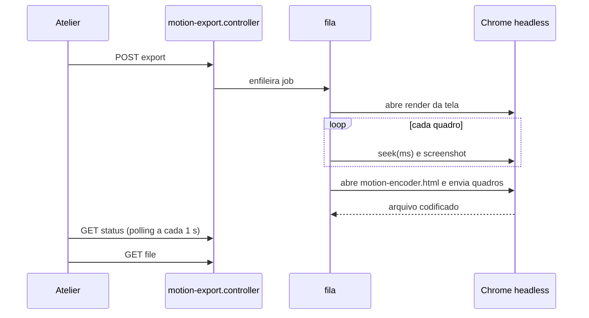

# EP-24.05: Exportação de vídeo

## 1. Identificação
- **Épico:** [EP-24](README.md)
- **Prioridade:** P1
- **Dependências:** 24.02
- **Bloqueia:** nenhuma
- **Pode tocar além da lista acima:** `package.json` (uma dependência de muxer fixada em versão exata e, se escolhido, um encoder de GIF), `SETUP.md` (seção de exportação) e `tools/atelier-pilot/lib/browser.js` (só reuso do launcher, sem mudar o comportamento atual).

## 2. Contexto
`playwright-core` já é dependência e `tools/atelier-pilot/lib/browser.js` abre o Chrome ou o Edge instalados sem baixar navegador. O `ffmpeg` não está instalado na máquina de referência. O runtime da 24.02 expõe `window.__harnessMotion.seek(ms)` e só confirma o quadro depois de renderizado.

## 3. Objetivo
O usuário clica em "Exportar vídeo", escolhe formato, resolução e fps, acompanha o progresso e baixa o arquivo, sem instalar nada além do que o harness já usa.

## 4. Requisitos
**Funcionais**
- RF1. Spike inicial (até meio dia): escolher o muxer (candidatos: `mediabunny`, `webm-muxer`) e confirmar o suporte a VP9 e H.264 no `VideoEncoder` do Chrome headless no Windows. Registrar a decisão no ADR-018.
- RF2. `POST .../motion/:screenId/export { format: webm|mp4|gif, fps?, scale? }` cria um job e devolve `{ jobId }`. `GET .../motion/export/:jobId` devolve `{ status, frame, total, error? }` e `GET .../motion/export/:jobId/file` baixa o resultado.
- RF3. O job abre o render da tela no viewport de `size` × `scale`, espera `__harnessMotion.ready`, e para cada quadro chama `seek`, espera a confirmação e captura um screenshot PNG.
- RF4. A codificação roda numa página local do próprio harness (`motion-encoder.html`) aberta no mesmo navegador: recebe os quadros, codifica com `VideoEncoder` e monta o arquivo com o muxer. MP4 só é oferecido se `isConfigSupported` aceitar H.264; caso contrário, a UI mostra só WebM e GIF.
- RF5. Se `ffmpeg` estiver no PATH, o job pode usá-lo para MP4 (detecção automática e opção `HARNESS_FFMPEG=0` para desligar). Ele nunca é obrigatório.
- RF6. Um job por vez por projeto (os demais esperam na fila), cancelamento por `DELETE`, timeout de 10 minutos, e arquivos em `projects/<slug>/design/exports/` removidos após 24 h.
- RF7. No Atelier, o botão "Exportar" (`fa-solid fa-file-video`) na barra do player abre o diálogo com formato, fps e escala, e mostra barra de progresso e link de download.

**Não funcionais**
- O navegador headless abre só URLs do próprio servidor (lista de origens permitidas), nunca URL vinda do usuário.
- Cada serviço com até 250 linhas: fila, captura, codificação e limpeza em módulos separados (`motion-export-queue`, `motion-export-capture`, `motion-export-encode`, `motion-export-cleanup`).
- Exportar 10 s a 30 fps em 1080p deve levar menos de 2 minutos na máquina de referência (meta medida e registrada).

## 5. Arquitetura


## 6. Implementação
1. Spike do muxer e do encoder, com registro no ADR.
2. Captura quadro a quadro com teste num navegador real (pula se não houver navegador).
3. Página de codificação e montagem do arquivo.
4. Fila, endpoints, limpeza e fallback opcional com ffmpeg.
5. Diálogo na UI (protótipo aprovado junto com a 24.03 ou antes desta etapa).
6. `SETUP.md` e linhas no mapa.

## 7. Cenários BDD
```gherkin
Funcionalidade: Exportar animação como vídeo

  @auto
  Cenário: CP-16 Exportar WebM
    Dado uma timeline de 1000 ms a 24 fps
    Quando exporto em webm
    Então o job termina com 24 quadros
    E o arquivo baixado é um WebM com duração de 1 s

  @auto
  Cenário: CP-17 MP4 indisponível sem suporte
    Dado um encoder que não aceita H.264 e sem ffmpeg
    Quando peço as opções de exportação
    Então mp4 não aparece entre os formatos

  @auto
  Cenário: CP-18 Cancelar exportação
    Dado um job em andamento
    Quando envio DELETE para o job
    Então o status vira cancelled e nenhum arquivo fica em exports/

  @auto
  Cenário: CP-19 Fila por projeto
    Dado um job em andamento no projeto
    Quando crio outro job
    Então ele fica com status queued até o primeiro terminar

  @manual
  Cenário: CP-20 Exportar pela interface
    Quando clico em Exportar, escolho GIF e confirmo
    Então vejo o progresso por quadro e baixo um GIF que toca a animação
```

## 8. Testes
| Tipo | Cenário | Comando ou arquivo |
|---|---|---|
| Unitário | CP-17, CP-19, limpeza por idade | `node --test tests/motion-export-queue.test.js` |
| Navegador | CP-16, CP-18 (pula sem Chrome/Edge) | `node --test tests/motion-export-capture.test.js` |
| Manual | CP-20 | navegador |

## 9. Critérios de aceite
- [x] Spike registrado no ADR-018 com versão exata do muxer.
- [x] CP-16 a CP-19 verdes e CP-20 verificado, com o arquivo exportado como evidência.
- [x] Meta de tempo medida e registrada.
- [x] `SETUP.md` explica que o ffmpeg é opcional.

## 10. Riscos
- **Memória com muitos quadros em 1080p:** enviar quadros ao encoder em streaming (um por vez), sem acumular todos na memória.
- **Fontes e imagens que carregam tarde:** `ready` espera fontes e imagens (`img.decode()`) antes do primeiro quadro.
- **Rollback:** desligar a rota de exportação; player e tools continuam funcionando.

## 11. Evidências
- Spike no ADR-018: WebCodecs codifica H.264, VP9, VP8 e AV1 no Chrome headless; `mediabunny` 1.65.2 e `gifenc` 1.0.3 fixados; ffmpeg não usado.
- Mudança em relação ao plano: a página de codificação não fica em `ui/public/`; é servida só ao navegador do job por `page.route` (`motion-export-encoder.browser.js`).
- Meta de tempo: 10 s, 30 fps, 1080p em 46 s (MP4) e 48 s (WebM).
- Testes: `tests/motion-export-queue.test.js`, `tests/motion-export-capture.test.js` (exportações reais e API HTTP), `tests/prototype-motion-export.test.js` (diálogo no Chrome).
- CP-20 no Atelier real: GIF de 640×360 gerado em 5,2 s e baixado; `docs/features/motion-export/evidence/`.
- **Divergência:** o uso opcional do ffmpeg (RF5) não foi implementado. Com H.264 disponível no WebCodecs ele não agrega; o `SETUP.md` diz que o ffmpeg não é necessário (ADR-018).
- **Divergência:** a página de codificação não fica em `ui/public/`; é servida só ao navegador do job por `page.route`, para não ficar exposta no servidor público.
