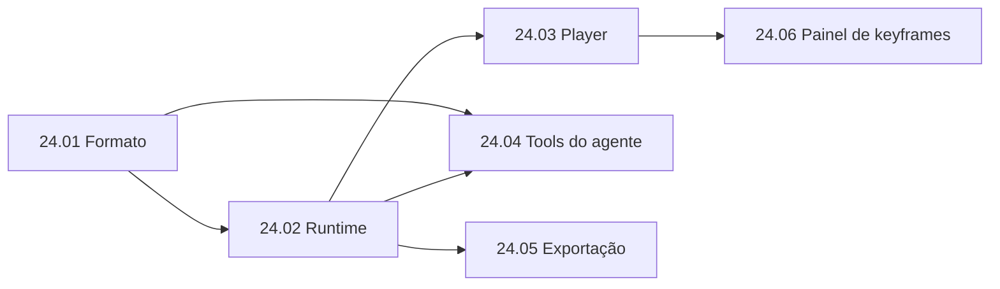

# EP-24: Motion design no Atelier

[Voltar ao índice](../../00-index.md)

## Objetivo
Criar animações (motion design) a partir de telas do Atelier, pedindo pelo chat ou ajustando no próprio Atelier, e exportar o resultado como vídeo. Não haverá um editor separado nem código de animação escrito livremente pelo modelo.

## Problema em uma frase
O Atelier só tem estados estáticos: hoje não há como descrever, pré-visualizar nem exportar movimento de uma tela.

## Inventário (verificado em 2026-11-21)

| Capacidade | Estado no repositório | Lacuna |
|---|---|---|
| Render de tela | `GET .../prototypes/:protoId/render/:screenId` (`prototype.controller.js`), iframe `sandbox="allow-scripts"` | Nenhuma |
| Alvos estáveis | `data-pid` injetado em todo elemento (`prototype-sanitizer.service.js`) | Nenhuma; vira contrato do motion |
| Bridge do iframe | Scripts injetados por `prototype-sandbox-common.service.js`; mensagens `HARNESS_PROTO_*` | Sem mensagens de tempo (`seek`, `play`) |
| Tools do agente | Tags `<tool name=...>` (`atelier-tools.service.js`, 256 linhas; parser em `atelier-tool-tags.service.js`) | Sem tools de timeline |
| Navegador headless | `playwright-core` ^1.64 e `tools/atelier-pilot/lib/browser.js` (Chrome ou Edge instalados) | Sem captura quadro a quadro |
| Codificação de vídeo | Nada; `ffmpeg` ausente na máquina de referência | Encoder sem ffmpeg (WebCodecs) |

## Decisões
- [ADR-018](../../03-decisions/ADR-018-motion-timeline-format.md): composição = tela do Atelier + `screens/<id>.motion.json` (`motion@1`), runtime com Web Animations API, tools de dados (não de código) e exportação no Chrome headless sem ffmpeg obrigatório.
- Fica fora do épico: exportação Lottie, áudio, e editor de curvas de easing.

## Histórias
| ID | História | Prioridade | Depende de |
|---|---|---|---|
| [24.01](24.01-formato-motion-validador.md) | Formato `motion@1`, validador e armazenamento | P1 | nenhuma |
| [24.02](24.02-runtime-timeline-iframe.md) | Runtime da timeline no iframe (seek, play, pause) | P1 | 24.01 |
| [24.03](24.03-player-atelier.md) | Player no Atelier: transporte, scrub e modo Motion | P1 | 24.02 |
| [24.04](24.04-tools-agente-motion.md) | Tools do agente para criar e ajustar a timeline | P1 | 24.01, 24.02 |
| [24.05](24.05-exportacao-video.md) | Exportação de vídeo (WebM, MP4, GIF) em job assíncrono | P1 | 24.02 |
| [24.06](24.06-painel-timeline-keyframes.md) | Painel de timeline com faixas e keyframes editáveis | P2 | 24.03 |

O MVP vai da 24.01 até a 24.05: com ele dá para criar a animação pelo chat, pré-visualizar e exportar o vídeo. A 24.06 traz a edição visual fina.

## Rota de entrega
Rota completa (`feature-delivery`) em todas as histórias: elas mudam contrato (formato de arquivo novo, mensagens do bridge, tags de tool), e a 24.03 e a 24.06 criam elemento visual novo, então precisam de protótipo aprovado.

## Riscos do épico
- **God module no painel de timeline:** a 24.06 nasce decomposta (régua, faixa, keyframe, arrasto, estado), cada arquivo com até 250 linhas.
- **Orfandade de `data-pid`:** editar a tela pode remover o alvo de uma faixa. O validador aponta faixas órfãs e não as apaga.
- **Suporte a H.264 no WebCodecs:** varia por sistema. WebM (VP9) é o padrão garantido e MP4 só sai se `VideoEncoder.isConfigSupported` aceitar.
- **Qualidade do modelo:** gerar keyframes coerentes precisa de sonda com modelos reais (lição do P-109 no EP-21). Isso está nos critérios da 24.04.
