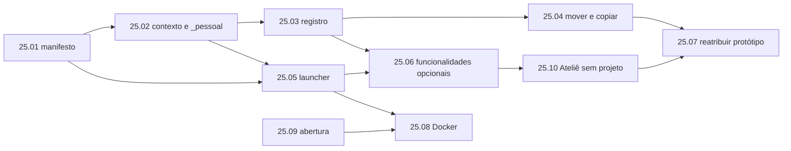

# EP-25: Escopos de funcionalidade, posse de artefatos e distribuição aberta

[Voltar ao índice](../../00-index.md)

## Objetivo

Permitir usar as funcionalidades do Harness sem um projeto (chat, Ateliê, Canvas, mapa mental), mover ou copiar artefatos entre donos depois, e entregar o produto "pronto" para quem não quer montar o ambiente: um comando com Docker, primeira execução guiada, repositório aberto e chaves de LLM de cada usuário.

## Problema em uma frase

O projeto ativo (`projects/.active`) é um estado global implícito que cerca de 20 serviços leem por conta própria, então nenhuma funcionalidade consegue funcionar sem projeto, nenhum artefato troca de dono e a instalação depende de montar Node, git e CLIs à mão.

## Decisões

- [ADR-019](../../03-decisions/ADR-019-escopos-e-posse-de-artefatos.md): três escopos de funcionalidade (projeto, opcional, global), contexto explícito no lugar do `.active` implícito, workspace pessoal `_pessoal` e artefato com id estável e dono como metadado.
- [ADR-020](../../03-decisions/ADR-020-distribuicao-aberta-e-empacotamento.md): distribuição aberta e self-hosted com chaves próprias (BYOK), Docker agora, app desktop só com demanda real e critérios de promoção.
- Reaproveita [ADR-012](../../03-decisions/ADR-012-sqlite-sistema-de-registro.md): banco global com `project_id`. Mudar o dono de um artefato troca essa coluna e move o conteúdo em disco.

## Relação com outros épicos

| Épico | Relação |
|---|---|
| EP-17 (SQLite) | 25.03 usa a fundação do banco (17.01). As tabelas de Ateliê e Canvas (17.08) passam a apontar para o `artifact_id` do registro. |
| EP-07 (Artefatos) | O inventário e os metadados de origem (07.01, 07.03) são a base do registro, que não os substitui. |
| EP-22 (Navegação de projetos) | O seletor `Ctrl+K` (22.04) é reutilizado no launcher, que acrescenta a opção "Sem projeto". |
| EP-23 (Host de execução) | O seletor de host (23.06) é o ponto que um app desktop futuro reaproveitaria. |

## Histórias

| ID | História | Prioridade | Depende de |
|---|---|---|---|
| [25.01](25.01-manifesto-funcionalidades-escopos.md) | Manifesto de funcionalidades e escopos | P0 | nenhuma |
| [25.02](25.02-contexto-escopo-workspace-pessoal.md) | Contexto de escopo explícito e workspace pessoal | P0 | 25.01 |
| [25.03](25.03-registro-artefatos.md) | Registro de artefatos com id estável e dono | P0 | 25.02, 17.01 |
| [25.04](25.04-mover-copiar-artefatos.md) | Mover e copiar artefatos entre donos | P0 | 25.03 |
| [25.05](25.05-launcher-sem-projeto.md) | Launcher com seletor de projeto e "Sem projeto" | P1 | 25.01, 25.02, 22.04 |
| [25.06](25.06-funcionalidades-opcionais.md) | Janelas próprias de chat, mapa mental, quadro livre e diagramas, sem projeto | P1 | 25.03, 25.05 |
| [25.07](25.07-atelie-prototipo-reatribuicao.md) | Reatribuição de protótipo entre projetos | P2 | 25.04, 25.10 |
| [25.08](25.08-docker-primeira-execucao.md) | Empacotamento Docker e primeira execução guiada | P1 | 25.05 |
| [25.09](25.09-abertura-repositorio.md) | Abertura do repositório: licença, créditos e doação | P1 | nenhuma |
| [25.10](25.10-atelie-sem-projeto.md) | Ateliê com janela e rota próprias, sem projeto | P1 | 25.03, 25.05, 25.06 |

## Pendências de planejamento

- **Retirar das telas de projeto e criar rotas próprias (histórias de correção ou novo épico), ainda não criado.** Ateliê, mapa mental, quadro livre e diagramas hoje nascem dentro do workspace de Design/Studio (`design-canvas-workspace.js`, `design-canvas-catalog.js`), que é amarrado a projeto, e o Scrum também deve ser revisado para ver se embute algum deles. Falta decidir, com o dono: se vira um conjunto de histórias de correção neste épico ou um épico novo; o que sai de dentro do Studio e do Scrum e o que apenas ganha uma segunda porta de entrada; e como ficam os links antigos. As rotas novas (`/quadro-livre`, `/mapa-mental`, `/diagramas`, `/atelie`) nascem nas histórias 25.06 e 25.10 sem remover nada; a retirada fica nesta pendência.
- **Licença, créditos e doação (25.09):** adiada a pedido do dono em 2026-11-23.

## Aceite do épico

- Chat, Ateliê, mapa mental, quadro livre e diagramas abrem, cada um na sua rota, e salvam sem projeto selecionado; o artefato aparece no workspace pessoal.
- Um mapa mental criado sem projeto vira do projeto 1 por "Mover para projeto", e um protótipo do projeto 2 vira cópia no projeto 3, ambos com confirmação, sem perda e com referências quebradas listadas antes de gravar.
- `docker compose up` numa máquina limpa leva à primeira execução guiada em até 10 minutos, com o servidor ouvindo só em `127.0.0.1`.
- O repositório tem licença escolhida pelo dono, `CREDITS.md` e instruções de doação.

## Fora de escopo

SaaS, login multiusuário remoto, cobrança, isolamento multi-tenant e app desktop. O desktop só entra com demanda real, pelos critérios do ADR-020.

## Regras que valem para todas as histórias

- Limite de 250 a 300 linhas por arquivo, SRP, ícones FontAwesome e nenhum emoji.
- Nenhuma funcionalidade lê `projects/.active` diretamente depois de migrada: recebe o escopo pelo contexto.
- Mover remove da origem e exige confirmação explícita. Nunca sobrescreve no destino.
- Toda criação de arquivo atualiza o mapa em `docs/mapa/`.
