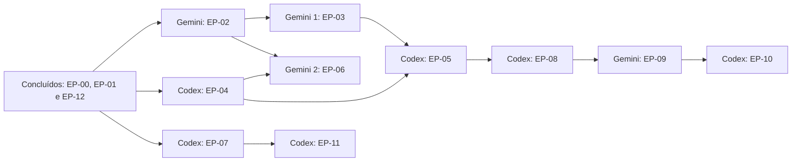

# Painel de Coordenação Gemini + Codex

> **Finalidade:** coordenar os dois chats ativos do Harness Leca — Gemini/Antigravity e Codex — e evitar sobreposição de arquivos, retrabalho e inconsistências de contratos. O [índice mestre](../00-index.md) define o backlog e [progress.md](progress.md) é a fonte oficial dos estados aceitos.

OpenCode e Claude estão fora desta execução por decisão do usuário. Não devem receber histórias, ser acionados ou aparecer como substitutos automáticos.

> **Exceção registrada em 2026-10-21:** por autorização explícita do usuário, uma sessão OpenCode concluiu EP-03.05 a EP-03.09, EP-05.06, EP-06.03 a EP-06.05, EP-07.01 a EP-07.05, EP-08.01 e EP-08.02. A alocação permanente das frentes continua com Gemini/Antigravity e Codex; a exceção não altera a política padrão.

---

## 1. Alocação oficial dos chats

| Chat | Responsabilidade | Épicos | Domínio principal | Próximo trabalho |
|---|---|---|---|---|
| **Gemini / Antigravity — Chat A1 (Escritório)** | Experiência 3D/2.5D e cena | **EP-03** | `ui/public/js/office*`, `office2d/`, `office3d/` | **EP-03.09 concluída** (9/9 no EP-03, épico encerrado); sem pendências na alocação atual |
| **Gemini / Antigravity — Chat A2 (Studio)** | Studio, layout, código e preview | **EP-06** | `ui/public/js/modules/studio*`, `ui/public/css/studio/` | **EP-06.05 concluída** (5/5 no EP-06, épico encerrado) |
| **Codex — Chat B** | Plataforma, dados, workflows, integração e qualidade | **EP-04 → EP-05/EP-07 → EP-08/EP-11 → EP-10**; manutenção da EP-12 | Serviços backend, persistência, Scrum, artefatos, agentes, deploy, testes e documentação de coordenação | **EP-08 encerrada (5/5)**; próxima: **detalhar 09.01 ou EP-11** |

### 1.1. Relação entre as trilhas



Codex executa apenas uma frente de implementação por vez. Com EP-03, EP-05 e EP-07 encerradas, segue entre EP-08 e EP-11 pela que estiver desbloqueada; depois, EP-10. O hardening continua como gate, não como terceira frente paralela.

### 1.2. Pacote inicial de cada chat

Ambos começam lendo `AGENTS.md`, `docs/harness-evolution/00-index.md`, este painel e `docs/harness-evolution/05-progress/progress.md`.

- **Gemini / Chat A1 (Escritório):** a 03.09 está concluída e o EP-03 encerrado; manter a paridade 2.5D, a telemetria, a iluminação dos agentes, a alternância de modos, a qualidade e a acessibilidade da cena. Sem nova história atribuída; não editar arquivos de Studio, Scrum ou backend.
- **Gemini / Chat A2 (Studio):** as 06.01 a 06.05 estão concluídas; manter os limites responsivos, acessibilidade, guard de alterações e o mapeamento de elemento para arquivo/componente. EP-06 encerrado; não editar arquivos de Escritório ou Scrum.
- **Codex / Chat B:** a 08.01, a 08.02, a 08.03, a 08.04 e a 08.05 estão concluídas (catálogo canônico de capacidades, catálogo de etapas do SDLC com agentes, vínculos de skills por projeto e raia, execução de workflows com eventos canônicos e rotinas com aprovação e histórico); o EP-08 está em 5/5 e encerrado; manter o hardening como validação transversal e detalhar 09.01 ou EP-11 conforme o gate. Não assumir arquivos de Chat, Escritório ou interfaces consumidoras do Studio.

Ao terminar uma história, o chat responsável registra evidências e informa ao outro apenas os contratos que viraram dependência. Nenhum chat continua automaticamente para o épico seguinte sem conferir os gates desta página.

---

## 2. Visão Consolidada de Progresso (89/104 Entregas Concluídas)

```
[EP-00] Auditoria e Arquitetura          [████████████████████] 100% (4/4)   - CONCLUÍDO
[EP-01] Window Manager Híbrido           [████████████████████] 100% (10/10) - CONCLUÍDO
[EP-02] Chat Universal e Conversas       [████████████████████] 100% (8/8)   - CONCLUÍDO
[EP-03] Escritório 2.5D/3D              [████████████████████] 100% (9/9)   - CONCLUÍDO
[EP-04] Projetos e Workspaces            [████████████████████] 100% (5/5)   - CONCLUÍDO
[EP-05] Scrum & Sprints (DIS Jira)       [████████████████████] 100% (6/6)   - CONCLUÍDO
[EP-06] Studio, Código e Preview         [████████████████████] 100% (5/5)   - CONCLUÍDO
[EP-07] Artefatos e Documentação         [████████████████████] 100% (5/5)   - CONCLUÍDO
[EP-08] Agentes, Skills e Workflows      [████████████████████] 100% (5/5)   - CONCLUÍDO
[EP-09] Central de Sessões & Orquestração[░░░░░░░░░░░░░░░░░░░░]   0% (0/5)   - ESPECIFICADO
[EP-10] Deploy e Datacenter              [░░░░░░░░░░░░░░░░░░░░]   0% (0/5)   - PLANEJADO
[EP-11] Auditoria e Qualidade            [░░░░░░░░░░░░░░░░░░░░]   0% (0/5)   - PLANEJADO
[EP-12] Prototype Engine Multiframework  [████████████████████] 100% (32/32) - CONCLUÍDO (MARCO M3)
```

---

## 3. Detalhamento das Entregas por Frente

### 3.1. EP-00: Auditoria e Arquitetura Existente (4/4 - Concluído)
- **00.01 Inventário de rotas e serviços:** 87 rotas catalogadas em `docs/harness-evolution/01-architecture/audit/inventory.md`.
- **00.02 Mapa de painéis:** Mapeamento de drawer `#officeDrawer`, duplicidade de chat e matriz de foco WASD em `audit/panels.md`.
- **00.03 Contratos e permissões:** Mapeamento de loopback e PIN remoto em `audit/contracts.md`.
- **00.04 Baseline de testes:** Suíte de regressão inicial em `docs/harness-evolution/04-test-plans/TP-00-baseline.md`.

### 3.2. EP-01: Window Manager Híbrido (10/10 - Concluído)
- **01.01 Registro de módulos:** `ui/public/js/window-manager/window-store.js` e `window-registry.js`. Catálogo FontAwesome e controle de z-index.
- **01.02 Adaptador das estações:** `station-adapter.js`. Mapeia objetos da cena 3D/2.5D para janelas de módulos no Window Manager.
- **01.03 Foco, camadas e câmera:** `focus-manager.js`. Teclas WASD/setas suspensas quando uma janela ganha foco; Escape devolve foco à cena.
- **01.04 Minimizar, restaurar e fechar:** `window-lifecycle.js`. Preservação de estado transiente e hooks de cleanup.
- **01.05 Barra de tarefas:** `taskbar.js` e `12-taskbar.css`. Dark glassmorphism, FontAwesome e alternância direta.
- **01.06 Mover, redimensionar e maximizar:** `drag-resize.js`. Confinamento de tela, alças de redimensionamento e duplo-clique.
- **01.07 Docking, abas e divisão:** `docking-manager.js` e `13-docking.css`. Divisão lateral e agrupamento de janelas em abas.
- **01.08 Persistência e restauração de layout:** `layout-persistence.js`. Schema `_v: 1` isolado por projeto e validação de viewport.
- **01.09 Layouts responsivos:** `responsive-layout.js` e `14-responsive-wm.css`. Breakpoints dinâmicos e modo fullscreen em telas menores.
- **01.10 Workspaces nomeados:** `workspace-presets.js`. Presets de fábrica `dev`, `scrum` e `ops`, com suporte a layouts personalizados.

### 3.3. EP-02: Chat Universal e Conversas (8/8 concluídas - Concluído)
- **02.01 Inventário de chat duplicado:** Concluído (`02.01-inventario-chat.md`).
- **02.02 Modelo canônico de mensagens:** Concluído (`chat-models.js`, `chat-models.d.ts`, `tests/chat-models.test.js`).
- **02.03 Apresentação compacta:** Concluído (`02.03-apresentacao-compacta.md`, `chat-presentations.js`, `chat-mini.js`, `tests/chat-compact-presentation.test.js`).
- **02.04 Apresentação lateral:** Concluído (`02.04-apresentacao-lateral.md`, `chat-presentations.js`, `studio-core.js`, `tests/chat-lateral-presentation.test.js`).
- **02.05 Apresentação completa:** Concluído (`02.05-apresentacao-completa.md`, `chat-presentations.js`, `chat-stream-ui.js`, `tests/chat-complete-presentation.test.js`).
- **02.06 Histórico por motor e continuidade:** Concluído (`02.06-historico-continuidade.md`, `chat-session-store.js`, `chat-continue.js`, `tests/chat-history-continuation.test.js`).
- **02.07 Rolagem ancorada na última mensagem:** Concluído (`02.07-rolagem-ancorada.md`, `chat-presentations.js`, `chat-ui-interaction.js`, `chat-render.js`, `tests/chat-scroll-anchoring.test.js`).
- **02.08 Sincronização com estados reais de execução e hardening:** Concluído (`02.08-sincronizacao-estados.md`, `02.08-sincronizacao-hardening.md`, `chat-execution-store.js`, `chat-send.js`, `chat-stream-ui.js`, `tests/chat-execution-sync.test.js`, `tests/chat-execution-hardening.test.js`). EP-02 encerrado formalmente em 8/8 com zero emojis e todos os 17 módulos de chat em compliance (< 300 linhas).

### 3.4. EP-03: Escritório 2.5D/3D (9/9 concluídas - Concluído)
- **03.01 Catálogo canônico de objetos interativos:** Concluído (`03.01-catalogo-objetos.md`, `office-object-catalog.js`, `stations.data.js`, `facilities.data.js`, `map-objects.js`, `interactions-setup.js`, `tests/office-object-catalog.test.js`).
- **03.02 Contrato padrão de ações dos objetos:** Concluído (`03.02-contrato-acoes.md`, `office-action-dispatcher.js`, áudio contextual automático, `tests/office-action-dispatcher.test.js`).
- **03.03 Estações abrindo janelas pelo Window Manager:** Concluído (`03.03-estacoes-janelas.md`, `station-adapter.js`, foco automático, presets sidebar/floating, bloqueio de câmera WASD com restauração via Escape e `tests/office-station-windows.test.js`).
- **03.04 Presets dos telões:** Concluído (`03.04-presets-teloes.md`, `office-screen-presets.js`, `office-screen.js`, `office-screen-views.js`, gerenciador observável `officeScreenPresets`, zero emojis e `tests/office-screen-presets.test.js`).
- **03.05 Estado real dos agentes na cena:** Concluído (`03.05-estado-real-agentes.md`, `office-agent-state.js`, `office-agent-telemetry.js`, `chat-execution-store.js`, `world-war-room.js`, `war-room-table.js`, poses do Avatar3D, cor do pad, zero emojis e `tests/office-agent-state.test.js` com 8 testes aprovados).
- **03.06 Iluminação funcional:** Concluído (`03.06-iluminacao-funcional.md`, `lighting-presets.js`, `office-lighting.js`, `office-lighting-dom.js`, `office-lighting-bootstrap.js`, `office3d/lighting-rig.js`, `15-lighting.css`, `data-office-lighting` e `tests/office-lighting.test.js` com 7 testes aprovados).
- **03.07 Alternância 3D, diorama e 2.5D:** Concluído (`03.07-alternancia-3d-diorama-25d.md`, `view-modes.js`, `office-view-mode.js`, `16-view-modes.css`, `data-office-view`, persistência por projeto e `tests/office-view-modes.test.js` com 9 testes aprovados).
- **03.08 Paridade do modo 2.5D:** Concluído (`03.08-paridade-modo-25d.md`, `action-bridge.js`, `iso-object-renderers.js`, `iso-parity-furniture.js`, posições 2D completas, assento/levantar e `tests/office-2d-parity.test.js` com 5 testes aprovados).
- **03.09 Desempenho e acessibilidade da cena:** Concluído (`03.09-desempenho-acessibilidade-cena.md`, `scene-preferences.js`, `office-scene-preferences.js`, `frame-loop.js`, DPR limitado, pausa por visibilidade, movimento reduzido, foco/instruções/região viva e `tests/office-scene-accessibility.test.js` com 7 testes aprovados).

### 3.5. EP-12: Prototype Engine & Design System Multiframework (32/32 Concluídas - Marco M3 Homologado)
- **F0 Diagnóstico (4/4):** 12.01 a 12.04 auditando HTMLs, MCP e baseline visual.
- **F1 Registry (4/4):** 12.05 a 12.08 (`design-registry.service.js`, `design-preview.service.js`, `design-extractor.service.js`).
- **F2 Modularização de Boilerplates (4/4):** 12.09 a 12.12 [Marco M1 Homologado] (`tests/marco-m1-validation.test.js`).
- **F3 Prototype Schema (4/4):** 12.13 a 12.16 (`prototype-schema.service.js`, `prototype-state.service.js`, `prototype-validator.service.js`).
- **F4 Reconstrução do Prototipo DIS (4/4):** 12.17 a 12.20 (`prototype-semantic-parser.service.js`, `prototype-screen-decomposer.service.js`, `prototype-reconstructor.service.js`).
- **F5 Sandbox Renderer e Inspetor (4/4):** 12.21 a 12.24 [Marco M2 Homologado] (`prototype-sandbox-renderer.service.js`, `prototype-bridge.service.js`).
- **F6 Adaptadores Multiframework (4/4):** 12.25 a 12.28 gerando código com paridade estrita:
  - Vanilla: `prototype-codegen-vanilla.service.js`
  - Angular 18 Signals: `prototype-codegen-angular.service.js`
  - React 18+ TSX: `prototype-codegen-react.service.js`
  - Testes de paridade: `tests/prototype-codegen-parity.test.js`
- **F7 Studio, Rastreabilidade e Piloto (4/4 - Marco M3 Homologado):**
  - 12.29 Integração ao Studio: `prototype-studio.service.js` e `tests/prototype-studio.test.js`.
  - 12.30 Rastreabilidade Tela -> Nó -> Componente -> Código: `prototype-traceability.service.js` e `tests/prototype-traceability.test.js`.
  - 12.31 Piloto DIS Completo (3 telas, navegação circular e datasets): `tests/prototype-pilot-dis.test.js`.
  - 12.32 Homologação final Marco M3: `tests/marco-m3-validation.test.js` e `reports/M3-validation-report.md`.

### 3.6. EP-05: Scrum & Histórias Reais DIS Jira (6/6 histórias aceitas - Concluído)
- **05.01 Migração compatível:** schema v2 aditivo, backup versionado, escrita atômica, rollback e compatibilidade entre `status` e `laneId`.
- **05.02 Doze raias configuráveis:** catálogo canônico, persistência por projeto, API validada, Kanban por `laneId` e modal acessível.
- **05.03 Reordenação horizontal:** ordem persistida dos 12 IDs, revisão otimista, conflito HTTP 409 e controles por arraste ou teclado no mesmo endpoint.
- **05.04 Movimentação e transições:** matriz canônica adjacente, histórico atômico, preservação Jira, conflito HTTP 409 e controles acessíveis.
- **05.05 Impedimentos, filtros e métricas:** `impediment`/`impedimentHistory`, rota dedicada, filtros compartilhados por texto/responsável/impedimento, métricas da visão filtrada e sinalização no cartão e drawer.
- **05.06 Projeção do Kanban no telão:** abas físicas ao lado do painel (`war-screen-tabs.js`, `war-screen-tabs-model.js`), Orquestração preservada como padrão, Kanban selecionado por clique ou `E`, projeção somente leitura (`war-screen-scrum.js`, `war-screen-projection-model.js`), carga de `/scrum` no `officeState` e atualização por `dai:scrumChanged`; 5/5 testes focados.
- **Tripla fonte de dados:**
  1. `_jira-dis.json`: Snapshot somente leitura de issues reais do Jira interno (473 issues: 449 histórias e 24 épicos).
  2. `doc/scrum/DIS-*/user-story.md`: Documentação e critérios de aceite reais em Markdown.
  3. `projects/<slug>/scrum.json`: Estado do quadro, sprint atual e mapeamento de colunas.
- **Serviços backend:** `project-scrum-jira-source.js`, `project-scrum-doc-source.js`, `project-scrum-resolver.js` e `project-scrum-transitions.js`.
- **Frontend:** módulos `design-scrum-story-*`, `design-scrum-lane-*`; estilos `09-scrum-story-details.css` a `12-scrum-story-transitions.css`.
- **Testes dedicados:** fontes, raias, ordem e transições em `tests/project-scrum-*.test.js` e `tests/design-scrum-*.test.js`.

### 3.7. EP-06: Studio, Código e Preview (5/5 histórias aceitas)
- **06.01 Layout responsivo e redimensionamento:** Concluído (`06.01-layout-responsivo.md`, `studio-layout.js`, `studio-core.js`, `studio.js`, `tests/studio-layout.test.js`), com limites dinâmicos, ARIA separator e persistência por projeto.
- **06.02 Chat compartilhado no Studio:** Concluído (`06.02-chat-compartilhado.md`, `studio-chat.js`, injeção contextual de código e de elementos visuais, `tests/studio-chat.test.js`).
- **06.03 Visualizações Código, Design e Preview:** Concluído (`06.03-visualizacoes-codigo-design-preview.md`, `studio-views.js`, `studio-source.js`, `source-workspace.service.js`, `tests/studio-views.test.js`).
- **06.04 Preservação de alterações e seleção contextual:** Concluído (`06.04-preservacao-alteracoes-selecao.md`, guard `canSwitchStudioView`, registro em `windowManager.unsaved` e fingerprint otimista).
- **06.05 Mapeamento de elementos visuais:** Concluído (`06.05-mapeamento-elementos-visuais.md`, `prototype-element-map.js`, rota `traceability`, painel `#atelierElementMap` e injeção de `<contexto-elemento arquivo=...>`; 14/14 testes focados).

### 3.8. EP-07: Artefatos e Documentação (5/5 histórias aceitas - Concluído)
- **07.01 Inventário de artefatos por projeto:** Concluído (`07.01-inventario-artefatos.md`, `artifact-inventory-scan.service.js`, `artifact-inventory.service.js`, rota `GET /api/project/:slug/artifacts`, aba Artefatos em `design-artifacts.js`), com seis tipos originais, resumo por estado, bloqueio de symlink e caminhos fora do projeto; 7/7 testes focados.
- **07.02 Importação de arquivos e pastas:** Concluído (`07.02-importacao-arquivos-pastas.md`, `artifact-import.service.js`, `artifact-import.controller.js`, rota `POST /api/project/:slug/artifacts/import`, preservação de subpastas, escrita sem sobrescrita e tipo `imported` no inventário); 8/8 testes focados.
- **07.03 Metadados de origem e controle de acesso:** Concluído (`07.03-metadados-origem-controle-acesso.md`, `artifact-metadata.service.js`, `artifact-access.controller.js`, rota `POST /api/project/:slug/artifacts/access`, manifesto `artifacts/.metadata.json`, checksum, acesso `project`/`local` e filtro remoto); 9/9 testes focados.
- **07.04 Previews seguros:** Concluído (`07.04-previews-seguros.md`, `artifact-preview.service.js`, `artifact-preview.controller.js`, `artifact.routes.js`, rota `GET /api/project/:slug/artifacts/preview`, JSON/raw com CSP, bloqueio remoto para `local` e painel na aba Artefatos); 7/8 testes focados (1 symlink ignorado no Windows).
- **07.05 Relacionamentos e Mapa em Camadas:** Concluído (`07.05-relacionamentos-mapa-camadas.md`, `artifact-relationships.service.js`, `artifact-relationships.controller.js`, `design-artifacts-relationships.js`, chave estável por rota/tela/campo, escrita local atômica, vínculos órfãos e navegação para tela/campo/camada no Mapa); 8/8 testes focados; HAR-012 (fidelidade visual) permanece bloqueada.

### 3.9. EP-08: Agentes, Skills e Workflows (5/5 histórias aceitas - Concluído)
- **08.01 Catálogo padronizado de capacidades:** Concluído (`08.01-catalogo-capacidades.md`, `capability-catalog.js`, `capability-definitions.js`, `capability-legacy.js`, `orchestration-capabilities.controller.js`, rotas `GET /api/orchestration/capabilities` e `/capabilities/:provider`), com sete provedores, estados `available`/`degraded`/`unavailable`/`unknown`, `resolveCapability` sem converter ausência em disponível, cancelamento externo rebaixado a `degraded` com escopo `harness_owned` e campos legados derivados; 6/6 testes focados e 6/6 de regressão de orquestração.
- **08.02 Agentes associados às etapas do SDLC:** Concluído (`08.02-agentes-por-etapa-sdlc.md`, `agent-stage-definitions.js`, `agent-stage-catalog.js`, `orchestration-agent-stages.controller.js`, `ui/server/routes/orchestration.routes.js`, rotas `GET /api/orchestration/agent-stages` e `/agent-stages/:stage`), com dez etapas canônicas, 17 agentes DAI com papéis `executor`/`support`, `code-review` como agente `builtin`, consultas por etapa e por agente e 404 para etapa desconhecida; 5/5 testes focados. Rotas consolidadas em `orchestration.routes.js` mantêm `router.js` em 295 linhas.
- **08.03 Vínculo de skills por projeto e raia:** Concluído (`08.03-skills-projeto-raia.md`, `skill-bindings.service.js`, `skill-bindings.controller.js`, `ui/server/routes/skill-bindings.routes.js`, rotas `GET`/`POST /api/project/:slug/skill-bindings`), com manifesto `skill-bindings.json` versionado, validação contra as 12 raias canônicas e as skills reais do projeto, relatório de órfãos, escrita atômica modo `600` restrita a loopback e leitura tolerante a manifesto inválido; 6/6 testes focados. `router.js` em 297 linhas.
- **08.04 Execução de workflows:** Concluído (`08.04-execucao-workflows.md`, `workflow-definitions.js`, `workflow-plan.service.js`, `workflow-runner.service.js`, `orchestration-workflows.controller.js`, `orchestration-workflow-runs.controller.js`, rotas de workflows e workflow-runs), com workflows `feature-delivery` (dez etapas) e `hotfix` (subconjunto ordenado), plano por projeto com agentes, skills reais, raia, gates e faltantes, ciclo de vida com eventos canônicos no event engine, `dryRun` sem eventos e escrita restrita ao loopback; 8/8 testes focados. `router.js` em 296 linhas. Com isso a suíte integral ficou verde (800/801, 1 skip de symlink no Windows) após a trilha do Codex corrigir as falhas de `coordination`/`hia-router`.
  - **Pendências alheias à trilha (resolvidas em 2026-10-21):** as falhas pré-existentes em `tests/coordination.test.js` (Codex marcado inativo por cota em `tools/lib/coordination/config.js`) e em `tests/hia-router.test.js` (esperava `qwen2.5-coder:1.5b`, mas `tools/lib/hia/router.js` devolve `ollama:qwen3.5:4b`) foram corrigidas. A suíte integral está verde (800/801, 1 skip de symlink no Windows).
- **08.05 Rotinas com aprovação e histórico:** Concluído (`08.05-rotinas-aprovacao-historico.md`, `routine-definitions.js`, `routine-runner.service.js`, `workflow-approval.service.js`, `workflow-history.service.js`, `orchestration-routines.controller.js`, `orchestration-approvals.controller.js`, rotas de rotinas, aprovações e histórico), com três rotinas canônicas (`rotina-feature-delivery` diária, `rotina-entrega-manual` e `rotina-hotfix`), chave de idempotência determinística por data local, fila de aprovações pendentes, eventos `execution.approval_requested`/`approved`/`rejected` e histórico persistido em `projects/<slug>/workflow-runs.jsonl`; a aba Rotinas da Visão 360° (`design-routines.js`, `design-routines-api.js`, `21-rotinas.css`) executa rotinas e registra decisões. 7/7 testes do runner, 5/5 de HTTP e 4/4 de interface; `npm test` 812/813 (1 skip de symlink) e `npm run check` verde em 675 JS e 17 JSON. EP-08 encerrado em 5/5 e EP-09 liberado, inclusive a 09.05 (fila de aprovações).

---


## 4. Diretrizes de Coexistência e Concorrência Segura

Para garantir que os dois chats trabalhem no mesmo repositório sem quebrar código ou sobrescrever implementações alheias:

1. **Protocolo de retomada:**
   - Ler `AGENTS.md`, o [índice mestre](../00-index.md), o [progresso oficial](progress.md) e verificar `git status` antes de editar.
   - Trabalhar em uma história detalhada por vez; a tabela acima define a responsabilidade permanente até nova decisão do usuário.
   - Preservar mudanças desconhecidas no worktree compartilhado e não marcar aceite sem evidências na história.
2. **Separação Rígida de Domínios:**
   - Cada chat só edita arquivos da sua frente de trabalho.
   - Qualquer contrato compartilhado (como `proto.json` ou `chat-models.js`) deve ser mantido retrocompatível.
   - `MAPA.md`, entrypoints, contratos globais e documentos de progresso são arquivos serializados: um chat termina sua atualização antes que o outro os edite.
3. **Anti-Monólito (250 a 300 linhas):**
   - Nenhum agente pode inflar arquivos existentes além de 300 linhas.
   - Criação de novos recursos exige submódulos em subdiretórios coesos.
4. **Padrão Estrito de Ícones:**
   - **Zero emojis** no código e nas interfaces visuais. Uso exclusivo de FontAwesome (`fa-solid`, `fa-regular`).
5. **Verificação Dupla Pré-Entrega:**
   - Toda história concluída deve rodar `npm run check` (zero erros de sintaxe) e `npm test` (100% de testes passando).
   - O arquivo `MAPA.md` deve ser atualizado no mesmo lote para documentar novos arquivos.

## 5. Handoffs obrigatórios

| Origem | Destino | Gate entregue |
|---|---|---|
| Gemini EP-02 | Gemini EP-06 | Contratos das apresentações e sessões estabilizados |
| Codex EP-04 | Gemini EP-06 | Seleção, persistência, templates e guard `windowManager.unsaved` estabilizados; o Studio registra/limpa seu dirty state e trata `UNSAVED_CHANGES` |
| Gemini EP-03 | Codex EP-05 | Contrato do telão necessário à projeção do Kanban |
| Codex EP-05 | Codex EP-08 | EP-05 encerrado: raias, transições, impedimentos e projeção no telão aceitos |
| Codex EP-08 | EP-09 transversal | Workflow, rotinas e políticas de aprovação com contrato estável (entregue em 08.04 e 08.05) |
| EP-02/03/04/08 | EP-09 transversal | Chat, Escritório, projeto e workflow estabilizados |
| EP-09 transversal | Codex EP-10 | Saúde, timeline, atenção e recuperação de estado disponíveis |
| Codex EP-07 | Codex EP-11 | Inventário, importação, previews e relações de artefatos disponíveis para auditoria |

Em todo handoff, o produtor registra contrato, testes e limitações na história. O consumidor não copia a lógica: importa ou adapta o contrato publicado.
