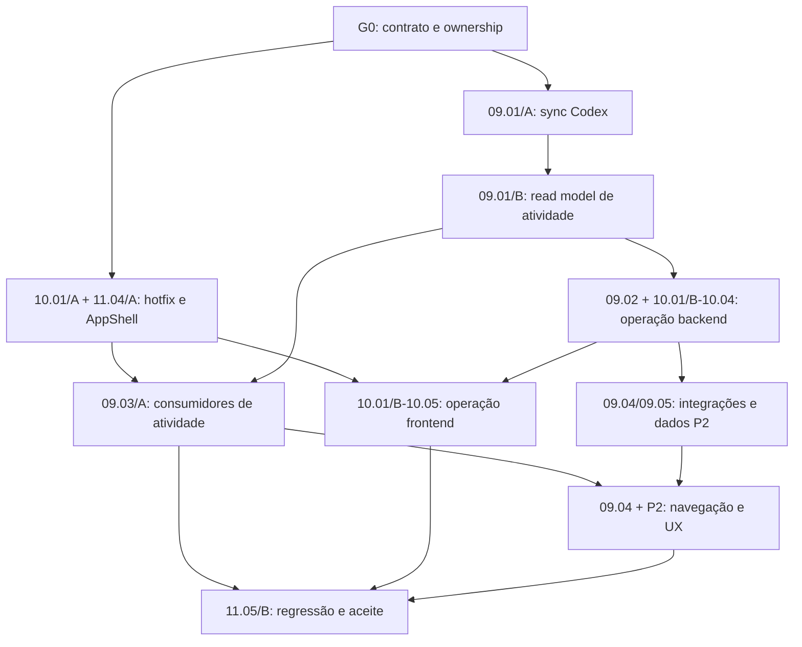

# Índice multiagente — atividade, interface e deploy

Este índice transforma o [plano de unificação](../PLAN-unificacao-atividade-interface-deploy.md) em fatias executáveis sobre os épicos existentes. Ele não cria novas histórias contáveis nem altera o total oficial do programa.

Somente Gemini/Antigravity e Codex participam desta iniciativa. Claude e OpenCode permanecem inativos.

## 1. Como usar

1. Verificar o gate e a onda liberada neste documento.
2. Consultar a história-mãe em EP-09, EP-10 ou EP-11.
3. Registrar `claim` e `start` no ledger antes de editar.
4. Editar somente os arquivos pertencentes à sua trilha.
5. Rodar testes direcionados da fatia e registrar evidência.
6. Fazer o handoff pelo ledger; o consumidor não copia regras do produtor.
7. Apenas o integrador edita arquivos serializados e executa a regressão integral.

Os IDs de fatia (`09.01/A`, `10.01/A`, etc.) servem à coordenação deste índice. No ledger, use a história-mãe, por exemplo:

```powershell
node tools/coordination.js claim EP-09.01 --provider codex --project harness-leca
node tools/coordination.js start EP-09.01 --provider codex --project harness-leca
node tools/coordination.js handoff EP-09.01 --provider codex --to gemini --message "Contrato e evidências publicados" --project harness-leca
```

## 2. Gate G0 — contrato e limites

Antes da primeira fatia de implementação, ficam estabelecidas estas regras:

- `projects/<slug>/chats/*.md` permanece fonte do conteúdo das conversas.
- O registro operacional previsto no EP-09 é uma projeção derivada e reconstruível.
- O read model inicial pode ler Markdown diretamente, mas isso não conclui EP-09.01 nem EP-09.02.
- IDs canônicos dos motores: `claude`, `codex`, `gemini`, `opencode`.
- `lastActivityAt` usa `fim` do frontmatter; `mtime` é fallback explícito.
- Estado de extração não é estado de execução.
- HTTP 2xx do webhook significa `accepted`, nunca `succeeded` sem evidência posterior.
- O worktree compartilhado está sujo: alterações desconhecidas são preservadas e nunca apropriadas por outro agente.

## 3. Propriedade exclusiva de arquivos

| Trilha | Dono | Arquivos exclusivos durante a iniciativa |
|---|---|---|
| Plataforma e sync | Codex | `tools/sync.js`, `tools/lib/sync-core.js`, `tools/import-codex-chats.js`, `tools/daily-journal.js`, `tools/lib/engines/**` |
| API e dados | Codex | `ui/server/**`, inclusive serviços `activity*` e controller/serviços de Deploy |
| UI e experiência | Gemini | `ui/public/*.html`, `ui/public/js/**`, `ui/public/css/**` |
| Testes backend | Codex | sync, serviços, controllers, contratos HTTP e `tests/overview.test.js` |
| Testes frontend | Gemini | novos testes DOM, renderização, teclado, responsividade e acessibilidade |
| Integração | Codex, em janela exclusiva | `MAPA.md`, `package.json`, `ui/server/router.js`, índices, progresso, ledger e fixtures globais |

Regras de fronteira:

- Codex publica contratos JSON e exemplos; Gemini somente os consome.
- Gemini não altera controller para adaptar a UI; solicita mudança por handoff.
- Codex não altera HTML/CSS/DOM para adaptar a API; mantém compatibilidade do contrato.
- Testes compartilhados não são ponto de integração: cada trilha cria arquivos próprios.
- `MAPA.md`, entrypoints, progresso e coordenação nunca são editados em paralelo.

## 4. Arquivos congelados para decomposição

| Arquivo | Situação | Regra |
|---|---|---|
| `ui/server/controllers/deploy.controller.js` | 279 linhas | Codex extrai serviços antes de adicionar regras. |
| `ui/public/deploy.html` | 271 linhas | Gemini extrai markup/comportamento antes de expandir a tela. |
| `ui/server/services/project.service.js` | 242 linhas | Codex extrai atividade antes de ampliar o resumo. |
| `ui/public/diario.html` | 204 linhas com CSS/JS inline | Gemini separa JS e CSS antes das melhorias P1. |

É proibido acrescentar novas responsabilidades ao fim desses arquivos.

## 5. Grafo de dependências



## 6. Ondas paralelas

| Onda | Codex | Gemini / Antigravity | Gate de saída |
|---|---|---|---|
| W0 — Governança | Publicar este índice e contratos-base | Revisar limites visuais e seletores estáveis | G0 aceito; arquivos exclusivos definidos |
| W1 — P0 isolado | `09.01/A`: sync Codex e testes | `10.01/A` + `11.04/A`: hotfix do grid e AppShell | G1: Codex sincroniza; Deploy renderiza; shell estável |
| W2 — Atividade | `09.01/B`: read model, timestamps e ordem do Diário | `09.03/A`: Diário/Dashboard/Overview contra fixture congelada | G2: mesma sessão tem motor e horário iguais nas três telas |
| W3 — Deploy | `09.02` necessário + backend `10.01/B`–`10.04` | frontend `10.01/B`–`10.05` contra contrato congelado | G3: estados e segurança coerentes ponta a ponta |
| W4 — P2 | `09.04/09.05`: navegação, saúde e dados | navegação, filtros, lotes, produtividade e UX | G4: P2 sem dados fictícios nem status inferido |
| W5 — Integração | API, segurança, documentação serializada | acessibilidade, responsividade e comparação visual | G5: regressão integral e aceite final |

As ondas liberam paralelismo entre trilhas, nunca dentro do mesmo conjunto de arquivos. Cada provedor mantém somente uma fatia de implementação ativa.

## 7. Pacotes Codex

| Fatia | História-mãe | Entrega | Arquivos principais | Estimativa | Depende |
|---|---|---|---|---|---|
| C-SYNC (`09.01/A`) | EP-09.01 | Codex em sync global/projeto, aliases, deduplicação e `dry-run` | `tools/sync.js`, `sync-core.js`, `sync.controller.js`, testes novos | `[BE] 8–12h · [TEST] 5–7h · [DOC] 1h` | G0 |
| C-ACTIVITY (`09.01/B`) | EP-09.01 | contrato de atividade, `lastActivityAt`, motor, contagens e ordem intradia | `activity*.js`, `project.service.js`, `daily-journal.js`, controllers | `[BE] 10–14h · [TEST] 6–8h · [DOC] 2h` | C-SYNC |
| C-OBS (`09.02`) | EP-09.02 | saúde/projeções estritamente necessárias, sem falso aceite do épico | serviços de projeção e testes de API | `[BE] 16–24h · [TEST] 8–12h · [DOC] 3h` | C-ACTIVITY |
| C-DEPLOY (`10.01/B`–`10.04`) | EP-10.01–10.04 | decomposição, estados, histórico, mascaramento e autorização | controller/serviços de Deploy e testes | `[BE] 24–34h · [TEST] 12–16h · [DOC] 3h` | C-ACTIVITY |
| C-P2 (`09.04/09.05`) | EP-09.04/09.05 | endpoints de navegação, atenção, saúde e métricas validadas | serviços/controllers e testes | `[BE] 10–16h · [TEST] 6–8h · [DOC] 2h` | C-OBS |
| C-INTEGRATE (`11.05/B`) | EP-11.05 | regressão, documentação e atualizações serializadas | testes integrais, `MAPA.md`, progresso | `[TEST] 6–8h · [DOC] 3–4h` | todas |

## 8. Pacotes Gemini

| Fatia | História-mãe | Entrega | Arquivos principais | Estimativa | Depende |
|---|---|---|---|---|---|
| G-SHELL (`11.04/A`) | EP-11.04 | AppShell, navegação ativa, catálogo visual e FontAwesome | quatro HTMLs, `app-shell.js/css`, catálogo frontend | `[FE] 12–16h · [TEST] 5–7h · [DOC] 1h` | G0 |
| G-DEPLOY-FIX (`10.01/A`) | EP-10.01 | importar `escapeAttr` e provar renderização das configurações | `deploy-render.js`, utilitários e teste DOM próprio | `[FE] 2–3h · [TEST] 2–3h` | G0 |
| G-ACTIVITY (`09.03/A`) | EP-09.03 | Diário, Dashboard e Visão Geral consumindo contrato único | Diário modular, módulos do Dashboard, Overview | `[FE] 18–24h · [TEST] 8–12h` | G-SHELL + fixture C-ACTIVITY |
| G-DEPLOY (`10.01/B`–`10.05`) | EP-10.01–10.05 | cards, filtros, feedback, confirmação e paridade visual | `ui/public/js/deploy/**`, HTML/CSS e testes UI | `[FE] 16–22h · [TEST] 7–10h` | G-DEPLOY-FIX + contrato C-DEPLOY |
| G-P2 (`09.04` + P2) | EP-09.04/EP-11.04 | navegação, lotes, produtividade, acessibilidade e mobile | consumidores visuais e testes próprios | `[FE] 8–14h · [TEST] 6–8h` | G-ACTIVITY + C-P2 |
| G-VALIDATE (`11.05/B`) | EP-11.05 | regressão visual, teclado, foco e viewports | testes frontend e evidências | `[TEST] 6–8h · [DOC] 1h` | todas |

## 9. Contratos de handoff

### H1 — Codex para Gemini: atividade

- schema com `sessionId`, `projectId`, `engine`, `title`, `startedAt`, `lastActivityAt`, `messageCount`, `extractionStatus` e `sourceFile`;
- exemplos sintéticos dos quatro motores;
- endpoints, timezone, fallback e limitações;
- testes contratuais verdes.

### H2 — Gemini para Codex: AppShell

- API de montagem, rota ativa e seletor de projeto;
- seletores estáveis para testes;
- breakpoints, foco e navegação por teclado;
- evidência de zero emojis nas telas tocadas.

### H3 — Codex para Gemini: Deploy

- estados `requesting`, `accepted`, `rejected`, `running`, `succeeded`, `failed` e `unknown`;
- respostas mascaradas e matriz de autorização;
- fixtures sintéticas sem URLs ou tokens;
- comportamento de erro e indisponibilidade.

Cada handoff deve usar `coordination.js handoff` e apontar para arquivos/testes, não apenas dizer “pronto”.

## 10. Gates de aceite

| Gate | Critérios objetivos |
|---|---|
| G1 — P0 | Deploy mostra configuração real; Codex sincroniza global/projeto; Diário ordena `23h → 00h`; testes direcionados verdes |
| G2 — Contrato | nenhuma tela reinterpreta motores/timestamps; mesma sessão mantém dados iguais; mudanças são retrocompatíveis |
| G3 — Deploy seguro | produção exige confirmação no cliente e autorização no servidor; 2xx vira `accepted`; nenhum segredo chega ao browser |
| G4 — P2 | filtros/lotes/métricas usam dados reais; navegação para conversa/Escritório funciona; estados desconhecidos são explícitos |
| G5 — Final | `npm test` e `npm run check` serializados; acessibilidade/mobile/visual validados; mapa, progresso e ledger atualizados uma vez |

Uma fatia concluída não conclui automaticamente sua história-mãe. EP-09.01/09.02 e EP-10 só mudam para `concluída` quando todos os critérios próprios forem atendidos.

## 11. Evidência mínima por pacote

- arquivos alterados e arquivos deliberadamente não tocados;
- comando de teste direcionado e resultado;
- contrato produzido ou consumido;
- riscos/limitações restantes;
- `complete --evidence` somente quando a história-mãe estiver realmente concluída;
- caso contrário, `handoff` com a fatia entregue e o restante explícito.

## 12. Arquivos serializados

O integrador reserva uma janela exclusiva antes de editar:

- `MAPA.md`;
- `package.json`;
- `ui/server/router.js`;
- `docs/harness-evolution/00-index.md`;
- `docs/harness-evolution/05-progress/*`;
- `projects/harness-leca/coordination/state.json` e projeções geradas.

Testes direcionados podem rodar em paralelo. `npm test` integral e atualizações de progresso rodam somente na W5, de forma serial.

## 13. Rastreabilidade de IA

- Skill: `technical-breakdown`.
- Agentes: Codex principal, análise de conflitos e análise de dependências.
- Camada A — DNA técnico: `MAPA.md`, fontes atuais, testes e limites de tamanho.
- Camada B — visual: quatro telas e regras de AppShell/FontAwesome.
- Camada C — negócio: plano de 24 melhorias, EP-09, EP-10 e EP-11.
- Dados: Tier 1; nenhuma URL ou credencial de webhook foi copiada.
