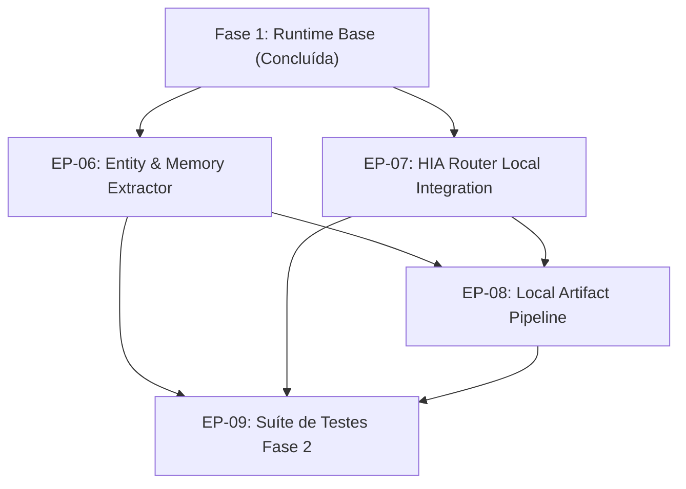

# Programa de Evolução — Local AI Runtime (Fase 2: Extração Estruturada & Roteamento HIA)

## 1. Visão Geral

A Fase 2 expande as capacidades locais integradas na Fase 1 (`tools/lib/runtime/`), focando em:
1. **Extração Estruturada Local:** Destilação de entidades, decisões técnicas, regras de negócio e termos de domínio a partir de conversas e briefings sem depender de cotas de LLMs em nuvem.
2. **Integração Bidirecional com o HIA Router:** Permitir que o `tools/lib/hia/router.js` reconheça intenções de classificação e extração, delegando diretamente para `tools/lib/runtime/` quando a CPU e RAM local estiverem viáveis (`Ryzen 5 7430U`, > 2.5 GB livres).
3. **Persistência Estruturada e Validação de Entidades:** Contrato estrito para extração de conhecimento com esquemas determinísticos.

## 2. Grafo de Dependências dos Épicos

## 3. Estrutura de Documentos e Épicos da Fase 2

- **Arquitetura & Contratos:**
  - `01-architecture/fase2-target-architecture.md`
  - `schemas/runtime-extraction.schema.json`
- **Épicos & Histórias:**
  - **EP-06: Entity & Memory Extractor** (`02-epics/EP-06-extraction/`)
    - `06.01-extraction-schema.md`: Contrato de extração (decisões, regras, entidades).
    - `06.02-extractor-service.md`: Serviço de extração estruturada local via Ollama.
  - **EP-07: HIA Router Local Integration** (`02-epics/EP-07-hia-router-integration/`)
    - `07.01-router-runtime-bridge.md`: Ponte entre HIA Router e Local Runtime para roteamento Local-First.
  - **EP-08: Local Artifact Pipeline** (`02-epics/EP-08-artifact-pipeline/`)
    - `08.01-local-artifacts-cli.md`: Extensão de extração local em `tools/extract-artifacts.js` com `--engine ollama`.
  - **EP-09: Suíte de Testes e Validação** (`02-epics/EP-09-test-suite/`)
    - `09.01-fase2-test-suite.md`: Testes unitários com mocks de extração e roteamento integrado.
- **Decisões de Arquitetura (ADRs):**
  - `03-decisions/ADR-004-local-first-extraction-pipeline.md`: Extração de artefatos local com modelo compacto.
  - `03-decisions/ADR-005-hia-router-runtime-delegation.md`: Delegação dinâmica do roteador para o runtime local.
- **Progresso:**
  - `05-progress/fase2-progress.md`: Tabela de acompanhamento da Fase 2.
