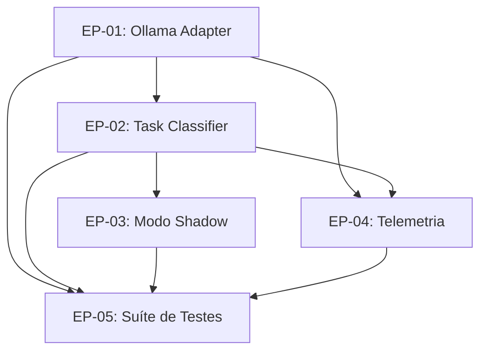

# Programa de Evolução — Harness Local AI Runtime (Fase 1)

## 1. Visão Geral
Este programa estrutura a integração do Ollama como runtime local de IA para classificação de tarefas, estruturação de dados e telemetria, operando em modo shadow sem afetar Claude, Codex, Gemini ou OpenCode, e com zero consumo de nuvem.

- **Baseline Original:** [runtime.md](runtime.md)
- **Status Geral:** 8/8 entregas concluídas (100%)
- **Fase 2 (Extração Estruturada & Roteamento HIA):** [00-index-fase2.md](00-index-fase2.md) — 5/5 histórias concluídas

## 2. Grafo de Dependências dos Épicos

## 3. Estrutura de Documentos

- **Arquitetura & Diagnóstico:**
  - [Auditoria do Estado Atual](01-architecture/current-state.md)
  - [Arquitetura-Alvo](01-architecture/target-architecture.md)
  - [Mapa de Dependências](01-architecture/dependency-map.md)
- **Épicos & Histórias:**
  - [EP-01: Ollama Adapter](02-epics/EP-01-ollama-adapter/README.md) (3 histórias)
  - [EP-02: Task Classifier](02-epics/EP-02-task-classifier/README.md) (2 histórias)
  - [EP-03: Modo Shadow](02-epics/EP-03-shadow-mode/README.md) (1 história)
  - [EP-04: Telemetria](02-epics/EP-04-telemetry/README.md) (1 história)
  - [EP-05: Suíte de Testes](02-epics/EP-05-test-suite/README.md) (1 história)
- **Decisões de Arquitetura (ADRs):**
  - [ADR-001: Adoção do Ollama como Runtime Local Primário](03-decisions/ADR-001-ollama-local-runtime.md)
  - [ADR-002: Execução em Modo Shadow com Zero Fallback de Nuvem](03-decisions/ADR-002-shadow-mode-zero-cloud-fallback.md)
  - [ADR-003: Validação Estrita de Contrato e Fallback Gracioso Local](03-decisions/ADR-003-strict-schema-validation.md)
- **Testes & Governança:**
  - [Plano de Testes TP-01](04-test-plans/TP-01-runtime-baseline.md)
  - [Resultados da Bateria 2 de Benchmark](06-benchmark-results.md)
  - [Tabela de Progresso — Fase 1](05-progress/progress.md)
  - [Tabela de Progresso — Fase 2](05-progress/fase2-progress.md)
