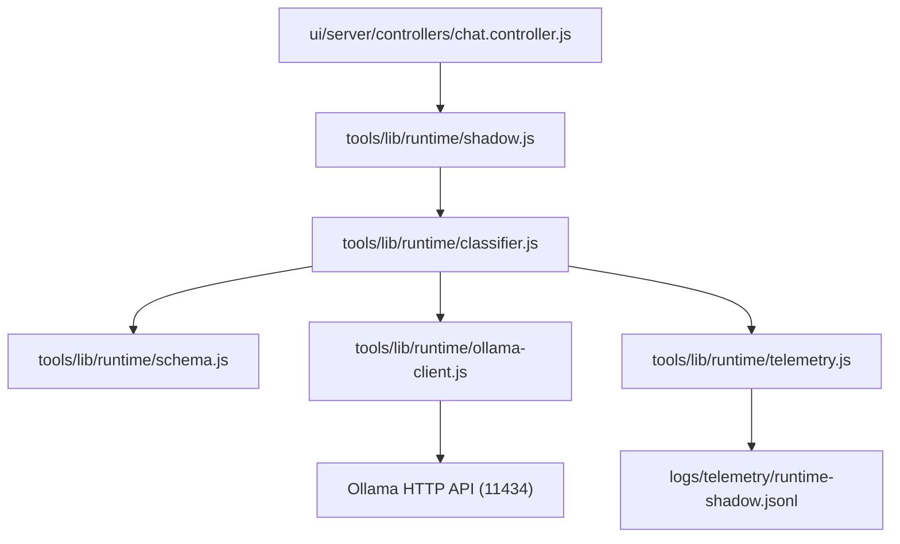

# Mapa de Dependências e Fronteiras — Harness Runtime

## 1. Módulos e Responsabilidades

| Módulo | Caminho Proposto | Responsabilidade | Limite Linhas |
|---|---|---|---|
| **Ollama Client Adapter** | `tools/lib/runtime/ollama-client.js` | Conexão HTTP a `localhost:11434`, ping/tags, chamadas `api/generate` com structured output | < 200 |
| **Task Classifier** | `tools/lib/runtime/classifier.js` | Construção do prompt estruturado, normalização e chamada do adapter | < 200 |
| **Schema Validator** | `tools/lib/runtime/schema.js` | Validação estrita do payload JSON de classificação | < 120 |
| **Shadow Interceptor** | `tools/lib/runtime/shadow.js` | Interceptação passiva das requisições sem afetar a resposta do usuário | < 150 |
| **Runtime Telemetry** | `tools/lib/runtime/telemetry.js` | Gravação em append-only de métricas de inferência, tokens e timings | < 150 |

## 2. Grafo de Dependências

