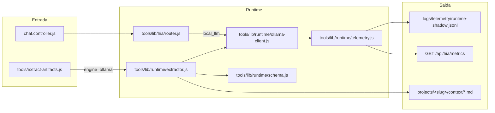

# Arquitetura Alvo — Local AI Runtime (Fase 2)

## 1. Objetivo

A Fase 2 estende o runtime local da Fase 1 (`tools/lib/runtime/`) com três capacidades:

1. **Extração estruturada de conhecimento** — decisões, regras, termos e resumo extraídos localmente, sem consumir cota de LLM em nuvem.
2. **Delegação Local-First do HIA Router** — o roteador reconhece intenções de extração/classificação e delega ao runtime local quando o hardware é viável.
3. **Pipeline de artefatos local** — a CLI de extração de artefatos aceita `--engine ollama` para produzir sugestões em `projects/<slug>/context/`.

## 2. Diagrama de Componentes

## 3. Contratos

| Contrato | Artefato | Responsabilidade |
|---|---|---|
| Classificação de tarefa | `tools/lib/runtime/schema.js` | 5 enums canônicos validados de forma estrita |
| Extração de conhecimento | `schemas/runtime-extraction.schema.json` | 4 campos obrigatórios, `additionalProperties: false` |
| Cliente Ollama | `tools/lib/runtime/ollama-client.js` | HTTP, timeout, checagem de RAM livre, métricas nativas |
| Telemetria | `tools/lib/runtime/telemetry.js` | JSONL sanitizado, sem prompt bruto |
| Superfície HTTP | `ui/server/controllers/hia.controller.js` | `GET /api/hia/metrics` expõe `localRuntime` |

## 4. Regras de Operação

1. **Local-First com degradação silenciosa:** falha do Ollama nunca deve gerar chamada a motor em nuvem (ADR-002, ADR-005).
2. **Zero vazamento de conteúdo:** a telemetria registra apenas metadados e contagens, nunca o prompt ou a resposta textual.
3. **Nenhuma escrita automática em `memory.md` / `instructions.md`:** as extrações vão para `projects/<slug>/context/` como sugestão para revisão humana.
4. **Orçamento de contexto:** o classificador e o extrator operam com `numCtx` limitado (4096) e `think: false`.

## 5. Painel de Observabilidade

O bloco de runtime local no painel HIA (`ui/public/js/modules/chat-hia-local-runtime.js`) exibe:

- Total de inferências, taxa de validade e falhas.
- Tokens de prompt e de geração somados.
- Duração média da inferência.
- Distribuição por tipo de tarefa e por executor sugerido.

## 6. Fora de Escopo (Fase 2)

- Embeddings e busca semântica (RAG) sobre conversas.
- Substituição de motores em nuvem para chat interativo.
- Escrita automática de memórias persistidas sem revisão humana.
