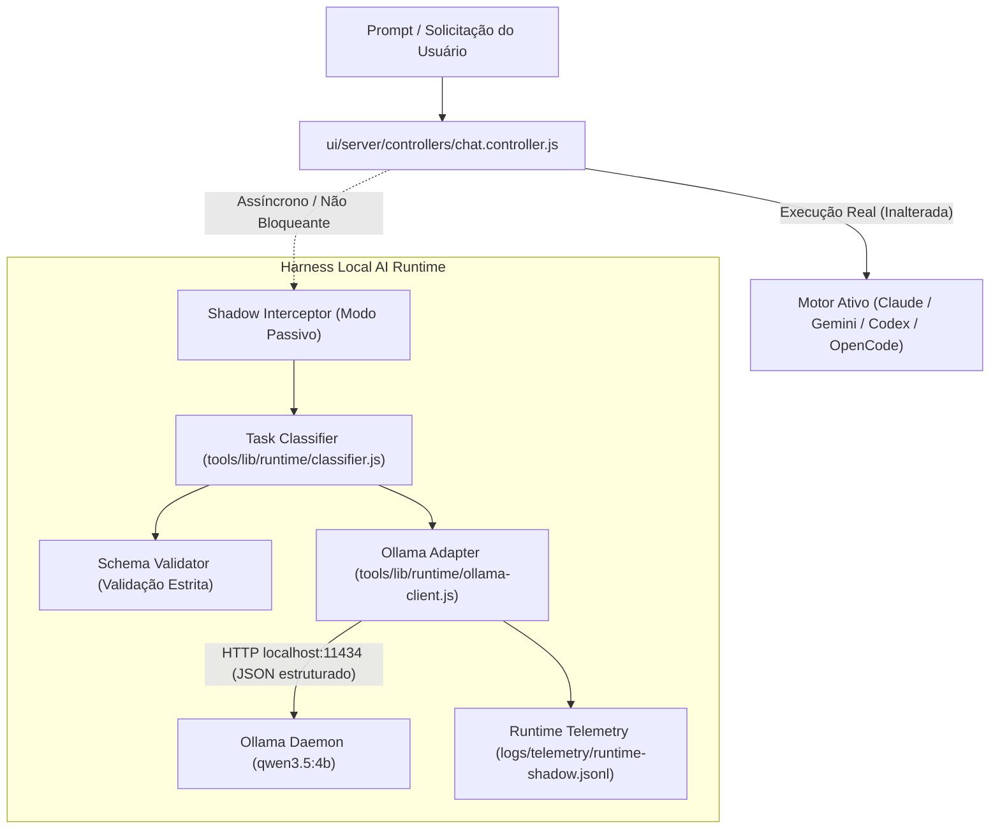

# Arquitetura-Alvo — Local AI Runtime (Ollama) & Modo Shadow

## 1. Visão Geral

O objetivo da arquitetura é fornecer inferência local eficiente, previsível e segura, focada em tarefas estruturadas de baixa latência e zero custo de nuvem, sem impactar o trabalho interativo com Claude, Codex, Gemini ou OpenCode.



## 2. Princípios e Invariantes da Arquitetura
1. **Zero Impacto no Usuário:** A classificação em modo shadow roda de forma não bloqueante. Falhas locais nunca geram erro na interface do chat.
2. **Zero Fallback para Nuvem:** Se o Ollama estiver offline ou sem memória, a classificação shadow é registrada como `skipped` ou `unavailable`. Nenhuma API de nuvem é invocada como substituto.
3. **Contrato Estrito:** A resposta da LLM é parseada e validada contra o schema canônico:
   ```json
   {
     "tipo": "bug" | "feature" | "refactor" | "docs" | "test",
     "complexidade": "baixa" | "media" | "alta",
     "modulo": string,
     "executorSugerido": "local_llm" | "cloud_llm" | "script" | "human",
     "justificativa": string
   }
   ```
4. **Proteção de Memória:** Configuração explícita de `keep_alive: "5m"` e validação de RAM livre antes da inferência.
5. **Anti-Monólito:** Arquivos com menos de 250 linhas, responsabilidade única, desacoplamento entre adapter HTTP, classificador e telemetria.
