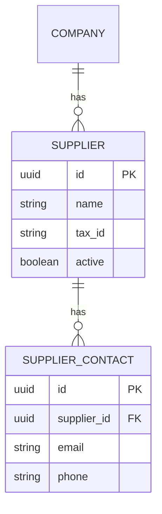

# Modeling: Supplier registration

## Entities

## API contract
| Method | Path | Permission | Notes |
|---|---|---|---|
| POST | /suppliers | purchasing | 409 with the existing supplier when the tax id repeats |
| PATCH | /suppliers/{id} | purchasing | name, contact, active |
| GET | /suppliers | any | filter by active |

## Decisions
- ADR-001: unique index on (company_id, tax_id); the backend enforces it, the screen only reflects it.
