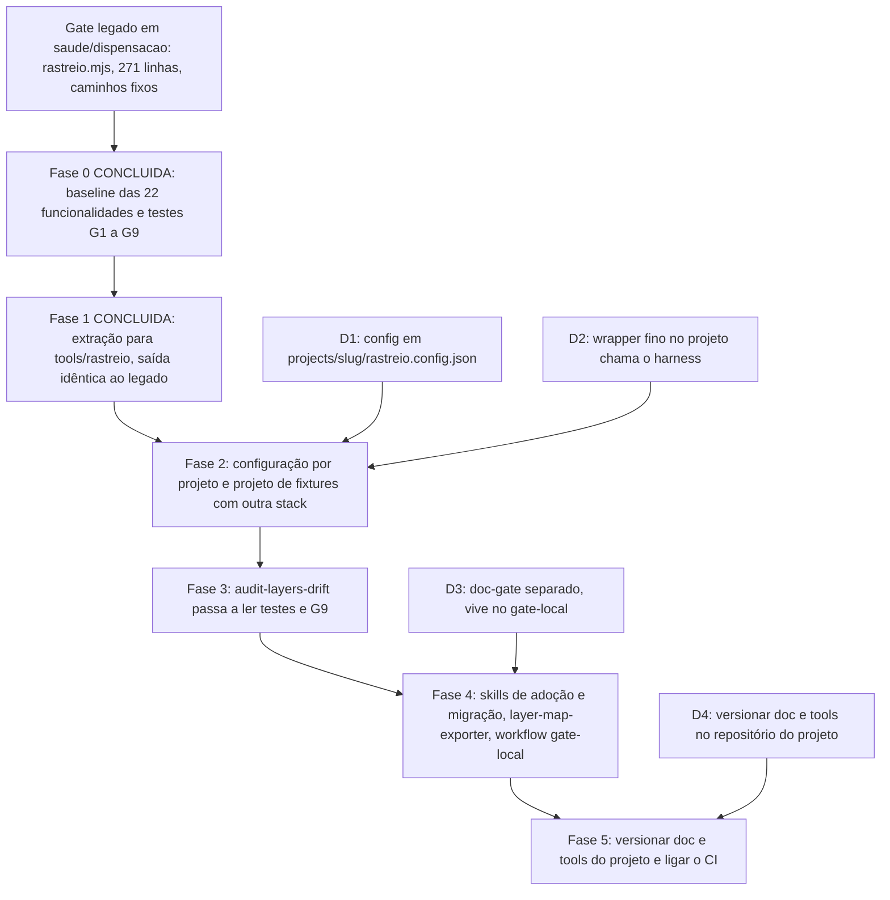
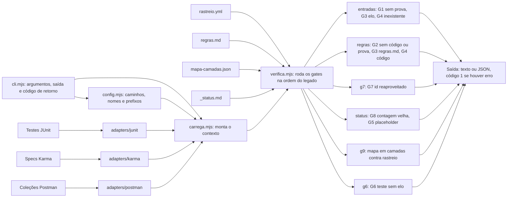
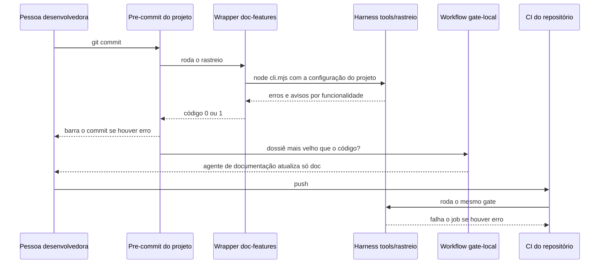
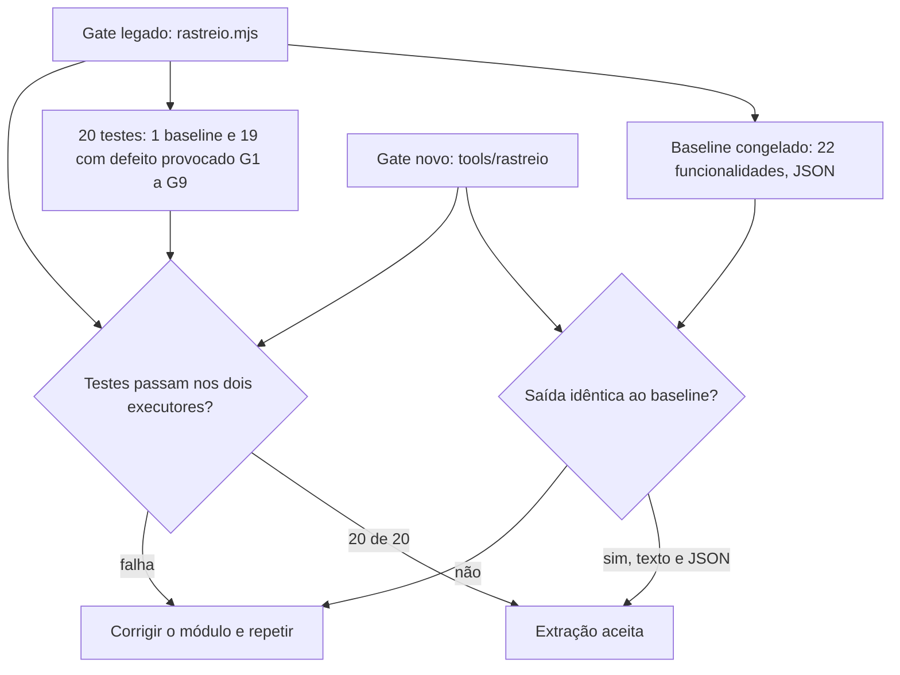

# Diagramas do gate de rastreio

Data: 10/11/2026 · Contexto em [00-resumo-executivo.md](00-resumo-executivo.md) e [01-plano-execucao.md](01-plano-execucao.md).

Cada bloco abaixo é um diagrama Mermaid independente, no formato aceito pelo canvas de Quadros (flowchart e sequenceDiagram, sem cercas dentro do conteúdo colado). Para inserir: copie só o texto entre as cercas, ou peça no chat do canvas "crie este diagrama" colando o bloco.

## 1. Plano em fases e decisões

Situação em 10/11/2026: fases 0 e 1 prontas (a 1 ainda sem commit); as decisões D1 a D4 já foram respondidas.

## 2. Arquitetura do gate novo (tools/rastreio)

O gate lê os arquivos do projeto, monta um contexto (configuração e índices) e passa esse contexto para cada grupo de gates. Nenhum gate lê caminho fixo.

## 3. Uso no dia a dia (pre-commit e CI)

Modelo alvo depois das fases 2, 4 e 5. O agente de documentação fica fora do gate (D3).

## 4. Como o gate foi validado (fases 0 e 1)

