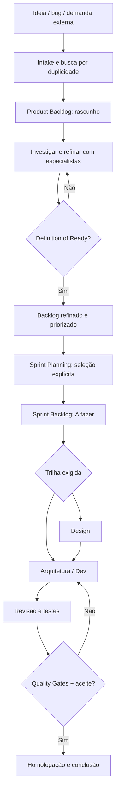

# Harness Leca — Contexto arquitetural: Delivery Orchestrator

> Status: proposta para revisão; não é especificação confirmada pelo código.
> Complementa `CONTEXTO-SCRUM-TRACEABILITY.md` e `PLANO-REVISAO-SCRUM-TRACEABILITY.md`.
> Data de elaboração: 2026-10-31.

## 1. Problema e objetivo

Hoje o Harness dispõe de Scrum/Kanban e há uma proposta de rastrear histórias, implementações, sessões, commits, testes e evidências. A nova proposta adiciona uma camada **Delivery Orchestrator** para conduzir uma demanda desde um rascunho até uma entrega validada, atribuindo especialistas de IA a etapas de trabalho e usando contratos de entrada/saída e Quality Gates.

Objetivo: nenhuma demanda ou implementação ficar sem origem, responsável, decisão, evidência e histórico rastreável. **A IA auxilia e automatiza; aprovações de negócio e ações arriscadas permanecem sujeitas à política do projeto.**

## 2. Escopo da proposta

- Intake: ideia, correção, melhoria, refatoração, dívida técnica, investigação, documentação e tarefa emergencial.
- Product Backlog: rascunho, triagem, investigação, refinamento, priorização.
- Sprint Planning: seleção explícita de itens refinados, capacidade e dependências.
- Sprint Backlog: itens selecionados como `A fazer`, com fluxo de execução por trilhas.
- Especialistas por fase: PM, analista de requisitos, QA, arquiteto, UX/UI, tech lead, desenvolvedores, segurança e release.
- Especificação estruturada: problema, contexto do código, user story, RF, RNF, BDD/Gherkin (Given/When/Then), critérios de aceite, riscos e evidências.
- Workflows condicionais: Design, Dev, dados, documentação ou trilhas paralelas quando viáveis.
- Rastreamento transversal: eventos, sessões, decisões, Git, testes, artefatos, memória e MAPA.md.

## 3. Separação de dimensões — decisão proposta

Não representar todas as informações num único status/raia:

| Dimensão | Exemplo | Responsabilidade |
|---|---|---|
| Maturidade | rascunho / em refinamento / refinado / aprovado | Qualidade da definição |
| Planejamento | product backlog / sprint-12 | Comprometimento da sprint |
| Trilha | design / arquitetura / dev / QA | Tipo de trabalho |
| Execução | a fazer / em andamento / impedido / concluído | Progresso operacional |

As 12 raias atuais devem ser inspecionadas e preservadas até evidência técnica que justifique migração. `lanesRevision`, matriz de transições e trilha de auditoria não devem ser contornadas.

**Correção do fluxo:** o refinamento pode/deve ocorrer ainda no Product Backlog, antes de a história ser selecionada numa sprint. Uma sprint não deve depender de histórias mal especificadas. Itens urgentes exigem política de exceção auditada.

## 4. Fluxo de referência

A ramificação é ilustrativa: design e implementação podem ser paralelos ou independentes quando os contratos permitirem.

## 5. Especialistas: funções, não fornecedores

| Etapa | Especialista(s) | Saída esperada |
|---|---|---|
| Intake | Triager / PM | demanda categorizada, origem, deduplicação |
| Discovery | analista / tech lead / QA | evidências no repositório, hipóteses, impactos |
| Specification | PM / requisitos / QA | história, RF, RNF, cenários BDD, aceite |
| Design | UX/UI / Design System / acessibilidade | fluxos, protótipos, estados, validação |
| Architecture | architect / security / DBA | ADR ou decisão leve, contratos, riscos |
| Sprint planning | scrum master / tech lead / PO | priorização, capacidade, decomposição |
| Implementation | dev especialista / integração | alterações vinculadas, testes e logs |
| Review | reviewer / QA / security | revisão e evidências técnicas |
| Homologação | PO / QA / usuário autorizado | aceite explícito e rastreável |

Um especialista é uma configuração reutilizável (papel, prompt, skills, ferramentas, permissões, modelo e orçamento). Não é necessariamente uma instância de modelo exclusiva nem implica execução simultânea. Preferir scripts determinísticos antes de LLM em tarefas objetivas.

## 6. Dados lógicos propostos (validar esquema real)

- `Demand`: id, projectId, type, title, description, origin, dedupeFingerprint, createdBy, maturityStatus, priority, timestamps.
- `Story`: id, demandId, revision, functionalRequirements, nonFunctionalRequirements, acceptanceCriteria, bddScenarios, approvedBy.
- `SprintAssignment`: storyId, sprintId, assignedAt, assignedBy, auditReason.
- `WorkflowInstance`: id, storyId, workflowDefinitionVersion, activeStages, lifecycleStatus.
- `StageExecution`: id, workflowId, stageId, specialistRoleId, executionId, startedAt, finishedAt, outcome.
- `QualityGateEvaluation`: id, storyId, stageId, gateVersion, evidenceRefs, result, evaluatedBy, evaluatedAt.
- `Implementation`, `Execution`, `Evidence`, `AuditEvent`: reaproveitar a proposta anterior, evitando fonte de verdade duplicada.

Relacionamentos: Demand 1:N Story (caso a demanda se decomponha); Story N:M Sprint somente se a estratégia permitir carry-over por entidade de associação; Story 1:N WorkflowInstance; WorkflowInstance 1:N StageExecution; Story 1:N GateEvaluation; Story 1:N Implementation. **Verificar no repositório antes de materializar.**

## 7. Invariantes e controles

1. Rascunho pode ser registrado incompleto, mas não pode ser marcado como refinado sem DoR.
2. Seleção para sprint é distinta de avanço técnico; não mudar sprint silenciosamente.
3. Nenhum agente muda status sem autorização e precondições verificadas.
4. Toda transição registra ator, motivo, antes/depois, correlationId, fonte e versão.
5. Eventos de integração são idempotentes, com recuperação após falha, dedupe e controle de concorrência.
6. `test.completed` não significa teste aprovado; anexar comando, saída, ambiente e status.
7. Referências a arquivos e commits são evidências verificáveis, não afirmações de agentes.
8. Manter trilha de mudanças de escopo e versões de requisitos; não sobrescrever histórico.
9. Segredos e conteúdo sensível não entram em logs, memória ou evidências por padrão.
10. Deve existir política para trabalho sem história (órfão), bugs urgentes, rollback e execução offline.

## 8. Questões abertas

- As 12 raias representam estados, tipos de tarefa ou ambas as coisas?
- O Scrum tem Product Backlog e Sprint Backlog distintos na persistência?
- Como estão modeladas stories/tasks, permissões, agentes, workflows e hooks?
- Qual é a fonte de verdade entre SQLite, markdown e eventos JSONL?
- Qual comportamento de agentes e automações já está de fato implementado?
- Qual a política de aprovação humana e de roteamento de modelos por especialista?
- Qual integração com Jira existe e é conveniente?
- Como DAI difere do Harness e que componentes podem ser reutilizados?

## 9. Fora do escopo imediato

Alterar raias reais, executar sprints, criar ou fechar histórias em massa, migrar dados ou aplicar mudanças no código sem revisão aprovada.

---

## Adendo v3 — integração DAI (31/10/2026)

**Status:** evidências documentais consultadas na branch padrão `dev` de `matheussanabria/harness-dai`; comportamento de runtime ainda NÃO auditado. Este adendo prevalece sobre propostas anteriores que pressupunham inexistência de pipelines e especialistas.

- Fonte: `README.md`: `.agents/` é origem dos 17 agentes; `skills/` é origem das competências; exportação para Claude Code via `scripts/export_claude_code.py`; `harness/cli.py` é caminho legado.
- Fonte: `skills/orquestracao/sdlc-pipeline/SKILL.md`: skill executa o workflow `feature-delivery`, com execução por estágio, dossiê `docs/features/<slug>/`, `_status.md`, gates e variantes `domain-creation`, `domain-change`, `composition`, `hotfix`.
- Fonte: `docs/SDLC_PIPELINE_DESIGN.md`: estágios `story`, `bdd`, `prototype`, `modeling`, `dev`, `tests`, `review`, `commit-pr`, `deploy`; mapeamento de especialistas; confirmação explícita para commit/PR e deploy.
- Fonte: `workflows/product-delivery/WORKFLOW.md`: macrofluxo de produto com estados discovery → requirements → design → architecture → engineering → features → quality → deploy; documento marcado `draft` e informa ausência de adaptador ponta a ponta.

**Implicações para Scrum:**
1. Não criar um segundo pipeline SDLC concorrente: avaliar adaptador para contratos e artefatos existentes no DAI.
2. Separar `demand maturity`, `sprint allocation`, `workflow stage` e `execution status` (dimensões diferentes, sem forçar novas raias).
3. Refinamento preferencialmente antes da seleção para sprint; permitir exceções com autorização e registro.
4. Usar `storyId` e `workflowRunId` como vínculo, sem tratar `_status.md` como única fonte transacional de auditoria.
5. Os dados de Scrum, histórico e `lanesRevision` existentes devem ser preservados; investigar modelos reais antes de desenhar migrações.
6. Garantir operação multi-motor através de adaptadores; a skill documentada é Claude Code-first.
7. Verificar a localização efetiva de `workflows/feature-delivery/manifest.yaml` e a cópia exportada antes de assumir resolução de caminhos.

**Decisão pendente:** autorizar somente Discovery e plano técnico nesta rodada; não editar repositórios, não mover histórias e não executar workflows, commits ou deploy.

Leia também `06-INTEGRACAO-SCRUM-DAI.md` e `07-PROMPT-REVISAO-CRUZADA.md` nesta pasta.
