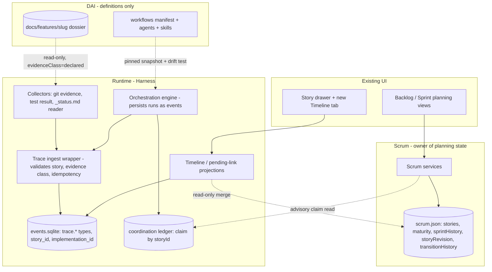
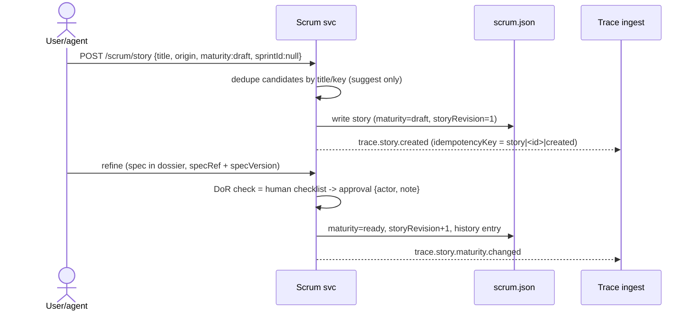
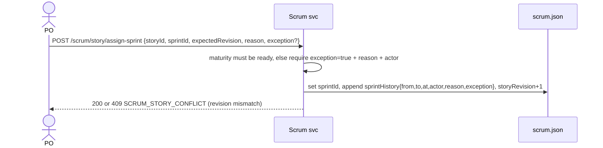
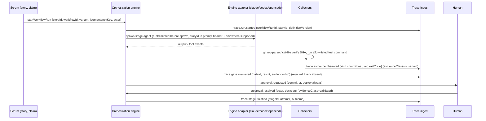
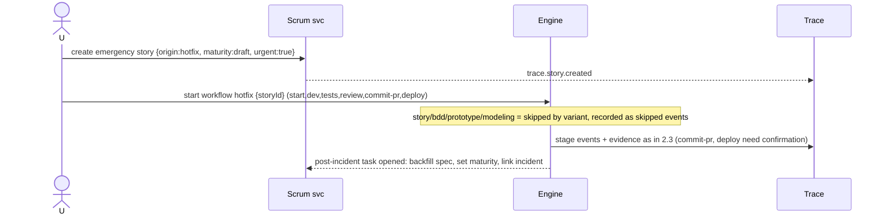
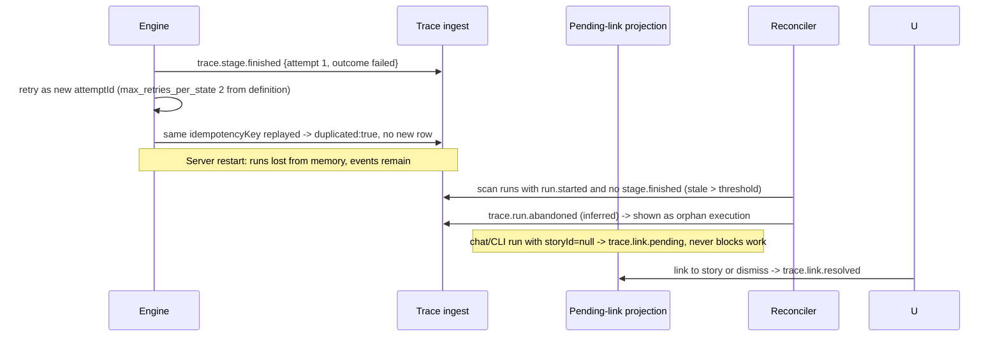
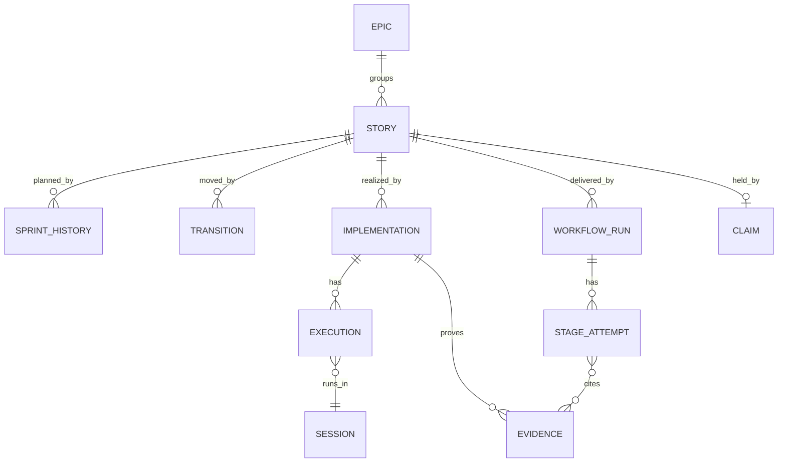

# 04 - Arquitetura proposta (TO-BE) - epic EP-18 (provisional), ADR-014 (draft in 05)

Status: proposal for review; nothing implemented. Basis: Harness a89703c, DAI 7248777 (read-only).
Tags: [Fact path:line], [Hypothesis], [Pending decision]. Everything under "Proposed" below is a design choice, not an observation. `DAI:<path>` = DAI evidence. `svc/` = `ui/server/services/`.
Guiding rules: smallest architecture compatible with the code; reuse `scrum.json`, the event store, the orchestration engine and the ledger; no second SDLC pipeline (v3 addendum item 1); lanes untouched (addendum items 2, 5).

## 1. Component diagram

[Hypothesis] The Scrum to trace direction is one-way: Scrum emits nothing that it must later read back as truth; the Timeline merges `scrum.json` histories with events at read time (no dual write of the same fact).

## 2. Sequences

### 2.1 New demand to refined story

[Fact] today `sprintId` is defaulted to the active sprint when absent (svc/project-scrum-sanitize.js:39), so drafts must pass `sprintId:null` explicitly or the default must depend on `maturity` [Pending decision, see 05 s6]. Event emission is best effort after the JSON commit, same pattern as the workflow bridge (persistence failures never break the flow, raw-harness-sprint-workflow.md:22).

### 2.2 Sprint selection

[Fact] today the same route writes only `sprintId` and `updatedAt` (svc/project-scrum-ops.js:100-107). [Fact] for Jira stories the Jira sprint wins in the resolver (`source.sprintId ?? localStory.sprintId`, svc/project-scrum-resolver.js:35,54), so the history entry must record `requestedSprintId` and `effectiveSprintId`.

### 2.3 Feature-delivery stage with evidence

[Fact] today runs have no storyId (svc/orchestration/workflow-run-store.js:45), are in memory, and approvals have free-text actors. [Fact] commit-pr and deploy require explicit confirmation each time in DAI (`DAI:workflows/feature-delivery/manifest.yaml:305,317`) and in the Harness definitions (APPROVAL_STAGES, workflow-definitions.js:7-12). The system never commits: it prepares and records.

### 2.4 Hotfix

[Fact] hotfix skips story/bdd/prototype/modeling and DAI exempts it from "story with acceptance criteria" (`DAI:policies/routing.md:58`); DAI has no post-incident requirement (raw-dai-stories-gates.md:31). The backfill task is therefore a Scrum-side addition [Proposed]. Exception to Sprint rules is recorded in `sprintHistory.exception=true`.

### 2.5 Failure, retry, orphan execution

[Fact] replay of same `id` or `(source_provider, idempotency_key)` is a no-op (svc/events/event-store.js:137-141; event-migrations.js:49-51). [Fact] `max_retries_per_state` is 2 in the definition (`DAI:workflows/feature-delivery/manifest.yaml:69-71`).

## 3. Entity model reconciled with real stores

| Entity | Store (real) | Key (real or proposed) | Cardinality | Status |
|---|---|---|---|---|
| Story | scrum.json `stories[]` | existing `id\|key`; Jira `jira-<id>` (svc/project-scrum-sanitize.js:29; jira-source.js:51) | Epic 1:N Story; Sprint 1:N Story (current) | Existing + new fields `maturity`, `storyRevision`, `specRef`, `specVersion` |
| Demand | none | - | Demand 1:N Story only if split | Deferred (05 s6) |
| SprintAssignment | scrum.json `sprintHistory[]` (new key; persist.js whitelist must add it) | `<storyId>:<at>:<to>` like transition ids (transitions.js:51-62) | Story 1:N entries; Story N:M Sprint over time; exactly 0..1 current | New |
| TransitionRecord | scrum.json `transitionHistory[]` | `<storyId>:<occurredAt>:<toLane>` | Story 1:N | Existing; add optional `actor`, `reason` |
| WorkflowDefinition | DAI manifest, pinned snapshot in Harness | `feature-delivery@1.3.0` | 1:N Run | Definition owned by DAI |
| WorkflowRun | events (`workflow_run_id`), cache in run store | `wf-<uuid>` (executionId) | Story 0:N Run | Existing in memory; persisted via events |
| StageRun / Attempt | events (`step_run_id`, `attempt_id`) | `att-<uuid>`, attemptNo | Run 1:N Stage; Stage 1:N Attempt | Existing ids, not persisted as entity |
| Implementation | events (`implementation_id`) | `imp-<uuid>` minted on first execution against a story | Story 1:N Impl; Impl 1:N Execution; Impl 1:N Evidence | New |
| Execution | events (`run_id`, `execution_id`) | `runId = chatId` or workflow executionId (chat-run-telemetry.service.js:4) | Execution N:1 Session | Existing |
| Session | canonical-sessions.json | `provider\|nativeSessionId\|sourceKind` fingerprint (ADR-TEL-003:17) | Session 1:N Execution | Existing |
| Evidence | events (`trace.evidence.*`) | event id; `ref` = SHA / test run id / file hash | Impl 1:N; Stage 0:N | New |
| AuditEvent | `events` table | `id` UNIQUE, `(source_provider, idempotency_key)` UNIQUE | any entity 0:N | Existing table, new types |
| PendingLink | derived projection | event `trace.link.pending` without matching `resolved` | - | Derived |
| Claim | ledger state.json | storyId + provider (reducer.js:10-17) | Story 0..1 active claim | Existing, uninitialized here |

[Hypothesis] Implementation may be unnecessary if one WorkflowRun per story-effort is enough; kept because chat/CLI executions outside a workflow also need a grouping (CONTEXTO s5). [Pending decision] 05 s4.

## 4. Axes: persisted vs derived

| Axis | Values (proposed) | Persisted or derived | Owner | Note |
|---|---|---|---|---|
| Maturity | draft, refining, ready (rejected optional) | Persisted: `story.maturity` | Scrum | Legacy stories default to `ready` on read [Hypothesis] so existing sprints are unchanged |
| Planning | unassigned, selected, removed | Persisted: `sprintId` (current) + `sprintHistory`; "selected/committed" derived | Scrum | Active sprint default must not apply to drafts |
| Stage | story, bdd, prototype, modeling, dev, tests, review, commit-pr, deploy | Derived from latest `trace.stage.*` events of the active run | Runtime | Never a story field |
| Execution | queued, running, blocked, waiting_approval, passed, failed, abandoned | Derived from run events; persisted only as events | Runtime | `blocked` here is not the Scrum impediment flag |
| Lane | 12 canonical ids | Persisted: `laneId` (+ `transitionHistory`) | Scrum | Moved only via `moveStoryToLane`; runtime may only propose |

Lane projection policy (suggestion only, no writes) [Proposed]: draft or refining maps to backlog/discovery/refinamento; ready to pronto-para-dev; run in `dev` stage to em-desenvolvimento; `review` to em-revisao; `tests` to em-testes. [Fact] lane ids are fixed but names, activity and order are configurable (raw-scrum-core.md:10), so lane cannot be derived from maturity; this is why maturity is persisted separately. Transitions stay adjacent-only (svc/project-scrum-transitions.js:44-47); a suggestion that needs a skip is shown, not applied.

## 5. One source of truth per data type

| Data | Single source | Everything else |
|---|---|---|
| Story fields, maturity, sprint, lane, impediment | scrum.json | projections, UI cache |
| Lane and sprint change history | scrum.json (`transitionHistory`, `sprintHistory`) | Timeline merges at read time |
| Workflow definition and gate criteria | DAI manifest (pinned version) | Harness hardcoded copy removed or generated |
| Run, stage, attempt, evidence, gate result, approval | events.sqlite | in-memory run store = cache; Scrum shows projection |
| Who works on a story now | coordination ledger | Scrum shows advisory badge |
| Dossier documents (spec, BDD, models) | files in `docs/features/<slug>/` | events hold path + hash + version only |
| `_status.md` | declared evidence only | never the audit store (addendum item 4) |
| Commit identity | git object database | event holds SHA + `verifiedAt` |
| Memory | `projects/<slug>/memory/` | none |

## 6. Bridging the Harness engine and DAI feature-delivery without a second pipeline

| Option | What | Pros | Cons |
|---|---|---|---|
| 1 CLI/file-based | Harness reads `docs/features/<slug>/_status.md` and dossier files after a Claude Code session | Zero DAI change; works for sessions outside Harness | Markdown only, no ids/frontmatter (`DAI:SKILL.md:52-74`); no code reads it today; not transactional; declared only |
| 2 Runtime/events | Harness engine (already DAI-shaped) persists run/stage/attempt events with storyId; agents invoked via adapters | Reuses engine, bridge and store; observable; multi-engine | Engine runs in memory; runner may not launch agents (unknown); needs storyId plumbing |
| 3 Duplicate workflows | Maintain stage logic in Harness | Fast | Already partly true (agent-stage-definitions.js:60-175); drift of gates and specialists |

Recommendation [Proposed]: option 2 as the system of record for runs started by Harness, plus option 1 as a read-only, optional reader that imports dossier state as `evidenceClass=declared` for sessions run outside Harness. Option 3 is rejected; the existing hardcoded copy is replaced by a pinned snapshot of the DAI manifest and a drift test that fails when versions differ [Hypothesis: needs the DAI path or a vendored snapshot, Pending decision]. `storyId` and `workflowRunId` are the join keys; `_status.md` header gets them only if DAI accepts an additive header line [Pending decision, addendum item 7]. DAI-side changes are not required for the MVP.

## 7. Declared by agent / observed by system / validated

| Class | Meaning | Example | Who may write | Where shown |
|---|---|---|---|---|
| declared | An agent or document says so | agent text "tests pass", `_status.md` checkbox `[x]` | collector marks `evidenceClass=declared`, `relation=declared` | grey badge |
| observed | The system measured it | git `cat-file -e <sha>` ok; test command exit code from allow-listed runner; tool.invoked events | collectors and engine only | blue badge |
| validated | A human or deterministic gate accepted observed evidence | approval event with actor; gate evaluation citing observed evidence ids | engine on approval or gate | green badge |

Rules [Proposed]: a `gate.passed` / `trace.gate.evaluated` with result pass is rejected unless it cites at least one observed evidence id (DAI invariant: no gate.passed without observable checks, 06-INTEGRACAO s6); `test.completed` without command, exit code and environment is stored as declared; a story cannot reach conclusion by declared evidence alone. [Fact] ingest already drops client `ingestedAt` and rejects `trust=declared` (svc/events/event-ingest.js:72,83); ADR-TEL-003 grades link `relation` (native, declared, inferred, unknown) which is a different concept from claim class, so a payload field `evidenceClass` avoids unfreezing the trust contract [Pending decision].

## 8. Multi-engine strategy

- [Fact] DAI export loses hooks, subagent delegation, sandboxing, manifests and global rule injection on non-Claude engines (raw-dai-stories-gates.md:36). Therefore nothing in the trace may depend on hooks.
- Engine-agnostic sources first: Harness-launched run events (runId minted before spawn, ADR-TEL-003 decision 1), git collector, test runner, approvals. Hook-based capture (Claude PostToolUse) is optional enrichment.
- `engineCapabilities` map in the adapter: `{hooks, nativeSessionId, envInjection, subagents}` per engine, filled from facts (`tools/lib/engines/*`); native id formats are Desconhecido [Pending decision].
- Binding story to run: Harness injects `storyId` through the channel each engine supports (env var where supported, otherwise prompt header and worktree path `C:/Temp/hl-<id>`, branch name = story.branch, [Fact worktree.js:2,17]); engines without injection get `relation=declared` or `inferred` (ADR-TEL-003:53).
- Specialist definitions are never copied: DAI export is the only producer; Harness consumes the manifest snapshot.
- External sessions (not launched by Harness) are discoverable only through git trailers and `_status.md`; they enter as pending links.

## 9. Concurrency

| Level | Mechanism | Evidence / status |
|---|---|---|
| Story document | `storyRevision` + `expectedRevision` on edit, assign-sprint, impediment, mirroring `lanesRevision` (409 on mismatch) | [Fact] lanes use it (svc/project-scrum-ops.js:166-196); stories do not [Proposed] |
| scrum.json file | atomic tmp+rename exists, **no lock**: read-modify-write can lose updates across processes | [Fact] svc/project-scrum-migration.js:68-83; add lock with the `wx` + stale-removal pattern of tools/lib/coordination/storage.js:35-45; no shared helper exists (raw-git-tests-memory-mapa.md:17) [Pending decision] |
| Agent ownership | ledger claim/lease (120 min), heartbeat, handoff; Scrum shows holder; edits by non-holder produce a warning event, not a block, in MVP | [Fact] reducer.js:50-64; ledger not initialized for harness-leca |
| Event ingest | UNIQUE `id` and `(source_provider, idempotency_key)`, `ON CONFLICT DO NOTHING`, `BEGIN IMMEDIATE` migrations, `busy_timeout 5000` | [Fact] event-store.js:103-106; event-migrations.js:49-51,61-64 |
| Duplicate story creation by two sessions | deterministic creation key from `(slug, origin, normalized title, correlationId)`; second call returns existing | [Proposed] |
| Cross-store (JSON + SQLite) | no distributed transaction; JSON commit first, event after, reconciler compares `transitionHistory` ids with events | [Hypothesis] |

## 10. Project isolation and privacy

Isolation. [Fact] stores are per project directory and slug regex is `[\w-]+` (raw-scrum-core.md:22). [Fact] event DB path is `projects/<slug>/coordination/events.sqlite` (svc/events/event-store.js:51-53). [Fact] Jira snapshot and doc stories are read from `repoRoot`; two projects sharing a repo share those sources (leakage not fully traced). Rules [Proposed]: every trace event carries `projectId`; collectors resolve commits only inside the project's `repoRoot`; a trailer `Story: X` that does not exist in the project's `scrum.json` becomes a pending link, never a cross-project link; test "story of other project is neither linked nor exposed" (PLANO matrix).

Privacy. [Fact] redaction exists (tools/lib/redact.js; svc/events/event-sanitizer.js), default is metadata-only with no prompt or output text (ADR-TEL-007; chat-run-telemetry.service.js:4-5), payload byte cap at ingest (event-ingest.js:79-82). Rules [Proposed]: events store path + hash, never dossier text or conversation; test output limited to the existing 4000-char cap and redacted; actor id is a handle, no email; DAI data policy: no secrets, credentials or PII. [Fact] `projects/` is gitignored, so the trace is local and unversioned; backup and retention for the audit class are a [Pending decision].

## 11. Minimal MVP cut (detail in 05)

1. Story `maturity`, `storyRevision`, `sprintHistory`, drafts created with `sprintId:null`. 2. Event types `trace.*`, columns `story_id`, `implementation_id` (migration v2, additive), retention exemption for the audit class. 3. `storyId` on workflow start and chat run. 4. Git evidence collector (trailer parse + SHA verify) and pending-link list. 5. Timeline tab, read-only, with the three evidence badges. Out of scope: auth, Jira write, new lanes, automatic lane moves, `_status.md` import, DAI changes.
